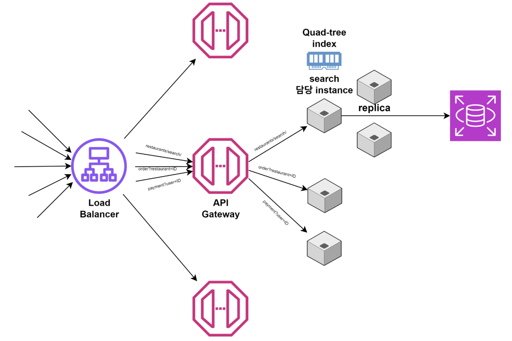

<aside>
📝

**복습**

2장: 2.2 일관성, 2.3 가용성

5장: 5.3 데이터 복제 전략

6장: 분산 캐싱

16장: 16.2 데이터 저장소 선택 커닝 페이퍼

</aside>

## 1. 상황 분석

### 만들 것: Proximity Service

> 10장에서 내 주변 음식점 찾기 & 주문하기 기능을 단순화한 서비스를 대상으로 삼음
>
- **근접서비스(Proximity Service)**: 사용자 현재 위치 데이터 기반으로 주변 식당, 상점 등을 탐색해주고 연결해주는 위치 기반 서비스
- 적용사례: Uber, Yelp(지역 상점 검색), Doordash, Tinder, GoogleMap, Strava 뭐 우리나라 배달의민족 같은 앱들이겠죠?

### 요구사항

#### 1. 기능적 요구사항

- 기능: (1) 음식점 검색 → (2) 메뉴 주문
- (1) 사용자는 자신의 위치 `lat`, `long` 와 검색 반경 `dist`를 기준으로 주변 음식점을 검색할 수 있어야 함.

#### 2. 비기능적 요구사항

- **가용성**: 일부 인스턴스에 문제가 생겨도 서비스 정상 운행해야 함
- **확장성**: 약 1억명의 사용자와 트래픽 폭주를 감당해야 함
- **낮은 지연 시간**: 주변 음식점 찾는 읽기 요청은 200ms 이내에 응답해야 함
- **일관성**: 음식점 정보는 자주 안 바뀌니까 업데이트 시 약간의 지연이 있는 Eventual Consistency(최종 일관성)를 허용함.
- **신뢰성**: 장애/요청 급증에도 데이터 손실 X

#### 3. API 구성

- **음식점 조회**: `GET /restaurants/search?lat={위도}&long={경도}&dist={반경}` → 200ms 이내
- **음식 주문**: `POST /orders` (사용자 ID, 음식점 ID, 주문항목 및 수량, 결제수단 등등)

### 규모 파악

- **사용자 규모**: 전체 예상 사용자 **1억명,**
  DAU 10%인 1000만 명
- **주문 트래픽 QPS**: 대부분의 주문이 점심 3시간, 저녁 3시간 즉 6시간에 집중된다고 가정.

  $\text{평균 주문 QPS} = {\text{10,000,000 \$} \over 6\times3,600} \approx \mathbf{1,200\text{QPS}}$

- **최대 트래픽 및 검색 QPS**:
    - 최대 트래픽 정의: 평균의 5배
      $1,200\times5 = \mathbf{6,000}\text{QPS}$

      사용자 1명이 주문 전 평균 5번 검색 시에도 똑같은 트래픽 수준.

- **데이터 규모**: 전 세계 등록 음식점 총 1000만개 중 현재 주문 가능한 활성 음식점 **100만개**

## 2. 시스템 설계

### 핵심 질문

1. [기본 컴포넌트 분리]

   사용자 요청이 **로드 밸런서**를 거친 뒤, ‘고객 관리’, ‘음식점 검색’, ‘주문 및 결제’에 따라 어떻게 마이크로서비스와 각각의 데이터베이스로 분리할 수 있을까?

   ⇒ API Gateway(인그레스)로 API별 다른 서비스에 연결한다. 앞의 요청 경로 보고 알맞은 마이크로서비스 인스턴스로 동적 라우팅, 로드 밸런싱, 요청 제한, 인증 같은 공통 작업 처리하는 구조.

2. [위치 기반 검색 병목 해결]

   1000만개의 음식점이 담긴 관계형 DB에 단순히 위도/경도 범위 조건으로 SQL 쿼리를 날리면 초당 6000건의 요청을 200ms 안에 처리할 수 없음.

   2차원 지도 공간을 효율적으로 분할할 수 있는 방법은? (위치 검색을 빠르게 하기 위한 `(위도 경도) -> 음식점 ID 목록` 매핑)

    1. **쿼드 트리**: 지도 전체를 4개의 사각형 구간으로 나누되 한 구역 내 음식점 수가 특정 임계값 이하가 될 때까지만 분할해서 리프에 음식점 ID 목록 저장

       ← 음식점 중심이 아니라 **위치 중심으로** 음식점을 나누되 일반적인 DB 인덱스/이진 트리로 1차원 값 하나 기준 정렬할 수 없으므로 위도/경도 두 축을 동시에 좁혀야 하는데 이는 자식 노드 4개를 낳으므로 4를 의미하는 Quad

        - 장점: 음식점 수가 임계값 넘을 때에만 4등분하므로 밀집된 강남구역은 아주 잘게 쪼개고 한산한 시골은 크게 쪼개므로 밀집도 편차가 훨씬 유연함.
        - 단점: 데이터 자주 바뀌면 트리 지속적으로 수정해야 함.
    2. **지오 해시**: 지도를 일정한 크기의 격자로 균등 분할, 각 구역에 0과 1의 이진수 라벨 부여해서 위도/경도를 단일 문자열 키로 변환한다.
        - 단점: 밀집된 곳이 아닌 바다/사막/외곽에도 쓸데없이 격자 구역이 생겨 공간이 낭비되고 탐색 시간이 늘어난다.
3. [장애 복구와 데이터 동기화]

   만약 메모리 기반의 공간 인덱스를 사용한다면, 서버가 내려갔을 때 어떻게 빠르게 복구할 수 있을까?

   → 위의 쿼드 트리를 하드에 두지 않고 RAM 위에 올려 탐색한다. 그러면 디스크 IO를 피할 수 있음.

   → 단점: RAM은 휘발성이라 서버 재시작/장애 나면 인덱스 날아감. 따라서 DB 데이터 기반으로 트리 다시 복구/빌드하는 절차가 필요하고 서버를 레플리카를 둬서 한 대 죽어도 다른 서버가 응답하게 해야 함.
   `음식점 +` or `음식점 -` 의 경우 가끔씩 동기화해주면 됨(Eventual Consistency).

### 2-1. 최초 설계

