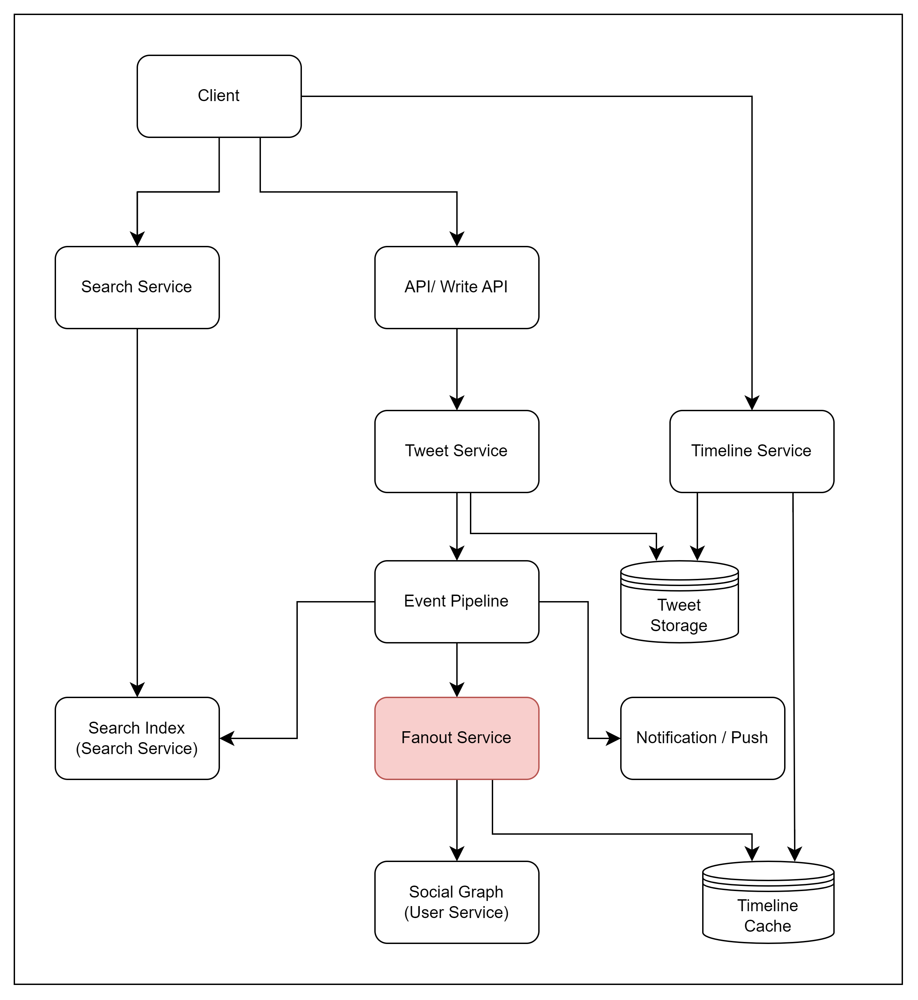
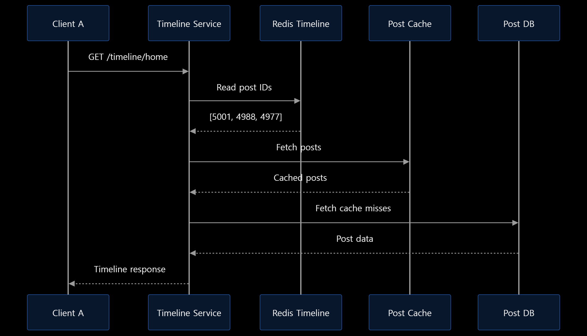
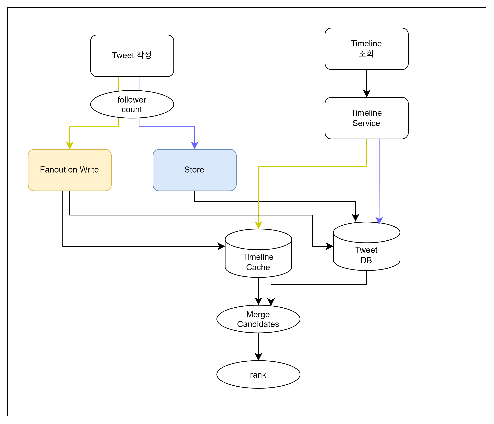
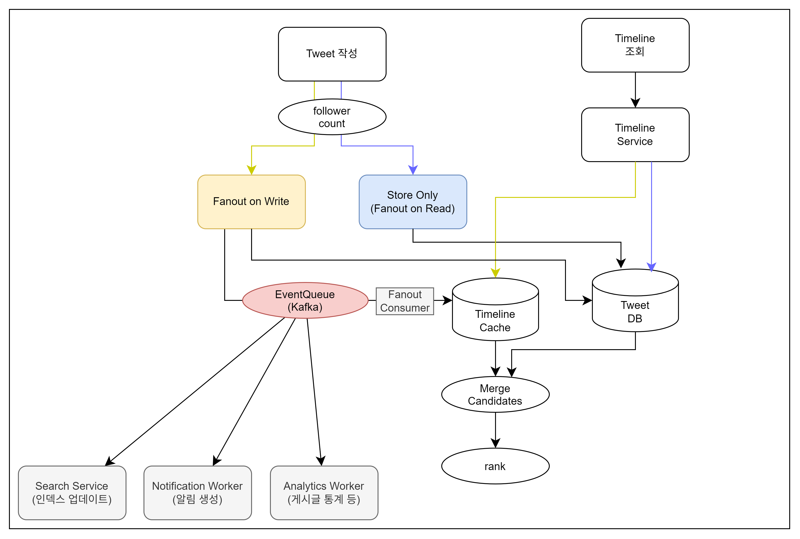

## X 서비스 설계

### 기능

- 타임라인 서비스
- 사용자 서비스 (팔로잉-팔로워)
- 검색 서비스
- 트윗 서비스

### 규모

- 전체 사용자 1억명
- 저장소
    - 트윗: 연간 7.3TB
    - 미디어: (20% 가정) 연간 73PB
    - 사용장: 100TB

  → 5년간 용량 365PB

- 초당 최대 트윗수: 1200건
- 초당 최대 미디어 업로드수: 240건
- 초당 타임라인 생성 위한 팬아웃 요청: 12만건
- 캐싱규모: 일별 조회 20억건x 캐시적중률 80% = 하루 320GB

### 실제 X 서비스 구조



- Fanout 전략: (Fanout: 하나의 데이터/이벤트가 여러 대상으로 퍼지는 구조)
    - 문제: 팔로우 관계 조회와 게시글 조회가 매번 결합되는 형태. 조회 시점에 계산량이 몰린다.
    - 해결:
        - **Fanout on Write:** 게시글 작성될 때 팔로워들의 타임라인을 업데이트한다.

          **→ Celebrity Problem**: Hot user 처리가 힘듦. 1000만 팔로워 보유자가 글을 쓰면 게시글 하나를 저장한 후 1000만 개의 타임라인에 기록해야 함.

        - **Fanout on Read:** 팔로워가 타임라인을 조회할 때, 팔로우중인 게시글을 다 모아서 타임라인을 만든다. - 요청 시점에 게시글 모으고 정렬해 타임라인을 만든다.
            - 그냥 이거랑 똑같다

                ```sql
                SELECT *
                FROM posts
                WHERE author_id IN (
                    SELECT followee_id
                    FROM follows
                    WHERE follower_id = :user_id
                )
                ORDER BY created_at DESC
                LIMIT 20;
                ```


        즉, 게시글 저장의 책임 ↔ 타임라인에 배포하는 책임을 분리.



- **Hybrid Fanout : Fanout on Write + Read**
    - follower count를 해서 celebrity의 경우는 read, 일반의 경우는 write 로 처리.

  



- 타임라인 Cache: Redis, Valkey(Redis 파생) - 고속 인메모리
    - 게시글 전체보다 게시글 ID를 넣기.
- **트위터 DB**: Cassandra, DynamoDB - 대규모 데이터, key-value 형식이라 (트위터 데이터 자체는 id-내용 으로 단순함)
    - ID 체제는 auto increment보다는 분산 환경을 고려한 id 체제. snowflake 스타일 (timestamp, worker id 조합)

| 공개된 기술 | 해결하려는 문제 | 내 설계에서 대체할 수 있는 기술 |
| --- | --- | --- |
| Manhattan | 분산 Key-Value 저장, 대규모 데이터 | Cassandra, DynamoDB, ScyllaDB |
| FlockDB / Graph Store | 대규모 Social Graph | MySQL, PostgreSQL, graph DB |
| Haplo / Redis 기반 Timeline Cache | Timeline 고속 조회 | Redis, Valkey |
| Blobstore | 대규모 이미지·영상 저장 | S3 |
| Earlybird / Lucene | 실시간 검색 및 인덱싱 | OpenSearch, Elasticsearch |
| Hadoop / HDFS | 대규모 데이터 처리 및 분석 | Spark, Data Lake |
| Kafka 등 Event Pipeline | 비동기 이벤트 처리 | Kafka, Redpanda, AWS MSK |