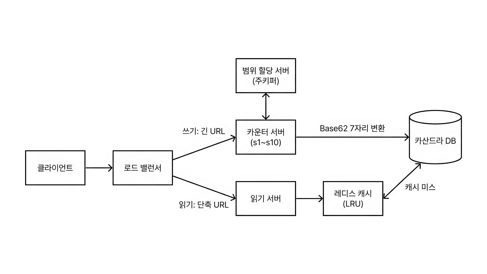

원래 5주차였는데 7주차로 바뀜.

> URL 단축 서비스 시스템 설계
>

### 활용 사례

단축 URL을 사용하게 되면

1. 지표 추적 가능
    - 클릭률, 클릭횟수, (QR일 경우) 스캔 횟수/공유 횟수
2. ‘단축’ url이므로 간결, 가독성 개선, 공유 편리해짐

<aside>
📝

### 기능적 요구사항

#### 필수 (+ API 설계)

- POST `/shorturl` : 긴 URL → 단축 URL
    - 단축 URL: 길이 일정, 고유
- GET `/shorturls/{shorturl}` : 단축 URL → 긴 URL

#### 추가

- 입력 URL 검증
- 입력 URL 수정 가능
- 사용자 맞춤형 단축 URL 생성
- 단축 URL 사용 기간 설정 (6개월)
- ~~오류 발생해도 가능해야 = 가용성~~
- URL 매핑 삭제 가능
- 단축 URL 지표 추적 가능
- 사용자 계정 관리

### 비기능적 요구사항

- **가용성:** 오류 발생해도 사용 가능해야 함
- **확장성**: 1억명 이상 지원. 갑작스러운 트래픽 대응 가능
- **응답속도**: 지연없는 읽기쓰기
- **일관성:**
    - 당연히 동일한 단축 URL은 동일한 원본 URL 반환 가능해야 함
    - 동일한 긴 URL에 대해 사용자가 달라도/동일인이 두번 만들어도 동일한 아웃풋 반환

  → 매핑 필요

- **내구성**: 시스템 장애에도 데이터 삭제/손실 안되게 해야 함.
- **신뢰성**: 시스템 장애에도 요구사항 충족해야 함.
</aside>

### 규모 파악

- 단축 URL 생성
    - 문자 종류: 알파벳 + 숫자: 62개
- 서비스 규모
    - 전체 사용자 수: 10억명
    - 단축URL 기능 사용자 수: 1억명
- 서비스 하루 이용량: 1억 건
- 운영기간: 최소 10년?
- URL 글자 수

  → URL 10년 저장시 1억*365*10년 = 최소 3650억 개 생성 가능해야 함.

  7글자를 쓰면 서로다른 URL 3650억개를 만들기 위해
  $62^7 \approx 3,500,000,000,000$ (3조 5000억) 가능.

- 저장 공간
    - 1 ROW: 단축URL(20B), 원본URL(1000B), 생성시각(10B), 수정시각(10B), 생성자(20B) ⇒ 1060B $\approx$ 1500B
    - ALL DATA: 3650억 $\times$ 1500B $\approx$ 500TB
    - ALL DATA + 3 REPLICA: 500TB*3 = 1.5PB
- 읽기/쓰기 초당 요청 수 (RPS; Request per sec)
    - 쓰기 RPS: ${\text{하루 요청 1억 건} \over \text{86,400초/일}} \approx {\text{1억}\over 100,000\text{초/일}} \approx 1000\text{RPS}$
    - 읽기 RPS: “쓰기보다 100배 정도 많다고 가정”

      100,000RPS

### 고려사항

#### 고유 URL 생성 (핵심)

1. **무작위 생성 → {중복 있으면 재생성} 반복 → 저장 ❌**
    - 문제
        1. 최소 한번의 DB 조회, 예측 불가능한 지연, 쓰기 요청 지연시간 증가
        2. 동시성 충돌 발생: 같은 URL 넣고 하나는 성공했을 때
    - 해결
        1. `putIfAbsent` 활용 - 특정 키가 없을 때만 새로운 값을 추가하는 기능. 이미 있다면 덮어쓰지 않는다.
        2. DB 저장 후 검증 추가.. 근데 이것 역시 비용
2. **MD5 해시 ❌**

   입력 데이터에 대해 128bit 길이 고정된 해시값 생성.

   $62^7\approx 2^{42}$이므로 약 42비트 필요.

    - 장점: 저장공간 효율적이며 동일한 입력값에 대해 동일한 아웃풋
    - 단점: 해시값 충돌. 128개 크기가 고유하다는 거지 여기서 42비트 잘라내면 충돌 확률 커짐.
3. **카운터 방식 ❌**

   `short.ly/1` `short.ly/2` 처럼 숫자를 하나씩 늘려서 고유한 값을 만들기.

    - 단점: 고유 ID 생성 서버가 Single Point of Failure; SPOF가 된다.

   → `호스트 ID` (6bit) + `시간 ID`(32bit) + `카운터 증가값`(4bit) (총 42비트)로 조합 가능.

    - 호스트 ID 6비트 == 호스트 최대 64대만 사용 가능. (왜?)
    - 1밀리초에 요청 16개 초과 시 충돌 발생 (왜?) ← 카운터 영역에서 4비트로 표현 가능한 숫자가 총 $2^4=16$개이기 때문에!
4. **분산 카운터 방식**

   충돌 원천 차단을 위해 숫자 1씩 증가시켜 62진수 문자열로 변환.

   조건: 중앙 카운터 하나에 몰리지 않게 + 여러 서버가 겹치지않는 숫자를 각자 빠르게 찍어내기

   → 시퀀스 번호를 범위로 쪼개서 여러 서버에 나눠주는 방식.

    - **범위 분할 및 할당 구조**: 7자리로 만들 수 있는 3.5조개 번호를 k 단위로 나눠(100만) 총 350만개의 범위로 만든다.

      범위 할당 서버가 범위를 관리하면서, 여러 개 카운터 서버(`s1`, `s2` …) 요청을 받아 겹치지 않는 범위를 배정하고 맵 구조로 기록. `R1 0-1M) -> s1`

      카운터 서버에서는 배정받은 범위 내에서 숫자를 1씩 증가시킴. (중복 없이 고유!)

    - **62진수 변환**: 받은 10진수를 62진수로 변환

      23151324612 62로 계속 나눠 구한 나머지 → {n, n, n, n, n, n} → 62진수 문자 세트에 매핑해서 문자열 `mmmmm` 으로 만든다.

    **단점**
    
    - 할당된 범위를 다 쓰면? : 카운터 서버가 새로운 범위를 카운터 서버에게 요청
    - 카운터 서버가 다운되면? : 350만개 짜리 범위 하나가 유실되는 건 전체 3.5조 개 중에서는 크지 않음 (바로 드롭할 생각부터 하네)
    - 유실되는 범위를 더 줄이려면: N번째 URL 생성할 때마다 카운터 값을 할당 서버에 주기적으로 기록한다. 복구하면 마지막 시점+N부터 새로운 시작하면 되니까 N만큼만 손해
        - 이해안되면이거읽으셈
            
            100번마다 기록한다 하면
            
            101 … 199 까지는 기록이 안되니까 
            
            1xx에서 오류가 나면 그냥 200에서 시작하는거
            
    - 범위 할당 서버가 spof(단일장애지점)가 되면? : 읽쓰 요청이 많지 않아 주키퍼를 사용하면 ㄱㅊ

### 3. 어떤 DB를 써야 할까?

- 저장할 핵심 데이터는 `단축 URL <-> 원본 URL` 매핑
    - 10년간 500TB, 복제 포함 1.5TB

아주 단순할 거 같아서.. 복잡한 거 필요 없고 매핑도 단순한 키-값 방식이므로 교재의 선택: Redis

1. 키값 조회에 최적화됨
2. 속도빠른 인메모리 데이터베이스
3. 확장성 내구성 장애허용성 다 굿

→ 그치만 1.5PB 전체를 RAM 기반인 레디스에 올린다는 것은 비용이 막대하지 않을까? : 카산드라/HBase 같은 컬럼 패밀리 데이터베이스를 스토리지로 활용

### 설계

**레디스를 LRU 캐시로 활용한 버전**

- **컬럼 패밀리 DB를 선택한 이유?**:
    - 대규모 데이터 분산 저장, 빠르고 키 기반 조회에 최적화돼있음.
    - HBase가 가용성<일관성을 우선할때 필요한 거라고 하는데 가용성이 더 중요한 상황 같아서 (한번 만들어진 URL이 수정되는 경우가 없음.)
- **주키퍼를 선택한 이유?** :
    - 분산 환경의 여러 서버가 서로 충돌 없이 협력하도록 돕는 분산형 조율 서비스 (클러스터 관리 프레임워크)라서..

      어느 카운터 서버가 몇번부터 몇번 쓰고 있는지 같은 요청 빈도는 낮지만 중요한 관리용 정보를 맡긴다.