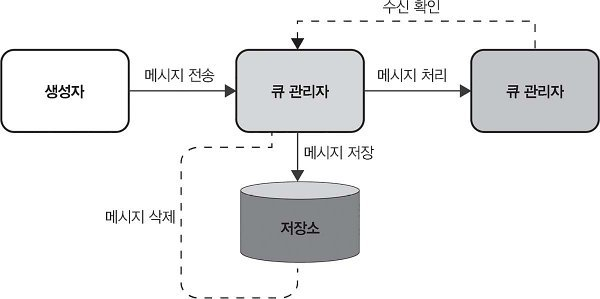
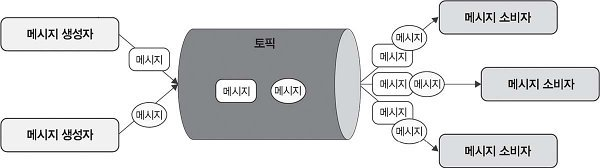
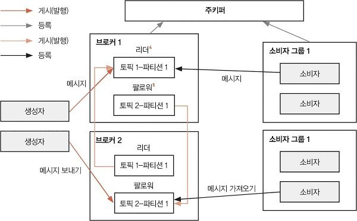

# 7장. 발행/구독과 분산 큐

분산 시스템에서는 독립적으로 동작하는 구성 요소가 네트워크를 통해 협력한다. 각 구성 요소가 데이터를 안정적으로 주고받으려면 메시지를 어디에 보관하고, 누구에게 전달하며, 장애가 발생했을 때 어떻게 처리할지 정해야 한다.

이 장에서는 다음 두 가지 메시징 패턴을 다룬다.

- **발행/구독 시스템:** 생성자가 특정 토픽에 메시지를 발행하고, 그 토픽을 구독한 소비자가 메시지를 받아 처리한다.
- **분산 큐:** 여러 서버에 걸쳐 메시지를 저장하고 전달한다. 생성자와 소비자 사이에서 메시지를 보관하고 처리 부하를 나눈다.

두 방식은 서비스 간 결합도를 낮추는 데 사용된다. 생성자는 메시지를 만드는 역할에, 소비자는 메시지를 처리하는 역할에 집중할 수 있다. 특히 서비스를 독립적으로 배포하고 확장하는 마이크로서비스 환경에서 이러한 구조를 활용한다.

<br>

## 7.1 분산 시스템의 발전 과정

모놀리식 아키텍처에서는 여러 구성 요소가 하나의 서비스 안에 밀접하게 연결되어 있다. 마이크로서비스 아키텍처에서는 각 서비스를 분리하고, 서비스들이 메시지를 주고받으며 협력한다. 서비스가 분리되면 서로를 직접 호출하는 방식뿐 아니라 메시지를 중간에 저장하고 전달하는 방식도 필요해진다.

**분산 큐는 여러 서버에 분산된 메시지를 저장하고 전달하는 구조다.** 생성자가 보낸 메시지를 큐에 보관하고, 소비자가 이를 받아 처리한다. 메시지를 보낸 순서대로 처리해야 하거나 각 메시지를 하나의 소비자가 처리하도록 배분해야 하는 상황에 주로 사용한다.

큐를 사용할 때 모든 환경에서 같은 수준의 순서와 전달을 보장하지 않으므로 제공 순서와 전달 횟수는 설계에서 정해야 한다.

### 7.1.1 분산 큐 설계

분산 큐는 메시지를 안정적으로 저장하고 전달하면서 처리 부하를 분산한다. 생성자가 메시지를 보내는 속도와 소비자가 메시지를 처리하는 속도가 달라도, 두 구성 요소 사이에서 메시지를 보관하며 작업을 이어 갈 수 있게 한다.

**큐를 활용하는 이점**

- **부하 관리:** 큐는 메시지 생성자(producer)와 소비자(consumer) 사이에서 아직 처리하지 못한 메시지를 보관한다. 메시지가 한꺼번에 들어와도 소비자가 자신의 처리 속도에 맞춰 받아 갈 수 있으므로, 순간적인 요청 증가가 곧바로 소비자의 과부하로 이어지는 부담을 줄인다.
- **구성 요소 간 결합도 낮추기:** 생성자는 메시지를 큐에 보내고, 소비자는 큐에서 메시지를 받아 처리한다. 서로의 상태와 구현에 직접 의존하는 부분을 줄일 수 있으므로 각 구성 요소를 독립적으로 개발하고 확장하기 쉽다. 이러한 분리는 시스템을 모듈화하고 유지 보수하는 데도 도움이 된다.
- **신뢰성과 일관성:** 소비자가 메시지 처리에 실패했을 때 메시지를 다시 전달할 수 있다. 실패한 작업을 그대로 잃어버리지 않고 다시 처리할 기회를 제공하여 신뢰성을 높인다. 어떤 상황에서 재전달할지와 중복 처리를 어떻게 다룰지는 전달 보장 수준에 맞춰 설계해야 한다.

**분산 큐 설계 및 구현하기**

분산 큐를 설계할 때는 처리해야 할 작업량, 장애가 발생했을 때의 동작, 메시지 전달 방식을 함께 정한다.

- **확장성:** 메시지 수나 메시지 크기가 늘어나도 시스템이 이를 감당할 수 있어야 한다. 현재 부하만 처리하는 데 그치지 않고 작업량이 증가했을 때 저장 용량과 처리 능력을 늘릴 수 있도록 설계한다.
- **장애 허용성:** 일부 서버나 구성 요소에 장애가 발생해도 큐가 계속 동작할 수 있어야 한다. 한 구성 요소의 실패가 메시지 처리 전체의 중단으로 이어지지 않도록 해야 한다.
- **메시지 일관성:** 책은 메시지를 정확히 한 번 전달하고, 필요한 경우 올바른 순서로 처리하는 것을 설계 목표로 제시한다. 실제로 요구할 전달 수준과 순서는 애플리케이션의 특성에 따라 정하며, 뒤의 아키텍처 고려 사항에서 최소 한 번 전달과 정확히 한 번 전달을 구분한다.

**분산 큐의 주요 특징**

- **큐 관리자(queue manager):** 메시지를 분배하는 구성 요소다. 요구된 메시지 순서를 유지하고, 적절한 소비자에게 메시지를 전달하며, 처리에 실패한 메시지의 재전송을 관리한다. 메시지를 보관하는 기능과 함께 소비자에게 어떤 메시지를 전달할지 조정하는 기능이 필요하다.
- **메시지 저장소(message storage):** 소비자가 처리하기 전까지 메시지를 보관하는 공간이다. 많은 메시지를 안정적으로 저장할 수 있어야 하며, 생성자가 보내는 메시지를 기록하는 쓰기 작업과 소비자에게 전달할 메시지를 꺼내는 읽기 작업을 빠르게 지원해야 한다.
- **로드 밸런싱(load balancing):** 특정 소비자에게만 메시지가 몰리지 않도록 작업을 분배한다. 각 소비자의 현재 작업량과 처리 능력을 고려해 메시지를 균형 있게 배분해야 한다.
- **장애 허용과 복구(fault tolerance and recovery):** 실패한 메시지나 처리 오류를 감지하고, 메시지를 다시 전달하거나 다른 경로로 보낸다. 메시지를 처음 전달하는 기능뿐 아니라 전달 및 처리에 실패한 뒤 복구하는 기능도 필요하다.
- **확장성(scalability):** 메시지와 소비자가 늘어났을 때도 처리 능력을 확장할 수 있어야 한다. 저장과 전달, 소비자 관리가 증가한 부하를 함께 감당하도록 구성한다.



*참고 자료: [distributed-queue.html](distributed-queue.html)*

1. **생성자가 메시지를 전송한다.** 생성자는 처리할 내용을 메시지로 만들어 큐 관리자에게 보낸다.
2. **큐 관리자가 메시지를 저장하고 전달한다.** 메시지를 저장소에 보관하고, 처리할 소비자에게 전달한다. 저장소는 전달할 메시지가 처리되기 전까지 보관하는 역할을 한다.
3. **소비자가 메시지를 받아 처리한다.** 소비자가 메시지를 받아 처리하고, 처리 중임이 확인되면 큐 관리자에게 수신 확인을 보낸다.
4. **큐 관리자가 보관 정책에 따라 메시지를 정리한다.** 수신이 확인되면 큐 관리자가 메시지를 정리한다.

처리에 실패한 경우에는 큐 관리자가 재전송을 관리한다. 생성자는 메시지를 만드는 역할을, 큐는 메시지를 보관하고 분배하는 역할을, 소비자는 메시지를 처리하는 역할을 맡는다.

**아키텍처를 설계할 때 고려할 사항**

- **메시지 순서 보장:** 메시지의 처리 순서와 전달 횟수를 요구 사항에 맞게 정한다. 어떤 애플리케이션은 메시지가 들어온 순서를 엄격히 유지해야 한다. 다른 애플리케이션은 최소 한 번(at-least-once) 전달하거나 정확히 한 번(exactly-once) 전달하는 것이 중요할 수 있다. 이 결정은 메시지의 처리 방식과 우선순위, 구성 요소 사이의 통신 방식에 영향을 준다.
- **데이터 영속성:** 메시지를 얼마나 오래 보관하고, 언제 삭제할지 결정한다. 소비자가 메시지를 확인(acknowledge)할 때까지 보관해야 할 수도 있고, 성능을 우선하여 일정 수준의 손실을 허용할 수도 있으므로 데이터 무결성과 성능 사이의 균형을 잡아 선택한다.
- **보안:** 메시지의 무결성을 보호하고 큐에 접근할 수 있는 사용자를 제어한다. 데이터의 프라이버시와 시스템에 적용되는 규제 요건도 고려한다.
- **기술 스택 선택:** 지원 언어, 필요한 성능, 기존 인프라와의 호환성을 기준으로 도구를 선택한다. RabbitMQ, 아파치 카프카, 아마존 SQS 등이 있다.
- **메시지 형식 설계:** 메시지 크기와 직렬화/역직렬화 방식을 정한다. 생성자와 소비자가 같은 형식으로 메시지를 해석할 수 있어야 하며, 추적과 디버깅에 사용할 메타데이터도 구성해야 한다.
- **장애 허용성:** 구성 요소의 실패를 처리할 재시도(retry) 전략을 마련한다. 처리가 불가능한 메시지는 데드 레터 큐(dead letter queue)로 관리하는 등의 방법을 사용한다.

분산 큐를 설계할 때는 메시지를 저장하고 꺼내는 기능만 정해서는 충분하지 않다. 순서, 전달 보장, 보관 기간, 보안, 실패 처리 방식을 애플리케이션의 요구 사항에 맞춰 함께 결정해야 한다.

<br>

## 7.2 발행/구독 시스템 설계

**발행/구독(publish/subscribe) 모델**에서는 생성자인 발행자가 특정 토픽에 메시지를 발행하고, 소비자인 구독자가 자신이 구독한 토픽의 메시지를 받아 처리한다. 여러 소비자가 같은 종류의 정보에 관심을 가질 때 이 구조를 활용할 수 있다.

토픽(topic)은 관련된 메시지를 논리적으로 묶는 카테고리나 채널이다. 생성자는 메시지를 보낼 토픽을 선택하고, 소비자는 관심 있는 토픽을 구독한다. 메시지를 보내는 쪽에서 개별 소비자를 직접 지정하는 대신 토픽을 기준으로 생산과 소비를 연결한다.

이 구조는 여러 소비자에게 정보를 전달하는 데 적합하며, 실시간 데이터 처리와 이벤트 기반 시스템에서 사용된다.

### 7.2.1 발행/구독 시스템의 주요 특징

- **생성자와 소비자 간의 낮은 결합도:** 생성자는 자신의 메시지를 어떤 소비자가 처리하는지 알 필요가 없다. 토픽에 메시지를 발행하면 소비자가 구독 관계에 따라 이를 받아 간다. 생성자와 소비자의 구현을 분리할 수 있어 시스템을 변경하고 확장하기 쉽다.
- **확장성과 효율성:** 대량의 메시지를 처리하고 여러 소비자에게 분배할 수 있다. 생성자와 소비자를 독립적으로 늘릴 수 있으므로 많은 메시지를 다루는 분산 시스템에 적합하다.
- **메시지 처리의 유연성:** 소비자는 전달받은 메시지를 자신의 목적에 따라 처리한다. 같은 메시지 전달 구조를 실시간 데이터 분석이나 이벤트에 반응하는 애플리케이션 등에 활용할 수 있다.

이러한 특징을 구현하려면 토픽과 소비자를 관리하고, 메시지를 전달할 경로와 서비스 품질을 정의해야 한다.

- **토픽 관리:** 토픽을 생성, 관리, 삭제하는 방식을 정한다.
- **메시지 라우팅:** 생성자가 발행한 메시지를 적절한 소비자에게 전달하는 경로를 결정한다.
- **소비자 관리:** 소비자를 등록하고 활성 소비자 목록을 유지한다. 각 소비자가 어떤 토픽을 구독하는지 관리하며, 관심사가 바뀌면 구독을 추가하거나 취소할 수 있도록 한다. 소비자의 등록 여부와 구독 상태를 함께 관리해야 한다.
- **서비스 품질(Quality of Service, QoS) 기술:** 메시지 전달을 어느 수준까지 보장할지 정한다. 최대 한 번, 최소 한 번, 정확히 한 번 가운데 필요한 수준을 선택하고, 메시지 순서도 어떻게 유지할지 결정한다.
- **확장성과 로드 밸런싱:** 생성자와 소비자가 늘어날 때 처리 능력을 확장한다. 특정 노드에 부하가 집중되지 않도록 메시지를 분배해야 한다.



*참고 자료: [publish-subscribe.html](publish-subscribe.html)*

여러 생성자가 같은 토픽에 메시지를 발행하고, 여러 소비자가 해당 토픽의 메시지를 받아 간다. 생성자와 소비자는 토픽을 통해 연결되며, 각각의 수는 시스템 요구에 따라 달라질 수 있다.

토픽은 넓은 범주로 만들 수도 있고, 더 구체적인 주제로 세분화할 수도 있다. 또한 하나의 토픽을 여러 파티션으로 나누어 여러 노드가 작업 부하를 분담하도록 구성할 수 있다. 토픽을 어떤 주제로 구분할지와 토픽 안의 데이터를 어떻게 분산할지를 함께 고려하면 처리량을 높이는 데 도움이 된다.

### 7.2.2 발행/구독 시스템을 설계할 때 고려할 사항

마이크로서비스에서는 각 서비스가 비동기적으로 메시지를 주고받고 이벤트에 반응할 수 있다. 발행/구독 구조를 사용하면 메시지를 생성하는 서비스와 처리하는 서비스를 분리할 수 있지만, 증가하는 메시지와 구독자를 감당할 수 있는지도 설계해야 한다.

특히 **확장성**과 **신뢰성**이 중요하다. 확장성은 늘어나는 작업량을 처리할 능력이고, 신뢰성은 장애가 발생하더라도 요구한 수준으로 메시지를 전달하고 시스템을 복구하는 능력과 관련된다.

**확장성을 결정하는 요소**

- **수평 확장과 수직 확장:**
  - 수평 확장은 서버나 장비를 추가하는 방식이다. 메시지 처리량이 늘어나면 여러 서버가 부하를 나누게 하여 시스템 용량을 늘려 수요가 변하는 상황에서 유연하게 대응할 수 있다.
  - 수직 확장은 기존 장비의 CPU나 메모리 등 자원을 늘리는 방식이다. 단기적으로 적용하기는 간편하지만, 장기적인 유연성과 안정성 측면에서는 수평 확장이 더 좋다.
- **동적 로드 밸런싱:**
  - 메시지 브로커가 발행자와 구독자 사이에서 메시지 전달과 부하 분배를 담당한다. 발행자와 구독자는 메시지 생성과 처리에 집중할 수 있다.
  - 브로커를 여러 개 배치하면 부하를 나누고 확장성과 안정성을 높일 수 있다. 메시지양과 구독자의 수요가 바뀌었을 때 분배를 조정하여 특정 노드에서 병목이 발생하는 것을 줄인다.
- **토픽 파티셔닝:**
  - 하나의 토픽을 여러 파티션으로 나누는 방법이다. 토픽이 메시지를 주제별로 묶는 단위라면, 파티션은 그 토픽의 메시지를 나누어 저장하고 처리하기 위한 단위다.
  - 발행자는 토픽에 메시지를 보내고 구독자는 관심 있는 토픽의 메시지를 받아 간다. 여러 발행자와 구독자가 같은 토픽을 이용하면서도 서로의 구현에 직접 의존하지 않도록 구성한다.
  - 토픽은 시스템의 요구에 따라 생성하고 주제의 범위를 조정할 수 있다. 토픽을 파티션으로 나누어 여러 노드에 배치하면 메시지 부하를 분산하고 처리량을 높일 수 있다.

**신뢰성을 확보하기 위한 요소**

- **메시지 전달 보장:** 최대 한 번, 최소 한 번, 정확히 한 번 등 필요한 전달 수준을 정한다. 어떤 수준을 선택하는지에 따라 메시지 손실이나 중복을 다루는 방식이 달라진다. 따라서 애플리케이션이 손실과 중복을 어느 정도 허용할 수 있는지 먼저 확인해야 한다.
- **장애 허용성:** 데이터를 여러 노드에 복제하고 메시지를 다시 전송하는 재시도 메커니즘을 마련한다. 일부 구성 요소가 실패해도 다른 구성 요소와 복제본을 활용해 서비스를 이어 갈 수 있도록 설계한다.
- **메시지 순서:** 순서가 중요한 애플리케이션에서는 메시지의 시간적 순서를 유지할 방법이 필요하다. 분산 환경에서는 메시지가 여러 경로를 거치므로 순서를 유지하는 작업이 더 복잡해진다. 순서 보장을 설계 단계에서 다루어야 하는 이유다.

**소비자 관리와 메시지 라우팅**

- **소비자 등록 및 관리:** 소비자가 특정 토픽을 구독하거나 구독을 취소할 수 있도록 지원한다. 소비자가 자신의 구독 상태를 관리할 수 있어야 하며, 시스템은 그 상태를 메시지 전달에 반영해야 한다.
- **효율적인 메시지 라우팅:** 메시지를 적절한 소비자에게 전달하는 알고리즘을 설계한다. 올바른 수신자를 찾는 것뿐 아니라 전달 지연을 줄이고 시스템 자원을 효율적으로 사용하는 것도 고려한다.

**서비스 품질 수준**

모든 시스템이 같은 전달 보장을 요구하지는 않는다. 어떤 시스템은 메시지를 반드시 한 번 이상 전달하거나 정확히 한 번 전달하는 것이 중요하다. 다른 시스템은 더 강한 전달 보장보다 짧은 지연 시간을 우선할 수 있다.  
따라서 서비스 품질은 애플리케이션의 요구에 맞춰 정한다. 메시지 전달 보장, 순서, 지연 시간 가운데 어떤 조건을 충족해야 하는지 정하고, 이를 지원할 수 있는 구조와 도구를 선택해야 한다.

**기본적인 발행/구독 시스템 구축**

1. **적절한 도구와 기술 선택하기**
   - 필요한 확장성, 신뢰성, 기능을 제공하는 플랫폼을 선택한다. 아파치 카프카, RabbitMQ, 구글 Pub/Sub 등이 있다.
   - 생성자와 소비자를 구현할 프로그래밍 언어와 프레임워크를 정한다.
2. **발행/구독 인프라 설정하기**
   - 생성자가 메시지를 보낼 토픽을 정한다.
   - 메시지의 저장, 전달, 처리에 필요한 인프라를 구성한다.
3. **생성자와 소비자 구현하기**
   - 생성자가 특정 토픽으로 메시지를 보내는 코드를 작성한다.
   - 소비자가 토픽을 구독하고 메시지를 처리하도록 구현한다.
   - 메시지 처리 중 오류가 발생했을 때 동작할 오류 처리와 재시도 로직을 추가한다.
4. **테스트 및 최적화하기**
   - 여러 상황에서 시스템이 예상한 대로 동작하는지 확인한다.
   - 로드 밸런싱과 메시지 라우팅 설정을 조정하여 성능을 개선한다.

*참고 자료: [메시지 전달 보장 비교](message-delivery.html)*

같은 문서 ID와 버전의 데이터를 검색 인덱스에 반영하는 작업이 잘 와닿지 않을 수 있는데, 쇼핑몰의 검색용 상품 목록을 갱신하는 일을 생각하면 된다. 검색용 목록의 101번 상품을 이 3번 버전의 내용으로 바꾸는 작업에서 덮어쓰기를 해도 동일한 정보가 덮어씌워지기 때문에 "최소 한 번 적용되는 것이 중요"한 작업이다.

<br>

## 7.3 카프카

**아파치 카프카(Apache Kafka)**는 대용량 데이터를 실시간으로 처리하기 위해 설계한 분산 스트리밍 플랫폼이다. 데이터를 안정적으로 보관하는 내구성, 빠른 처리 속도, 시스템을 확장할 수 있는 구조를 제공하며, 발행/구독과 큐 기반 메시징 패턴에 모두 활용할 수 있다.

**카프카의 핵심 개념**

- **토픽:** 레코드, 즉 메시지를 분류하는 논리적 카테고리다. 생성자는 특정 토픽으로 데이터를 보내고, 소비자는 필요한 토픽을 선택해 데이터를 읽는다.
- **생성자와 소비자:** 생성자는 토픽에 데이터를 보내고 소비자는 토픽에서 데이터를 읽어 처리한다. 책의 예에서는 생성자가 ‘날씨 정보’ 토픽에 오늘의 기온을 보내고, 해당 토픽을 구독한 소비자가 기온 데이터를 필요한 작업에 사용한다. 생성자와 소비자는 각각 독립적으로 확장할 수 있다.
- **브로커(broker):** 카프카 클러스터를 구성하는 서버다. 하나 이상의 브로커가 생성자가 보낸 데이터를 저장하고 소비자의 요청에 응답한다. 책은 브로커의 역할에 소비자 관리와 읽은 위치의 추적도 포함해 설명한다. 소비자의 읽기 진행 상황은 아래의 오프셋 개념과 연결된다.
- **파티션과 복제(partitions and replication):** 하나의 토픽을 여러 파티션으로 나누어 데이터를 분산한다. 파티션의 데이터를 여러 브로커에 복제해 장애에 대비한다. 파티션은 작업 부하를 나누는 데 사용하고, 복제는 장애가 발생했을 때 데이터를 사용할 수 있도록 하는 데 사용한다.

**메시지가 생성자에서 소비자로 전달되는 과정**

1. **생성자가 토픽에 메시지를 보낸다.** 실제 메시지는 그 토픽에 속한 파티션 중 하나에 기록된다.
2. **브로커가 파티션의 데이터를 저장한다.** 여러 브로커가 토픽의 파티션을 나누어 관리하므로 저장과 요청 처리 부하를 분산할 수 있다.
3. **파티션의 데이터를 복제한다.** 다른 브로커에도 복제본을 두어 일부 브로커에 문제가 생겼을 때 데이터 손실 위험을 줄인다.
4. **소비자가 구독한 토픽의 파티션에서 메시지를 읽는다.** 소비자는 브로커에 데이터를 요청하고, 받은 메시지를 처리한다.
5. **오프셋(offset)으로 읽기 위치를 관리한다.** 오프셋은 파티션 안에서 레코드의 위치를 나타낸다. 소비자는 이 위치를 이용해 어디까지 읽었고 다음에 어디부터 읽을지 관리한다.

오프셋을 통해 읽기 위치를 식별하고 진행 상황을 관리할 수 있다. 카프카의 순서 보장은 **같은 파티션 안에서** 적용된다. 여러 파티션의 메시지 전체에 하나의 순서가 자동으로 부여되는 것은 아니다.  
커밋은 다시 시작할 위치를 기록하는 동작이며, 커밋한 오프셋은 다음에 읽을 레코드의 위치를 나타낸다. 메시지 처리 후 오프셋을 커밋하기 전에 장애가 나면 같은 메시지를 다시 처리할 수 있다. 따라서 오프셋만으로 정확히 한 번 처리가 보장되지는 않는다.

토픽, 파티션, 브로커를 함께 사용하면 메시지 저장과 소비자의 읽기 요청을 여러 서버가 나누어 처리할 수 있다. 여기에 복제를 적용해 장애에 대비한다. 이것이 카프카의 확장성과 신뢰성의 기본 구조다.

주키퍼(ZooKeeper)는 브로커의 상태 추적과 파티션 리더 선출을 위한 조율에 관여하는 구성 요소이다. 생성자는 토픽에 메시지를 보내고, 브로커는 파티션에 저장된 메시지를 관리하며 소비자의 요청에 응답한다.



*참고 자료: [카프카 아키텍처 직접 따라가기](kafka-architecture.html)*

### 7.3.1 분산 시스템에서 카프카의 중요성

카프카는 메시지를 전달하는 기능에 더해, 계속 발생하는 이벤트를 저장하고 소비할 수 있는 스트리밍 플랫폼으로 사용된다. 대규모 데이터를 낮은 지연 시간으로 처리해야 하는 분산 시스템에서 이러한 특성을 활용한다.

카프카를 배포하고 운영하는 과정을 다음 네 단계로 설명할 수 있다.

1. **카프카 클러스터 설정하기**
   - **클러스터 설정:** 여러 브로커를 구성해 장애 허용성과 가용성을 확보한다. 브로커 수를 정하고 각 브로커의 설정을 조정하여 저장과 요청 처리 부하가 고르게 분산되도록 한다.
   - **주키퍼 통합 설정:** 주키퍼를 설치하고 설정해 클러스터 정보와 브로커 간 역할 조율에 사용한다. 이 항목은 원문의 배포 순서를 보존한 것이며, 카프카 4.0 이후 구성에는 그대로 적용하지 않는다.
2. **토픽 생성 및 설정하기**
   - **토픽 생성:** 메시지를 저장할 토픽을 만들고 파티션 수와 복제 계수(replication factor)를 정한다. 파티션으로 처리 부하를 나누고 복제로 장애에 대비하므로, 성능과 안정성 요구를 함께 고려해야 한다.
   - **토픽 관리:** 토픽의 설정을 수정하거나 토픽을 삭제하는 방법을 알아야 한다. 생성한 뒤에도 성능을 모니터링하며 운영 요구에 맞게 관리한다.
3. **카프카 생성자와 소비자 구현하기**
   - **생성자 구현:** 토픽으로 메시지를 보내는 코드를 작성한다. 메시지를 전송 가능한 형식으로 직렬화하고 카프카 클러스터와의 연결을 관리해야 한다.
   - **소비자 구현:** 토픽을 구독하고 메시지를 처리하는 코드를 작성한다. 여러 메시지를 처리할 때의 동시성과 오프셋 관리에 주의하여 안정적으로 처리하도록 한다.
4. **모니터링과 유지 보수**
   - **클러스터 모니터링:** 클러스터의 상태와 성능 지표를 확인할 수 있는 도구를 사용한다. 문제가 커지기 전에 이상을 발견하고 대응할 수 있어야 한다.
   - **성능 튜닝:** 생성자와 소비자의 설정뿐 아니라 네트워크와 디스크 입출력도 조정한다. 메시지 처리 성능은 애플리케이션 설정과 기반 자원의 영향을 함께 받기 때문이다.

### 예시: 공항

공항에는 서울-부산, 서울-제주처럼 여러 노선이 있다. 이 노선을 토픽에 대응하여 각 토픽에는 정해진 종류의 데이터가 모이고, 데이터를 필요로 하는 소비자가 해당 토픽을 선택한다.

**항공사: 생성자(producer)** 

항공사는 비행기를 준비해 특정 노선으로 보낸다. 생성자는 데이터를 만들고, 비행기는 데이터를 실은 메시지다. ‘날씨 정보’ 항공사가 서울-부산 노선을 통해 오늘의 날씨 데이터를 보낸다.

**승객: 소비자(consumer)**

승객은 자신에게 필요한 데이터가 도착하기를 기다린다. 날씨 정보가 필요한 승객은 해당 데이터를 보내는 노선을 선택한다. 소비자가 관심 있는 토픽을 구독하고 데이터를 읽는 역할에 해당한다.

**활주로: 파티션(partition)**

한 노선에 비행기가 몰리면 여러 활주로로 나누어 처리한다. 예를 들어 서울-부산 노선에 활주로 세 개를 두어 비행기가 분산해서 이륙하도록 한다. 토픽을 여러 파티션으로 나누어 처리량을 늘리는 구조를 설명한 것이다. 각 활주로에서 비행기가 차례로 출발하듯이, 순서는 각 파티션 안에서 이해해야 한다.

**관제탑: 브로커(broker)**

관제탑은 활주로에서 비행기가 오가는 과정을 관리하고 승객에게 필요한 데이터를 전달한다. 이 비유는 브로커가 파티션의 데이터를 저장 및 관리하고 소비자의 읽기 요청에 응답하는 역할을 설명한다.

**운항 관리 센터: 주키퍼(ZooKeeper)**

운항 관리 센터는 관제탑들이 어떤 활주로를 관리하는지 기록하고, 문제가 발생하면 다른 관제탑이 작업을 이어 가도록 조율한다. 책의 주키퍼 기반 아키텍처에서 클러스터 상태와 역할을 조율하는 기능에 대응한다. 현재 KRaft 구성과의 차이는 앞의 검증 메모를 참고한다.

**탑승권: 오프셋(offset)**

승객이 어디까지 데이터를 받았는지 확인하고 다음에 받을 위치를 찾는 표식에 해당한다. 책은 탑승권에 적힌 데이터 번호로 다음 위치를 추적하는 방식으로 설명한다. 이 비유에서 기억할 점은 읽기 위치를 기록한다는 것이다. 오프셋만으로 중복과 누락이 모두 방지된다는 뜻으로 확대해서 이해하지 않도록 앞의 검증 메모와 함께 읽는다.

**공항 운영 방식: 카프카 핵심**

생성자는 메시지를 특정 토픽으로 보내고, 토픽은 여러 파티션으로 나누어 데이터를 저장한다. 브로커는 데이터를 관리하고 소비자의 요청에 응답하며, 소비자는 오프셋을 사용해 읽기 위치를 관리한다.

<br>

## 7.4 카프카 스트림

**카프카 스트림(Kafka Streams)**은 카프카에 저장된 데이터를 실시간으로 처리하고 분석하는 애플리케이션을 만들 때 사용하는 클라이언트 라이브러리다. 카프카 토픽에서 데이터를 읽고, 처리한 결과를 다시 토픽으로 보낼 수 있다.

개발자는 **고수준 DSL(Domain-Specific Language)**과 **저수준 Processor API** 가운데 필요한 방식을 사용할 수 있다. 자주 사용하는 연산을 조합할 때는 DSL을 사용하고, 처리 구조와 상태를 세밀하게 제어할 때는 Processor API를 사용한다.

별도의 스트림 처리 프레임워크 없이 카프카를 기반으로 작업할 수 있다는 점과, 확장성 및 장애 허용성이 주요 특징이다.

**카프카 스트림의 주요 특징**

- **카프카와 완전한 통합:** 카프카 토픽에서 데이터를 읽고 쓰는 작업을 지원한다. 카프카의 파티션과 복제 기능을 활용하므로 스트림 처리 애플리케이션도 분산 처리와 장애 대응 구조를 이용할 수 있다.
- **고수준 DSL:** `map`, `filter`, `join`, `aggregate` 등 스트림 처리에서 사용하는 연산을 제공한다. 데이터를 변환하고, 조건에 맞는 데이터를 선택하며, 데이터를 결합하거나 집계하는 로직을 연산의 조합으로 표현할 수 있다. 각 처리 단계를 직접 구현하는 부담을 줄이면서 처리 의도를 선언적으로 작성한다.
- **저수준 Processor API:** 복잡한 처리 로직이나 처리 구조를 세밀하게 제어할 때 사용한다. 프로세서를 직접 설계하고 연결하거나 상태를 관리하여 맞춤형 처리 로직을 구현할 수 있다.
- **상태 기반(stateful) 처리:** 애플리케이션이 이전에 계산한 상태를 유지하고 새 데이터에 따라 갱신할 수 있도록 한다. 상태를 저장하고 조회할 수 있는 저장소를 제공하므로, 현재 들어온 메시지뿐 아니라 누적된 상태가 필요한 처리에도 사용할 수 있다.
- **정확히 한 번 처리(exactly-once processing):** 카프카의 트랜잭션 기능을 활용하여 장애 상황에서도 처리 결과의 중복이나 누락을 방지할 수 있다.
- **확장성 및 장애 허용성:** 애플리케이션 인스턴스를 추가해 수평 확장할 수 있다. 파티션을 기반으로 여러 인스턴스에 작업을 분배하고, 복제와 장애 대응(failover) 메커니즘을 활용해 일부 노드에 문제가 생겨도 처리를 이어 갈 수 있도록 한다.

**스트림 처리 토폴로지**

토폴로지(topology)는 스트림 처리 애플리케이션의 처리 단계와 연결 관계를 나타내는 그래프다. **노드(node)**는 입력 데이터를 처리하는 스트림 프로세서이고, **에지(edge)**는 프로세서 사이를 흐르는 스트림이다.

각 프로세서는 입력 데이터를 받아 처리하고, 그 결과를 출력 스트림으로 다음 단계에 전달한다. 따라서 토폴로지는 어떤 처리를 수행하는지뿐 아니라 데이터가 어떤 순서로 각 처리 단계를 거치는지도 나타낸다.

책에서 설명하는 기본 구조는 다음과 같다.

```text
입력 토픽(소스) → 데이터를 처리하는 프로세서 → 출력 토픽(싱크)
```

고수준 DSL을 사용하면 입력 토픽, 필요한 처리 연산, 출력 토픽을 정의하여 이러한 구조를 구성할 수 있다. 여러 처리 연산을 연결하면 전체 스트림 처리 파이프라인을 표현할 수 있다.

**카프카 스트림을 활용한 사례**

- **실시간 데이터 분석:** 계속 들어오는 데이터를 분석해 필요한 지표를 만들고 이상 징후를 감지한다. 데이터를 처리한 결과를 이용해 현재 상태를 파악하는 데 활용한다.
- **이벤트 기반 아키텍처:** 발생한 이벤트를 실시간으로 처리하고 반응하는 시스템을 구성한다. 이를 통해 마이크로서비스 사이의 통신과 작업 조율을 지원한다.
- **데이터 보강 및 변환:** 스트리밍 데이터에 외부 소스의 정보를 추가하거나 후속 처리에 필요한 형식으로 변환한다. 들어온 데이터를 다음 단계에서 사용할 수 있는 형태로 만드는 작업이다.
- **부정행위 감지:** 거래나 사용자 행동을 실시간으로 분석하여 부정행위를 식별하고 대응한다.
- **스트리밍 ETL:** 데이터를 실시간으로 추출(Extract), 변환(Transform), 적재(Load)한다. 데이터가 계속 들어오는 동안 통합과 처리를 이어 가는 구조다.

카프카 스트림은 고수준 연산과 세밀한 제어 방법을 함께 제공한다. 카프카 토픽을 기반으로 데이터를 읽고 쓰면서 처리 구조를 구성할 수 있다는 점에서 카프카 기반 실시간 데이터 처리에 활용할 수 있다.

## 7.5 키네시스

**아마존 키네시스(Amazon Kinesis)**는 AWS가 제공하는 클라우드 기반의 관리형 데이터 스트리밍 서비스다. 대량의 데이터를 낮은 지연 시간으로 수집하고 처리하는 데 사용하며, 실시간 분석, 로그·이벤트 데이터 처리, 대규모 애플리케이션 모니터링에 활용 가능하다.

스트리밍 데이터의 수집, 저장, 처리, 분석은 다음 세 가지 구성 요소가 담당한다.

- **키네시스 데이터 스트림(Kinesis Data Streams):**
  - 대규모 데이터를 실시간으로 수집하고 처리하는 기반이다. 로그 생성기나 실시간 이벤트 소스 등 여러 데이터 생성자가 스트림에 데이터를 계속 보낸다.
  - 여러 소스에서 동시에 들어오는 데이터를 다룰 수 있으며, 수집한 데이터를 즉시 처리하거나 분석해야 하는 상황에 사용한다.
  - 다른 처리/분석 기능이 활용할 스트리밍 데이터의 수집 역할을 맡는다.
- **키네시스 데이터 파이어호스(Kinesis Data Firehose):**
  - 스트리밍 데이터를 AWS 서비스나 외부 데이터 저장소에 적재하는 역할을 한다. 책은 Kinesis Data Streams와 연계해 데이터를 받는 구성을 설명한다.
  - 데이터를 받아 필요한 변환을 거친 다음 목적지로 자동 적재한다. 책에 제시된 목적지는 아마존 S3, 아마존 Redshift, 아마존 엘라스틱서치, Splunk다.
  - 수집한 데이터를 저장소와 연결하므로 분석 애플리케이션의 데이터 전달 구조를 단순화하고, 저장된 데이터를 조회하거나 시각화하는 데 활용할 수 있다.
- **키네시스 데이터 애널리틱스(Kinesis Data Analytics):**
  - 표준 SQL로 스트리밍 데이터를 실시간 분석한다. SQL 쿼리가 계속 들어오는 데이터를 처리하여 분석과 의사 결정을 지원한다.
  - Kinesis Data Streams와 함께 사용하면 데이터를 별도의 배치로 처리하거나 내보내는 과정을 거치지 않고 스트림을 분석할 수 있다고 설명한다.

Data Streams가 데이터를 수집하고, Firehose가 데이터를 목적지에 적재하며, Data Analytics가 스트림을 분석한다. 필요한 기능을 조합해 클라우드에서 데이터 수집부터 저장/분석까지 구성할 수 있다.  

참고로 Kinesis Data Firehose는 2024년 2월 9일 Amazon Data Firehose로 이름이 바뀌었다. 그리고 Amazon Kinesis Data Analytics for SQL Applications는 2026년 1월 27일 지원이 종료되었고 Amazon Managed Service for Apache Flink 또는 해당 서비스의 Studio로 이전해야 한다.
