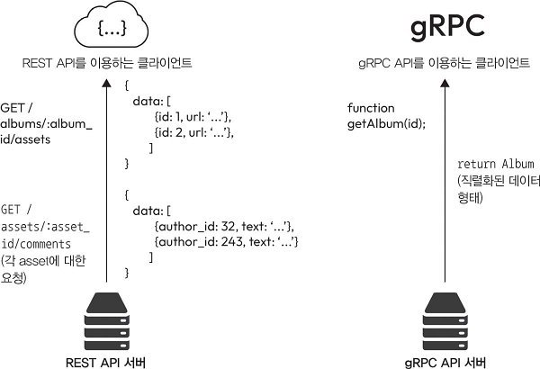
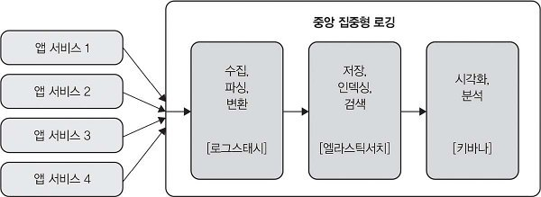
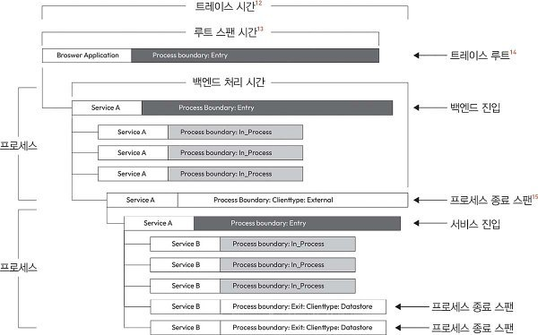

# 8장. 시스템 구성 요소 설계 및 구현: API, 보안, 메트릭

> 정리 범위: 첨부 PDF의 332~369페이지에 해당하는 8장 본문과 693~694페이지의 관련 주석이다. 페이지 번호는 PDF 뷰어 기준이다. 원문의 설명을 따라 정리하고, 원문과 구분이 필요한 기술적 내용은 **검증 메모**로 표시했다.

분산 시스템에서는 여러 소프트웨어 구성 요소가 서로 요청을 주고받으며 작업을 처리한다. 각 구성 요소를 연결하는 API를 설계하는 일과 함께, 접근 권한을 관리하고 운영 중 발생하는 문제를 확인할 수 있는 구조도 필요하다.

API(Application Programming Interface)는 서로 다른 소프트웨어 구성 요소가 통신하는 인터페이스다. 마이크로서비스처럼 서비스가 분리된 환경에서는 API의 통신 방식이 성능과 확장성에 영향을 준다. API를 외부에 공개하면 공격 대상이 될 수 있으므로 인증, 인가, 통신 암호화, 요청 속도 제한을 함께 설계해야 한다.

시스템을 운영할 때는 각 서비스에서 발생한 일을 기록하고 상태를 측정해야 한다. 로그로 개별 이벤트와 오류를 확인하고, 메트릭으로 성능과 상태를 수치화한다. 알림은 대응이 필요한 상황을 담당자에게 전달하고, 트레이싱은 하나의 요청이 여러 서비스를 거치는 과정을 보여 준다.

이 장에서 다루는 내용은 다음과 같다.

- REST API
- gRPC API
- REST와 gRPC 비교
- API 보안
- 분산 시스템 로깅
- 분산 시스템에서 메트릭
- 분산 시스템에서 알림
- 분산 시스템에서 트레이싱

<br>

## 8.1 REST API

REST(REpresentational State Transfer)는 네트워크 애플리케이션을 설계하는 아키텍처 스타일이다. 책에서는 표준 HTTP 메서드로 리소스를 다루는 REST API를 설명한다. HTTP를 이해하고 있다면 요청과 응답의 의미를 파악하기 쉬워 여러 종류의 클라이언트에서 활용할 수 있다.

### 8.1.1 REST API 설계 원칙

REST API는 클라이언트가 접근할 수 있는 **리소스(resource)**를 중심으로 설계한다. 객체, 데이터, 서비스 등이 리소스가 될 수 있다. 각 리소스는 URI(Uniform Resource Identifier)라는 문자열로 식별하며, API 엔드포인트도 리소스를 식별하는 데 사용한다.

클라이언트는 `GET`, `POST`, `PUT`, `DELETE` 같은 HTTP 메서드로 리소스에 수행할 작업을 표현한다. 책은 이러한 작업을 데이터베이스의 생성, 읽기, 수정, 삭제인 CRUD(Create, Read, Update, Delete)와 연결해 설명한다. 리소스의 식별과 그 리소스에 수행하는 작업을 함께 정하는 방식이다.

REST의 핵심 원칙은 **무상태성(statelessness)**이다. 클라이언트는 서버가 요청을 처리하는 데 필요한 정보를 각 요청에 포함해야 한다. 서버가 이전 요청에서 어떤 대화가 오갔는지를 기억하고 있어야만 다음 요청을 처리할 수 있는 구조를 피한다.

요청마다 필요한 정보가 들어 있으면 서버는 그 요청을 기준으로 처리할 수 있다. 책에서는 이러한 특성이 서버의 동작을 안정적이고 예측 가능하게 만든다고 설명한다. 여기에서 기억하지 않는 상태는 요청 사이의 클라이언트 대화 상태이며, 서버가 관리하는 리소스 자체를 저장하지 않는다는 뜻은 아니다.

### 8.1.2 REST API 활용 사례

REST API는 인터넷에 공개하는 API에 적합하다. HTTP 요청을 보낼 수 있는 웹 브라우저, 모바일 애플리케이션, 다른 서버가 모두 클라이언트가 될 수 있다. 다양한 환경에서 같은 API를 사용해야 할 때 HTTP의 호환성을 활용할 수 있다.

주요 작업이 데이터의 생성, 읽기, 수정, 삭제인 서비스에도 잘 맞는다. 책에서는 사용자 정보나 제품 목록을 관리하는 웹 애플리케이션을 예로 든다. 관리할 대상을 리소스로 정하고, 각 리소스에 필요한 CRUD 작업을 HTTP 메서드로 제공할 수 있다.

### 8.1.3 REST API의 장단점

REST API의 장점은 구조가 간단하고 이해하기 쉽다는 점이다. HTTP 메서드와 상태 코드를 활용하므로 HTTP에 익숙한 개발자는 요청한 작업과 처리 결과를 파악하기 쉽다. 별도의 바이너리 메시지 형식을 해석하지 않고도 요청과 응답을 확인할 수 있다는 점도 개발과 디버깅에 도움이 된다.

반면 하나의 복잡한 작업을 완료하려고 여러 리소스를 차례로 요청해야 하는 경우에는 통신이 비효율적일 수 있다. 필요한 데이터를 모으기 위해 여러 번 요청하고 응답을 기다려야 하기 때문이다. 또한 책에서 비교하는 JSON 기반 REST API는 전송할 데이터가 많아질수록 페이로드가 커질 수 있다.

이러한 제약 때문에 서비스 간 통신에서는 메시지 크기, 호출 횟수, 처리 속도까지 고려해 API 방식을 선택해야 한다. 다음 절에서는 함수 호출을 중심으로 통신하는 gRPC를 설명한다.

<br>

## 8.2 gRPC API

gRPC는 구글이 개발한 고성능 오픈 소스 원격 프로시저 호출(RPC) 프레임워크다. HTTP/2를 기반으로 통신한다. REST가 리소스를 중심으로 API를 설계한다면, gRPC는 원격 서비스에서 실행할 함수를 중심으로 인터페이스를 정의한다.

클라이언트는 정의된 서비스의 메서드를 호출하고, 서버는 해당 메서드의 구현을 실행해 응답한다. 이때 클라이언트와 서버가 같은 서비스 정의와 메시지 구조를 공유하는 것이 중요하다.

### 8.2.1 gRPC API의 설계 원칙

책에서 설명하는 gRPC는 **프로토콜 버퍼(Protocol Buffers, protobuf)**로 서비스 인터페이스와 메시지 구조를 정의한다. 프로토콜 버퍼는 정형 데이터를 직렬화하는 방식으로, 언어나 플랫폼이 달라도 같은 데이터 구조를 주고받을 수 있게 한다. JSON과 비교하면 메시지 크기와 처리 효율 면에서 유리할 수 있다.

서비스와 메시지 구조는 `.proto` 파일에 작성한다. 이 정의를 바탕으로 여러 언어의 클라이언트 코드와 서버 코드 스텁(stub)을 자동 생성한다. 개발자는 생성된 인터페이스를 사용해 원격 서비스를 호출하거나 서버 기능을 구현할 수 있다.

책에서 설명하는 개발 흐름은 다음과 같다.

1. **서비스와 메시지를 정의한다.** `.proto` 파일에 호출할 서비스와 주고받을 데이터의 구조를 작성한다.
2. **클라이언트와 서버 코드를 생성한다.** 같은 정의를 사용해 각 구현 언어에 필요한 코드를 만든다. 여러 언어로 작성된 서비스도 같은 인터페이스를 기준으로 통신할 수 있다.
3. **서비스를 구현하고 호출한다.** 서버는 정의된 기능을 구현하고, 클라이언트는 생성된 코드를 통해 기능을 호출한다.
4. **정의가 바뀌면 생성 코드를 갱신하고 배포에 반영한다.** 인터페이스를 한곳에서 정의하므로 변경 사항을 양쪽 코드에 일관되게 반영하기 쉽다. 실행 중인 서버와 클라이언트가 파일 변경만으로 자동 갱신되는 것은 아니다.

gRPC는 여러 프로그래밍 언어를 지원하므로 서로 다른 언어로 구현한 서비스들을 연결하는 데 사용할 수 있다. 인증, 로드 밸런싱, 양방향 스트리밍 같은 기능도 제공한다. 특히 양방향 스트리밍에서는 클라이언트와 서버가 데이터를 연속해서 주고받을 수 있다.

### 8.2.2 gRPC API의 활용 사례

gRPC는 서비스 사이의 호출이 빠르고 빈번하게 발생하는 마이크로서비스 아키텍처에 적합하다. 프로토콜 버퍼로 메시지 크기를 줄이고 효율적으로 통신하면 반복되는 서비스 호출의 부담을 줄일 수 있다.

실시간 애플리케이션에도 활용한다. 양방향 스트리밍을 통해 클라이언트와 서버가 계속 데이터를 주고받을 수 있기 때문이다. 서비스 간 통신에서 높은 처리 성능이 필요하거나 전송 부하가 큰 경우에는 이러한 특성이 선택 기준이 된다.

### 8.2.3 gRPC API의 장단점

gRPC의 장점은 책에서 비교하는 JSON 기반 REST API보다 작은 페이로드와 빠른 통신을 기대할 수 있다는 점이다. 프로토콜 버퍼로 메시지 구조를 명확하게 정의하므로 여러 언어의 서비스가 같은 데이터 형식을 공유하기도 쉽다.

반면 바이너리 메시지와 HTTP/2를 다뤄야 하므로 설정과 디버깅이 복잡해질 수 있다. 사람이 메시지 본문을 그대로 읽기 어렵고, 메시지를 해석하거나 호출을 시험할 도구가 필요하다.

서비스 인터페이스를 변경할 때도 작업이 추가된다. 데이터 구조를 다시 정의하고, 생성 코드를 갱신하고, 변경된 코드를 배포해야 한다. 책에서는 REST의 메시지를 수정하고 시험하는 과정과 비교해 이러한 변경 절차가 더 오래 걸릴 수 있다고 설명한다.

따라서 메시지 전송 성능뿐 아니라 인터페이스 변경 빈도, 개발 과정, 운영 도구까지 함께 고려해야 한다.

<br>

## 8.3 REST와 gRPC 비교

REST와 gRPC 가운데 어느 방식을 선택할지는 시스템이 요구하는 성능, 사용 편의성, 호환성, 통신 방식에 따라 달라진다. 책은 공개 API에는 REST가, 서비스 간 고성능 통신에는 gRPC가 적합한 경우가 많다고 설명한다.



그림의 왼쪽에서는 REST 클라이언트가 앨범에 속한 자산을 조회하는 `GET /albums/:album_id/assets` 요청을 보낸다. 각 자산의 댓글이 필요하면 `GET /assets/:asset_id/comments` 요청도 보낸다. 서버는 각 요청에 해당하는 데이터를 응답한다. 하나의 화면이나 작업에 필요한 정보가 여러 리소스로 나뉘어 있을 때 여러 번 호출할 수 있음을 보여 준다.

오른쪽에서는 gRPC 클라이언트가 `getAlbum(id)` 함수를 호출하고 직렬화된 `Album` 데이터를 반환받는다. 리소스를 각각 조회하는 형태와 정의된 함수를 호출하는 형태의 차이를 보여 주는 예다. 실제 호출 횟수는 각 API가 어떤 데이터를 한 번에 제공하도록 설계했는지에 따라 달라진다.

**책에서 제시하는 비교 기준**

- **성능:** gRPC는 HTTP/2와 프로토콜 버퍼를 사용한다. HTTP/2는 하나의 TCP 연결에서 여러 요청을 동시에 처리할 수 있어 통신 지연을 줄이는 데 도움이 된다. 프로토콜 버퍼는 JSON보다 작은 메시지를 만들 수 있으므로 전송량도 줄일 수 있다. 책은 이 조합을 gRPC가 일반적으로 높은 성능을 내는 이유로 설명한다.
- **사용 편의성:** REST는 HTTP 메서드와 상태 코드에 익숙한 개발자가 이해하기 쉽다. cURL이나 포스트맨(Postman) 같은 도구로 호출하고 응답을 확인할 수 있다. gRPC는 바이너리 메시지를 사용하므로 서비스 정의와 메시지 형식을 이해하는 도구를 사용해야 한다.
- **호환성:** REST는 HTTP 요청을 보낼 수 있는 다양한 장치와 환경에서 사용하기 쉽다. gRPC는 HTTP/2 기반 통신을 지원하는 환경이 필요하며, 브라우저나 중간 네트워크 구성 요소의 지원 여부도 확인해야 한다.
- **스트리밍 지원:** gRPC는 양방향 스트리밍을 지원하여 클라이언트와 서버가 동시에 데이터를 주고받을 수 있다. 책은 이를 일반적인 REST API의 요청·응답 방식과 비교한다. 지속적으로 데이터를 교환해야 하는 실시간 애플리케이션에서는 이 차이가 중요하다.
- **활용 사례:** REST는 공개 API, CRUD 중심 서비스, 여러 플랫폼과의 호환성이 필요한 환경에 잘 맞는다. gRPC는 마이크로서비스 사이에서 빈번하게 호출하거나 높은 통신 성능이 필요한 환경에 적합하며, 양방향 스트리밍이 필요한 실시간 처리에도 활용할 수 있다.

책은 브라우저와 서버 사이에서 데이터를 주고받을 때 REST를 우선 검토하고, 서비스 사이의 성능과 효율이 중요할 때 gRPC를 검토하도록 설명한다. 한 가지 방식의 장점만으로 결정하지 않고, 실제 클라이언트와 통신 조건을 기준으로 선택해야 한다.

> **검증 메모: 비교의 전제**
>
> REST는 JSON이나 HTTP/1.1만을 사용하도록 정한 규격이 아니다. 리소스의 표현 형식은 다양할 수 있고, HTTP/2도 HTTP의 메서드와 상태 코드 등의 의미를 유지한다. 따라서 책의 성능 비교는 주로 JSON 기반 REST 구현과 HTTP/2·protobuf 기반 gRPC 구현을 비교한 것으로 읽어야 한다. 또한 브라우저에서는 gRPC-Web을 통해 gRPC 서비스를 이용할 수 있다. 네이티브 gRPC와 gRPC-Web의 차이를 구분해야 한다. [REST의 리소스 표현](https://ics.uci.edu/~fielding/pubs/dissertation/rest_arch_style.htm#sec_5_2_1_2), [HTTP/2 명세](https://www.rfc-editor.org/rfc/rfc9113.html#section-2), [gRPC-Web 공식 예제](https://grpc.io/docs/platforms/web/basics/)

<br>

## 8.4 API 보안

API는 여러 소프트웨어 구성 요소를 연결하지만, 외부에서 시스템에 접근하는 경로이기도 하다. 공격자가 API를 악용하면 권한 없는 데이터 접근이나 과도한 요청으로 문제가 발생할 수 있다. API를 설계할 때는 요청을 처리하는 기능과 함께 접근 및 사용을 제어하는 방법도 정해야 한다.

먼저 **인증(authentication)**과 **인가(authorization)**를 구분한다. 인증은 요청을 보낸 사용자나 시스템이 누구인지 확인하는 과정이다. 인가는 그 주체가 요청한 데이터나 작업에 접근할 권한이 있는지 확인하는 과정이다.


그림의 왼쪽은 아이디와 비밀번호를 입력해 신원을 확인하는 인증을 보여 준다. 오른쪽은 확인된 사용자가 수행할 수 있는 작업과 수행할 수 없는 작업을 구분하는 인가를 보여 준다. 신원 확인을 마쳤더라도 모든 데이터와 기능에 접근할 수 있는 것은 아니므로 두 과정을 모두 설계해야 한다.

### 8.4.1 인증

인증은 사용자, 시스템, 애플리케이션의 신원을 확인하는 과정이다. API에 접근한 주체가 올바른 주체인지 확인하는 첫 단계이며, 구현 방식에 따라 사용 편의성과 보안 특성이 달라진다.

**책에서 소개하는 인증 관련 방식**

- **API 키:** 클라이언트가 HTTP 요청 헤더에 키를 포함해 보내고, 서버가 그 키의 유효성을 확인한다. 구현이 간단하지만 키가 유출되면 다른 사람이 이를 사용할 수 있다. 책에서는 키만으로 세밀한 권한을 제어하기 어렵다는 점도 한계로 설명한다.
- **OAuth:** 사용자가 다른 애플리케이션에 계정 정보를 직접 넘기지 않고도 자신의 리소스에 제한적으로 접근하도록 허용하는 방식이다. 책은 OAuth 2.0이 웹, 데스크톱, 모바일 애플리케이션과 스마트 기기 등 여러 환경에 맞는 절차(flow)를 제공한다고 설명한다. 계정 비밀번호를 공유하는 대신 필요한 접근 권한을 부여하는 데 의미가 있다.
- **JWT(JSON Web Token):** 두 시스템 사이에 전달할 정보를 JSON 형식의 클레임(claim)으로 표현하는 토큰 형식이다. 책에서는 클레임을 JWS(JSON Web Signature) 구조로 감싸 서명이나 메시지 인증 코드(MAC)로 무결성을 확인하는 방식을 설명한다. 간결하고 URL에 사용할 수 있는 문자로 표현되므로 시스템이나 네트워크 사이에서 정보를 전달하는 데 활용한다. 암호화 여부는 토큰을 어떤 형식으로 만드는지에 따라 달라진다.

> **검증 메모: OAuth와 JWT가 담당하는 역할**
>
> 책은 이들을 인증 절에서 함께 다루지만, OAuth 2.0은 표준상 **접근 권한을 위임하는 인가 프레임워크**다. 사용자 인증을 위한 계층으로는 OAuth 2.0 위에 구축한 OpenID Connect가 있다. JWT는 인증 절차 자체가 아니라 클레임을 전달하는 형식이다. 서명한 JWT의 내용이 자동으로 암호화되는 것은 아니며, JWS는 서명·무결성 보호를, JWE는 암호화를 담당한다. JWT를 사용한다는 사실만으로 API 키보다 안전하다고 단정할 수는 없다. [OAuth 2.0 명세](https://www.rfc-editor.org/rfc/rfc6749.html), [OpenID Connect 명세](https://openid.net/specs/openid-connect-core-1_0.html#Introduction), [JWT 명세](https://www.rfc-editor.org/rfc/rfc7519.html)

**옮긴이 노트: API 키의 의미와 검증 과정**

옮긴이는 API 키를 행사장의 입장권에 비유한다. 클라이언트는 키를 제시해 API에 요청할 자격이 있음을 나타내고, 서버는 그 키를 확인한다. 입장권이 다른 사람에게 넘어가면 그 사람이 사용할 수 있는 것처럼, API 키도 노출되면 공격자가 악용할 수 있다.

책의 서버 예제는 유효한 키 목록에 클라이언트가 보낸 키가 있는지 검사한다. 다음 코드는 책의 예제이며 들여쓰기와 공백을 정리했다.

```python
# 유효한 API 키 목록
VALID_API_KEYS = {"12345", "67890", "abcde"}

# API 키 검증 함수
def check_api_key(api_key):
    if api_key in VALID_API_KEYS:
        print("Access granted. Welcome!")  # 접근 허용
        return True
    else:
        print("Access denied. Invalid API key!")  # 접근 거부
        return False

# 예제 실행
user_api_key = "12345"  # 클라이언트가 보낸 API 키
check_api_key(user_api_key)  # 유효성 확인
```

검증 과정은 다음과 같다.

1. 서버가 유효한 API 키의 집합을 가지고 있다.
2. 클라이언트가 보낸 키를 `check_api_key()`에 전달한다.
3. 키가 집합에 있으면 접근을 허용하는 메시지를 출력하고 `True`를 반환한다.
4. 키가 없으면 접근을 거부하는 메시지를 출력하고 `False`를 반환한다.

예제의 `"12345"`는 유효한 키 목록에 있으므로 검증에 성공한다. 이 코드는 키를 비교하는 원리를 설명하는 함수이며, HTTP 요청을 받는 서버 전체를 구현한 코드는 아니다.

클라이언트는 자바스크립트의 `fetch()`로 요청을 보낸다. 책에서는 API 키를 `Authorization` 헤더에 `Bearer` 형식으로 넣는다.

```javascript
// 서버의 엔드포인트 URL
const API_URL = "http://example.com/api/resource";

// 클라이언트가 사용하는 API 키
const API_KEY = "12345";  // 유효한 API 키

// HTTP 요청 옵션
const options = {
    method: "GET",  // 요청 방식
    headers: {
        "Authorization": `Bearer ${API_KEY}`,  // 헤더에 API 키 추가
        "Content-Type": "application/json",  // 요청 데이터 형식
    },
};

// 서버에 요청 보내기
fetch(API_URL, options)
    .then(response => {
        if (!response.ok) {
            throw new Error(`HTTP error! status: ${response.status}`);
        }
        return response.json();  // JSON 응답 파싱
    })
    .then(data => {
        console.log("응답 데이터:", data);  // 응답 데이터 출력
    })
    .catch(error => {
        console.error("오류 발생:", error);  // 오류 출력
    });
```

클라이언트는 `GET` 요청을 보내며 `Authorization: Bearer 12345`라는 헤더를 전달한다. 응답 상태가 성공이면 본문을 JSON으로 읽고, 실패 상태이거나 요청 처리 중 오류가 발생하면 오류를 출력한다.

옮긴이는 Bearer 형식을 키를 소지한 주체가 요청할 수 있도록 하는 방식으로 설명한다. 따라서 이 예제에서 중요한 점은 키를 전송하는 위치와 서버의 유효성 검사가 연결된다는 것이다. 키를 헤더에 넣는 동작만으로 검증이 완료되는 것은 아니다.

> **검증 메모: 예제와 실제 API 규약의 차이**
>
> API 키가 항상 `Authorization: Bearer` 형식인 것은 아니다. API가 정한 헤더 이름과 전달 규약을 따라야 한다. 예를 들어 OpenAPI의 공식 안내는 `X-API-Key` 헤더를 사용하는 방식을 보여 준다. 위 코드의 `http://` 주소는 책의 예제 그대로이며, 실제 통신 보호에는 다음 8.4.3절에서 설명하는 HTTPS가 필요하다. [API 키 전달 방식](https://swagger.io/docs/specification/v3_0/authentication/api-keys/)

### 8.4.2 인가

인가에서는 인증된 사용자가 요청한 리소스에 접근할 권한이 있는지 확인한다. 신원이 확인된 사용자를 대상으로 어떤 데이터와 작업을 허용할지 결정하는 과정이다. 책은 대규모 애플리케이션에서 사용하는 두 가지 접근 제어 방식을 설명한다.

- **역할 기반 접근 제어(Role-Based Access Control, RBAC):** 권한을 역할에 할당하고, 사용자를 해당 역할에 연결한다. 시스템은 사용자가 가진 역할의 권한을 기준으로 접근을 허용한다. 사용자마다 권한을 개별적으로 관리하는 대신 역할과 역할에 속한 사용자를 관리하므로 권한 관리가 간단해진다.
- **속성 기반 접근 제어(Attribute-Based Access Control, ABAC):** 사용자, 리소스, 환경의 속성을 기준으로 접근 규칙을 정의한다. 책에서는 사용자 부서, 리소스 유형, 요청 시간을 예로 든다. 여러 속성을 조합해 접근 여부를 판단하므로 RBAC보다 세밀하게 제어할 수 있지만, 규칙을 정의하고 구현하는 과정도 복잡해진다.

RBAC에서는 사용자의 역할과 그 역할에 부여한 권한이 판단의 중심이 된다. ABAC에서는 요청 시점에 해당하는 속성들과 접근 규칙을 함께 평가한다. 권한을 어느 수준까지 구분해야 하는지, 관리할 규칙이 얼마나 복잡한지를 고려해 방식을 정한다.

### 8.4.3 API의 보안 통신

API로 데이터를 전송할 때는 **HTTPS(HyperText Transfer Protocol Secure)**를 사용해 클라이언트와 서버 사이의 통신을 보호해야 한다. 통신을 암호화하면 중간에서 데이터를 가로채더라도 그 내용을 읽기 어렵게 만들 수 있다.

비밀번호, 개인 정보, 금융 거래처럼 민감한 데이터를 다룰 때는 이러한 보호가 특히 중요하다. 인증과 인가를 갖추었더라도 전송 중인 정보가 노출되면 보안 문제가 생길 수 있으므로 통신 자체를 보호해야 한다.

TLS(Transport Layer Security, 전송 계층 보안) 설정도 최신 보안 요구에 맞게 유지해야 한다. 새로운 취약점이 발견되거나 보안 표준이 바뀌면 설정을 점검하고 갱신한다. 책은 이를 암호화와 데이터 무결성을 유지하기 위한 운영 작업으로 설명한다.

### 8.4.4 요청 속도 제한

요청 속도 제한(rate limiting)은 일정 시간 동안 클라이언트가 보낼 수 있는 요청 수를 제한하는 방법이다. 특정 사용자나 애플리케이션이 API를 과도하게 사용하지 못하게 하고, 여러 사용자가 서버 자원을 균형 있게 사용하도록 돕는다.

서비스 거부(DoS) 공격처럼 대량의 요청으로 서버를 과부하 상태로 만드는 시도에 대응할 때도 활용한다. 처리할 수 있는 범위로 요청량을 제한하면 과도한 요청 때문에 다른 사용자의 서비스 품질이 낮아지는 상황을 줄일 수 있다.

**대표적인 요청 속도 제한 알고리즘**

- **토큰 버킷(token bucket):** 버킷에 토큰을 일정한 간격으로 채운다. 요청 하나를 처리할 때 토큰 하나를 사용하며, 토큰이 없으면 추가 요청을 거부한다. 요청의 허용 여부를 판단할 때 버킷에 남은 토큰 수를 확인한다. 토큰을 모아 둔 상태라면 그만큼의 요청을 한꺼번에 허용할 수 있다.
- **누수 버킷(leaky bucket):** 버킷에 들어온 요청을 일정한 속도로 내보내는 방식이다. 요청이 몰리면 버킷에 대기하는 요청이 쌓이고, 버킷이 가득 차면 새 요청을 거부한다. 책의 옮긴이 예시는 주문이 들어오는 커피숍에서 직원이 일정한 속도로 주문을 처리하는 상황으로 이를 설명한다.
- **슬라이딩 윈도우(sliding window):** 현재 시점에서 일정 시간 범위 안에 처리한 요청 수를 추적한다. 그 범위의 요청 수가 한도에 도달하면 새 요청을 제한한다. 시간이 흐르면 집계 대상 시간 범위도 함께 이동하므로, 오래된 요청이 범위 밖으로 나간 뒤에 새 요청을 허용할 수 있다.

> **검증 메모: 누수 버킷의 설명**
>
> 원문 본문은 누수 버킷을 설명하면서 토큰이 일정한 속도로 들어오고 새어 나간다고 표현한다. 요청 제한에서 사용하는 큐 방식의 누수 버킷은 **도착한 요청이 대기하고, 정해진 속도로 처리되는 구조**로 이해하는 것이 정확하다. NGINX의 공식 설명도 초과 요청을 지연시키고 대기 한도를 넘으면 거부하는 방식으로 설명한다. 위 정리는 책의 커피숍 예시와 이 구분을 반영했다. [NGINX의 누수 버킷 설명](https://nginx.org/en/docs/http/ngx_http_limit_req_module.html)

**옮긴이 노트: 예시로 알아보는 각 알고리즘**

1. **토큰 버킷: 놀이 기구나 놀이방의 입장 토큰**
   - 입장하려면 토큰이 하나 필요하다. 사람이 몰려 토큰이 모두 소진되면 새로 온 사람은 바로 입장할 수 없다.
   - 시간이 지나면 토큰이 다시 채워지므로 이후 요청을 허용할 수 있다. 요청을 처리할 수 있는지는 현재 남아 있는 토큰으로 판단한다.
2. **누수 버킷: 일정한 속도로 주문을 처리하는 커피숍**
   - 주문이 들어오면 대기열에 쌓이고, 직원은 일정한 속도로 처리한다. 주문이 몰려도 처리 속도를 일정하게 유지한다.
   - 대기할 공간까지 가득 차면 새 주문을 받지 못한다. 입력이 몰리는 상황을 대기열로 흡수하되, 수용할 수 있는 양에는 한계가 있다.
3. **슬라이딩 윈도우: 최근 한 시간 동안 음료를 10잔까지 판매하는 자판기**
   - 책은 한 시간 동안 요청을 열 번까지 허용하는 예를 든다. 해당 범위에 요청이 이미 열 번 있다면 열한 번째 요청은 제한한다.
   - 여기에서 시간 범위는 현재 시점을 따라 움직인다. 단순히 다음 정각이 되면 모두 초기화하는 방식이 아니라, 기존 요청이 최근 한 시간의 범위에서 빠져나가는지 확인한다. 책의 “다음 시간을 기다린다”는 비유도 이러한 이동하는 시간 범위와 연결해 이해해야 한다.

알고리즘을 선택할 때는 요청량을 얼마나 정밀하게 제한해야 하는지, 순간적으로 몰리는 요청을 얼마나 허용할지, 구현과 관리가 얼마나 복잡해지는지를 고려한다. 토큰을 기준으로 허용할지, 요청을 일정 속도로 처리할지, 이동하는 시간 범위에서 횟수를 셀지가 서로 다르다.

<br>

## 8.5 분산 시스템 로깅

로깅(logging)은 시스템에서 발생한 이벤트를 기록하는 작업이다. 로그를 읽으면 애플리케이션 안에서 어떤 작업이 일어났는지, 어떤 오류가 발생했는지, 문제가 발생하기 전에 어떤 과정이 있었는지 확인할 수 있다.

분산 시스템에서는 여러 서버와 서비스가 동시에 동작하며 각각 로그를 만든다. 한 서비스의 로그만으로는 여러 서비스를 거치는 작업 전체를 이해하기 어려울 수 있다. 관련된 로그를 함께 분석해야 시스템 전반의 동작을 확인하고 문제를 추적할 수 있다.

대규모 시스템에서는 각 서비스의 로그를 중앙 저장소로 모아 관리하는 **중앙 집중형 로깅(centralized logging)**을 주로 사용한다.

### 8.5.1 중앙 집중형 로깅

중앙 집중형 로깅은 여러 기기에서 실행되는 서비스의 로그를 한곳에 모아 저장하고 검색·분석하는 방식이다. 서비스별로 흩어진 로그를 공통된 위치에서 조회할 수 있도록 수집 경로와 저장소를 구성한다.

**중앙 집중형 로깅 방식의 장점**

- **접근성 향상:** 여러 서비스의 로그를 한곳에서 검색하고 분석할 수 있다. 문제가 발생한 서비스뿐 아니라 관련 서비스의 기록도 함께 확인하기 쉬워진다.
- **상관관계 분석:** 서로 다른 서비스가 남긴 로그를 타임스탬프나 고유 식별자로 연결한다. 같은 트랜잭션이나 작업에 속한 로그를 모으면 그 작업이 여러 서비스에서 어떻게 처리되었는지 파악할 수 있다.
- **데이터 장기 보관:** 로그를 오랫동안 보관해 과거의 동작을 분석하거나 컴플라이언스 요구 사항을 충족하는 데 활용한다. 여기에서 컴플라이언스 요구 사항은 시스템과 데이터가 따라야 하는 법적·규제적 기준을 뜻한다.



그림에서는 앱 서비스 1~4에서 발생한 로그가 로그스태시, 엘라스틱서치, 키바나로 이어진다. 각 구성 요소의 역할은 다음과 같다.

1. **각 애플리케이션 서비스가 로그를 생성한다.** 서로 다른 서비스가 자신이 처리한 이벤트와 오류를 기록한다.
2. **로그스태시(Logstash)가 로그를 수집·파싱·변환한다.** 여러 서비스가 보낸 데이터를 받아 내용을 해석하고, 저장 및 분석에 사용할 형태로 가공한다.
3. **엘라스틱서치(Elasticsearch)가 로그를 저장·인덱싱한다.** 가공된 로그를 보관하고 검색할 수 있도록 만든다. 사용자는 필요한 조건에 맞는 로그를 조회할 수 있다.
4. **키바나(Kibana)가 데이터를 시각화하고 분석한다.** 엘라스틱서치의 데이터를 화면에서 살펴보고 시스템에서 발생한 이벤트를 분석한다.

이 구조는 로그를 수집하는 역할, 저장하고 검색하는 역할, 분석 결과를 보여 주는 역할을 연결한 예다. 책은 중앙 집중형 로깅을 구현하는 여러 방법 중 하나로 이 아키텍처를 제시한다.

**로그 항목에 포함할 정보**

- **발생 시각:** 이벤트가 발생한 날짜와 시간이다. 이벤트 순서를 확인하고 다른 서비스의 로그와 연결하는 기준이 된다.
- **서비스 이름:** 로그를 생성한 서비스의 이름이다. 여러 서비스의 로그가 섞여 있어도 발생 위치를 구분할 수 있어야 한다.
- **심각도:** `INFO`, `WARNING`, `ERROR`처럼 이벤트의 중요도 수준을 나타낸다. 필요한 수준의 로그를 골라 확인하는 데 사용한다.
- **메시지:** 어떤 이벤트가 발생했는지 설명한다. 로그를 읽는 사람이 수행된 작업이나 오류 내용을 파악할 수 있어야 한다.
- **추가 정보:** 사용자 ID, 트랜잭션 ID 등 해당 이벤트와 관련된 세부 정보다. 특정 사용자나 작업에 속한 로그를 찾고 영향을 확인하는 데 도움이 된다.

**중앙 집중형 로깅 오픈 소스 라이브러리**

책은 로그를 수집하고 통합하는 도구로 다음 세 가지를 소개한다.

- **로그스태시:** 엘라스틱스택(Elastic Stack)의 구성 요소로, 여러 소스의 데이터를 수집하고 변환한 뒤 엘라스틱서치 같은 저장소에 전달한다. 그림 8-3에서는 서비스별 로그가 저장소로 들어가기 전에 수집·가공하는 역할을 맡는다.
- **Fluentd:** 여러 소스에서 데이터를 수집하고 통합하는 데이터 수집기다. 흩어진 데이터를 공통된 수집 구조로 모아 이후 관리와 분석에 활용할 수 있게 한다.
- **Graylog:** 중앙 집중형 로깅을 위한 솔루션이다. 개방형 표준(open standard)을 바탕으로 시스템과 애플리케이션이 생성한 데이터를 대량으로 수집·저장하고, 실시간으로 분석하는 기능을 제공한다.

### 8.5.2 분산 로깅을 효과적으로 구현한 모범 사례

로그를 중앙으로 모으는 것과 함께 로그의 형식, 내용, 보관 방식도 일관되게 정해야 한다. 수집한 기록에서 필요한 정보를 찾을 수 있어야 문제 해결에 사용할 수 있기 때문이다.

- **일관된 로그 형식 사용하기:** 모든 서비스가 같은 형식으로 로그를 남기도록 한다. 서비스마다 형식이 다르면 검색과 분석 방법도 달라지므로 여러 서비스의 기록을 함께 다루기 어려워진다.
- **로그에 컨텍스트 정보 포함하기:** 사용자 ID나 트랜잭션 ID처럼 이벤트와 관련된 정보를 추가한다. 특정 작업에 해당하는 로그를 찾고, 문제가 어떤 사용자나 작업에 영향을 주었는지 파악할 수 있다.
- **예외를 적절히 처리하기:** 예외가 발생하면 스택 트레이스(stack trace)를 함께 기록한다. 스택 트레이스에는 오류가 발생한 위치와 함수 호출 순서가 담기므로, 오류 메시지만 있을 때보다 원인을 추적하기 쉽다.
- **적절한 로그 레벨 설정하기:** 즉각적인 대응이 필요한 오류에는 `ERROR`, 긴급하지 않지만 동작을 이해하는 데 필요한 기록에는 `INFO`처럼 상황에 맞는 레벨을 사용한다. 필요한 기록을 찾기 쉽게 하면서 불필요한 로그가 과도하게 쌓이는 것을 줄인다.
- **로그 순환 및 아카이빙하기:** 저장 공간과 보관 요건을 고려해 로그를 주기적으로 정리한다. 보관할 필요가 없는 오래된 로그는 삭제하고, 장기 분석이나 규정 준수에 필요한 로그는 별도로 안전하게 보관한다.

**옮긴이 노트: 로그를 순환한다는 의미**

옮긴이는 로그 순환을 냉장고에서 오래된 음식을 정리하고 새 음식을 넣을 공간을 확보하는 일에 비유한다. 로그를 계속 쌓아 두면 저장 공간이 가득 찰 수 있으므로 오래된 로그를 삭제하거나 다른 저장소로 옮겨 공간을 확보해야 한다는 설명이다.

정리할 때는 모든 로그를 무조건 삭제하는 것이 아니라 보관이 필요한 로그를 구분한다. 최근 운영에 필요한 로그는 조회할 수 있게 두고, 오랫동안 보관해야 하는 로그는 아카이빙하는 식으로 저장 공간과 데이터 보존을 함께 관리한다.

<br>

## 8.6 분산 시스템에서 메트릭

메트릭(metric)은 측정한 데이터를 수치로 표현한 것이다. 일정 시간 동안의 상태와 성능을 정량적으로 살펴볼 수 있어 시스템 확장, 성능 개선, 문제 해결의 근거로 사용한다.

분산 시스템에서는 여러 서비스의 메트릭을 수집하고 중앙에서 통합해 관리하는 것이 중요하다. 서비스마다 수치가 흩어져 있으면 시스템 전체의 상태를 파악하기 어려우므로 관련 지표를 함께 확인할 수 있어야 한다.

책은 메트릭을 통해 다음 질문에 답할 수 있다고 설명한다.

- 시스템이 원활하게 작동하고 있는가?
- 서비스 수준 목표(Service-Level Objectives, SLO)를 충족하고 있는가?
- 성능 병목 현상이 발생하고 있는가?
- 시스템이 예상한 대로 작동하고 있는가?

서비스 수준 목표는 서비스가 달성하려는 품질 목표다. 메트릭은 실제 측정값을 목표와 비교하고, 개선이 필요한 부분을 판단하는 데 사용한다.

### 8.6.1 메트릭 종류

수집할 메트릭은 무엇을 측정하는지에 따라 구분할 수 있다. 책은 시스템 자원, 애플리케이션 동작, 비즈니스 활동을 각각 살펴보도록 다음 세 가지를 제시한다.

- **시스템 메트릭:** CPU 사용량, 메모리 사용량, 디스크 입출력, 네트워크 입출력 등이 해당한다. 시스템 자원이 얼마나 사용되고 있는지 확인한다. 어떤 자원에 부하가 집중되는지 파악하는 데 활용할 수 있다.
- **애플리케이션 메트릭:** 요청 속도, 오류 비율, 응답 시간 등이 해당한다. 애플리케이션이 요청을 얼마나 많이 받고, 얼마나 빠르게 처리하며, 얼마나 자주 실패하는지를 보여 준다. 성능과 안정성을 판단하는 데 사용한다.
- **비즈니스 메트릭:** 사용자 가입 수, 주문 건수처럼 애플리케이션의 업무 도메인과 관련된 수치다. 시스템의 동작이 실제 비즈니스 활동에 어떤 영향을 주는지 확인한다.

같은 시스템을 관찰하더라도 자원 사용량, 요청 처리 결과, 비즈니스 결과는 서로 다른 측면을 보여 준다. 시스템에서 확인하려는 문제와 목표에 맞춰 필요한 메트릭을 선택한다.

### 8.6.2 메트릭을 위한 오픈 소스 라이브러리

메트릭을 활용하려면 수집한 수치를 저장하고 검색하거나 시각화할 도구가 필요하다. 책은 다음 도구들을 소개하며, 데이터독은 오픈 소스가 아닌 SaaS 서비스임을 구분한다.

- **프로메테우스(Prometheus):** 모니터링과 알림 기능을 제공하는 오픈 소스 도구다. 데이터를 다차원적으로 모델링하고, PromQL 쿼리 언어로 필요한 메트릭을 조회·분석한다. 그래프나 대시보드 도구와 연동할 수 있으며, 클라우드 환경이나 마이크로서비스처럼 구성 요소가 변하는 시스템을 모니터링하는 데 활용한다.
- **그라파이트(Graphite):** 숫자로 된 시계열 데이터를 저장하고 그래프로 나타내는 데 특화된 도구다. 시간에 따라 측정값이 어떻게 변했는지 확인할 수 있다. 웹 인터페이스인 Graphite-web에서 수집한 데이터를 바탕으로 원하는 그래프를 만들고 표시한다. 책은 구조가 단순하고 확장성이 높다는 점을 특징으로 든다.
- **데이터독(Datadog):** 클라우드 애플리케이션을 모니터링하는 SaaS 기반 서비스다. 서버, 데이터베이스, 여러 도구와 서비스의 상태를 모니터링하고 데이터를 분석하는 기능을 제공한다. 실시간 상태 확인과 문제 알림을 통해 팀이 문제를 파악하고 대응하도록 지원한다.

### 8.6.3 메트릭 구현 모범 사례

메트릭을 수집할 때는 수집량을 늘리는 것보다 무엇을 판단할 지표인지 정하는 일이 먼저다. 책은 다음 사항을 제시한다.

- **핵심 메트릭 선정하기:** 모든 메트릭의 중요도가 같지는 않다. SLO에 직접 영향을 주는 핵심 메트릭을 파악하고, 해당 지표를 중심으로 상태를 확인한다. 서비스가 달성해야 할 목표와 측정 항목이 연결되어야 한다.
- **일관된 이름 규칙 사용하기:** 여러 서비스에서 같은 규칙으로 메트릭 이름을 정한다. 이름만으로 측정 대상을 구분할 수 있으면 원하는 지표를 검색하고 함께 분석하기 쉽다. 다양한 서비스가 메트릭을 만드는 분산 환경에서 특히 필요하다.
- **오류율과 지연 시간 모니터링:** 오류율이 높아지거나 응답이 느려지는 현상은 문제의 초기 신호일 수 있다. 해당 메트릭이 정한 임계값을 초과하면 알림을 받도록 설정해 대응으로 연결한다.
- **메트릭 시각화:** 대시보드에서 측정값과 시간에 따른 변화를 확인한다. 숫자만 읽을 때 놓치기 쉬운 추세나 이상 현상을 그래프로 파악할 수 있다.

<br>

## 8.7 분산 시스템에서 알림

알림(alerting)은 시스템의 이상, 오류, 성능 문제를 담당자에게 알려 대응할 수 있게 하는 기능이다. 문제가 심해지거나 서비스가 중단된 뒤에 발견하는 상황을 줄이고, 대응이 필요한 시점에 조치하도록 돕는다.

알림 조건은 여러 방식으로 정할 수 있다. 오류율, 응답 시간, 자원 사용량이 정한 임계값을 초과했을 때 알림을 만들 수 있다. 특정 서비스가 중단되거나 시스템 전체에 장애가 발생하는 것처럼 사건 자체를 조건으로 삼을 수도 있다.

알림을 많이 만드는 것만으로 운영이 좋아지는 것은 아니다. 불필요한 알림이 반복되면 담당자가 중요한 알림까지 무시할 수 있다. 무엇을 감지할지와 함께 어떤 정보를 누구에게 전달하고, 어떤 조치를 기대하는지까지 설계해야 한다.

### 8.7.1 알림을 효율적으로 설계

효과적인 알림은 **문제를 놓치지 않을 민감도**와 **불필요한 경보를 줄일 정확성**을 함께 갖춰야 한다. 실제 문제가 없는데도 알림이 발생하는 거짓 경보(false alarm)가 반복되면 알림 피로(alert fatigue)가 생긴다. 담당자가 알림에 익숙해져 중요한 문제를 제때 확인하지 못할 수 있다.

책에서 제시하는 설계 기준은 다음과 같다.

- **중요도:** 알림의 우선순위를 구분한다. 즉시 대응해야 하는 긴급 알림과 근무 시간 안에 확인해도 되는 경고는 대응 시점이 다르다. 모든 알림을 같은 중요도로 처리하지 않도록 분류한다.
- **실행 가능성:** 알림을 받은 사람이 실제로 조치할 필요가 있는지 확인한다. 아무 조치도 필요하지 않은 상황이라면 알림으로 만들 필요가 없다. 알림의 발생과 대응할 작업이 연결되어야 한다.
- **문제를 파악할 수 있는 정보:** 문제가 발생한 서비스, 발생 시각, 관련 오류 메시지와 로그 등 진단에 필요한 정보를 포함한다. 수신자가 어디에서 무슨 일이 발생했는지 확인할 수 있어야 후속 조치를 시작할 수 있다.

### 8.7.2 알림을 위한 오픈 소스 라이브러리

책은 알림 생성과 전달에 활용할 도구들을 소개한다. 페이저듀티는 오픈 소스가 아니지만 모니터링 도구와 연결해 사용하는 사고 관리 플랫폼으로 함께 다룬다.

- **프로메테우스와 알림 매니저(Alertmanager):** 프로메테우스는 메트릭을 바탕으로 알림을 생성하고, Alertmanager는 프로메테우스나 다른 클라이언트가 보낸 알림을 처리한다. 중복된 알림을 제거하고, 관련 알림을 그룹화하며, 적절한 수신자에게 전달한다. 같은 문제에서 여러 알림이 발생해도 체계적으로 관리할 수 있게 한다.
- **그라파나(Grafana):** 여러 데이터 소스를 연결해 차트와 그래프를 제공하는 시각화 플랫폼이다. 데이터에 조건을 설정해 알림을 만들고 이메일, 슬랙(Slack), 웹훅(webhook) 등의 채널로 전달할 수 있다. 대시보드에서 관찰한 상태를 알림 조건과 연결할 수 있다.
- **페이저듀티(PagerDuty):** IT 부서와 운영 팀에서 사용하는 사고 관리 플랫폼이다. 프로메테우스나 그라파나 같은 모니터링 도구와 연동해 알림을 중앙에서 관리하고 담당자에게 전달한다. 전화, SMS, 이메일, 푸시 알림 등 여러 수단으로 중요한 문제를 알릴 수 있다.

이 도구들은 같은 역할만 수행하는 것이 아니다. 예를 들어 프로메테우스가 조건에 맞는 알림을 만들고 Alertmanager가 전달 방식을 관리할 수 있다. 알림 조건을 평가하는 기능과 담당자에게 전달하는 기능을 구분하면 전체 구성을 이해하기 쉽다.

### 8.7.3 알림 시스템 구현 모범 사례

- **알림을 너무 많이 발생시키지 말 것:** 필요한 상황에만 알림을 생성하도록 조건과 임계값을 조정한다. 잘못되거나 반복되는 알림이 많으면 담당자가 알림을 무시하게 될 수 있으므로, 실제 대응이 필요한 알림을 구분해야 한다.
- **알림을 테스트할 것:** 알림이 의도한 상황에서 발생하고 전달되는지 주기적으로 확인한다. 책은 정기적인 테스트나 카오스 엔지니어링 실험으로 점검할 수 있다고 설명한다. 옮긴이 주석에 따르면 카오스 엔지니어링은 의도적으로 장애를 일으켜 시스템의 복원력과 대응을 확인하는 실험 기법이다.
- **알림 프로세스를 문서화할 것:** 알림 유형별 문제 해결 절차와 상황을 전달할 대상을 정리한다. 관련 실행 지침(runbook)을 함께 두면 알림을 받은 뒤 어떤 순서로 확인하고 조치해야 하는지 알 수 있다.

알림 체계에는 감지 조건뿐 아니라 대응 절차도 포함된다. 문제를 발견한 뒤 수신자가 진단을 시작하고, 필요하면 적절한 담당자에게 상황을 전달할 수 있어야 한다.

<br>

## 8.8 분산 시스템에서 트레이싱

트레이싱(tracing)은 요청이 여러 서비스를 거쳐 처리되는 과정을 추적하는 기법이다. 분산 시스템에서는 하나의 요청을 처리하는 동안 여러 서버와 서비스가 관여하므로, 문제가 생겼을 때 요청이 어느 경로를 거쳤는지 확인하기 어렵다.

트레이싱은 서비스 간 호출 관계, 각 작업에 걸린 시간, 처리 과정에서 발생한 오류를 연결해 보여 준다. 요청이 느려졌다면 어떤 단계에서 시간이 오래 걸렸는지 확인하고, 요청이 실패했다면 어떤 작업에서 문제가 발생했는지 추적할 수 있다.

### 8.8.1 분산 트레이싱

분산 트레이싱(distributed tracing)은 여러 서비스와 서버에 걸친 요청의 처리 과정을 하나의 흐름으로 추적하는 방식이다. 요청이 처리되는 각 작업을 **스팬(span)**으로 기록하고, 서로 관련된 스팬을 모아 요청 전체를 나타내는 **트레이스(trace)**를 구성한다.

스팬은 요청 처리 중 특정 작업을 나타내고, 트레이스는 그 작업들이 연결된 전체 흐름을 나타낸다. 따라서 한 서비스의 처리 시간이 길다는 사실뿐 아니라 그 작업이 전체 요청의 어느 부분에 있는지도 확인할 수 있다.

**분산 트레이싱의 주요 장점**

- **성능 최적화:** 요청 흐름과 각 단계의 소요 시간을 시각화해 병목을 찾는다. 전체 응답이 느린 이유가 어느 서비스나 작업에 있는지 파악하면 해당 부분의 성능을 개선할 수 있다.
- **오류 진단:** 요청이 실패했을 때 트레이스에서 오류가 발생한 위치와 그 앞뒤 작업을 확인한다. 여러 서비스를 거친 요청이라도 어떤 단계에서 실패했는지 추적해 원인을 찾는 데 활용한다.
- **시스템 동작 파악:** 실제 요청이 어떤 서비스를 어떤 관계로 호출하는지 확인한다. 새로운 팀원이 시스템 구조를 이해하거나, 설정 및 아키텍처 변경을 계획할 때도 실제 호출 흐름을 참고할 수 있다.

### 8.8.2 분산 트레이싱을 위한 오픈 소스 라이브러리

책은 트레이스를 수집하고 분석할 수 있는 시스템과 관측 프레임워크로 다음 도구들을 소개한다.

- **예거(Jaeger):** 우버(Uber)에서 개발한 분산 트레이싱 시스템으로, 구글의 Dapper와 OpenZipkin에서 영향을 받았다. 분산 컨텍스트 전파, 트랜잭션 모니터링, 오류의 근본 원인 분석, 성능 최적화에 활용한다. 책은 엘라스틱서치, 카산드라, 카프카 등과 연동해 많은 트레이스 데이터를 처리하고 확장할 수 있다고 설명한다.
- **집킨(Zipkin):** 여러 서비스의 요청 처리 시간을 수집·관리해 지연 문제를 분석하는 분산 트레이싱 시스템이다. 요청 흐름을 시각화하는 인터페이스로 병목을 확인할 수 있다. 책에서는 메모리, MySQL, 카산드라, 엘라스틱서치 같은 저장소와 여러 언어 및 프레임워크의 연동을 소개한다.
- **오픈텔레메트리(OpenTelemetry):** 분산 트레이스와 메트릭 등 텔레메트리 데이터를 수집하기 위한 API, 라이브러리, 에이전트, 수집기 서비스를 제공하는 관측 프레임워크다. 다양한 언어와 플랫폼에서 데이터를 공통된 방식으로 수집하고 관측 도구와 연결하는 데 사용한다. 책은 컨텍스트 전파, 분산 트레이싱, 메트릭 수집 기능과 함께 프로메테우스·예거와의 연동을 설명한다.

> **검증 메모: 예거에서 카프카의 역할**
>
> 책은 엘라스틱서치, 카산드라, 카프카를 스토리지 백엔드로 함께 묶어 설명한다. 예거의 공식 아키텍처에서 카프카는 수집한 스팬을 실제 저장소로 보내기 전에 보관하는 **중간 버퍼**로 사용한다. Ingester가 카프카의 데이터를 읽어 저장소에 기록한다. 카프카의 역할을 검색용 트레이스 저장소와 구분해야 한다. [Jaeger의 카프카 연동 설명](https://www.jaegertracing.io/docs/1.76/deployment/#kafka)

**그림으로 살펴보는 트레이스의 구조**



책은 뉴 렐릭(New Relic)의 트레이싱 대시보드 예시로 API 호출 흐름을 설명한다. 뉴 렐릭은 애플리케이션 성능과 서비스 상태를 관찰하는 SaaS 기반 플랫폼이다. 그림은 요청의 시작점, 서비스 내부 작업, 다른 서비스나 저장소를 호출하는 지점을 시간 구간으로 나타낸다.

그림과 옮긴이 주석의 용어를 연결하면 다음과 같다.

- **트레이스 시간:** 요청이 시스템 전체에서 처리되는 데 걸린 총시간이다. 하나의 서비스 안에서만 측정한 시간과 구분한다.
- **루트 스팬 시간:** 요청이 시작된 주요 프로세스에서 소요된 시간이다. 그림에서는 브라우저 애플리케이션의 시작 구간과 연결해 표시한다.
- **트레이스 루트:** 요청이 시작된 최초 진입점이다. 여러 작업을 연결할 때 전체 요청의 출발점이 된다.
- **백엔드 처리 시간:** 요청이 백엔드로 들어간 뒤 처리되는 구간이다. 그림에서는 서비스 A와 서비스 B의 작업이 이 아래에 이어진다.
- **서비스 진입과 프로세스 내부 작업:** `Process boundary: Entry`는 해당 프로세스에 진입한 작업을, `In_Process`는 프로세스 안에서 수행한 작업을 나타낸다. 내부 작업이 어떤 상위 호출 아래에서 실행되는지 함께 볼 수 있다.
- **프로세스 종료 스팬:** 그림에서 `Exit: Clienttype: External`이나 `Exit: Clienttype: Datastore`로 표시한 구간이다. 옮긴이 주석은 요청이 특정 프로세스를 벗어나는 지점으로 설명한다. 그림에서는 다른 서비스나 데이터 저장소를 호출하는 경계에 해당하며, 서버 프로그램 자체가 종료된다는 의미로 읽지 않는다.

그림에서는 서비스 A 안에서 여러 내부 작업이 실행되고, 외부 호출이 서비스 B의 진입으로 이어진다. 서비스 B에서도 내부 작업과 데이터 저장소 호출이 나타난다. 각 구간의 시작·종료 위치와 길이를 함께 살펴보면 요청이 어느 경계를 거쳤고 어디에서 시간을 사용했는지 파악할 수 있다.

### 8.8.3 분산 트레이싱 구현 모범 사례

각 서비스가 기록한 스팬을 하나의 요청으로 연결하려면 코드 계측과 컨텍스트 전달을 함께 구현해야 한다. 책은 다음 사항을 제시한다.

- **코드에 트레이싱 추가하기:** 추적할 작업에 트레이싱 라이브러리를 적용하고 스팬을 생성한다. 요청을 처리하는 각 작업이 추적 데이터로 남아야 처리 과정과 소요 시간을 확인할 수 있다.
- **컨텍스트 전파하기:** 서비스가 다른 서비스를 호출할 때 트레이스 컨텍스트를 함께 전달한다. 책은 HTTP 요청 헤더에 컨텍스트를 넣는 방식을 설명한다. 호출받은 서비스도 같은 요청의 연장선에서 작업을 기록할 수 있어야 여러 서비스의 스팬을 하나의 트레이스로 연결할 수 있다.
- **스팬 이름을 명확하게 작성하기:** 스팬이 어떤 작업을 나타내는지 알 수 있도록 구체적이고 일관된 이름을 사용한다. 트레이스를 조회했을 때 각 단계의 역할을 이해하고 비슷한 작업을 비교할 수 있어야 한다.
- **스팬에 주석 추가하기:** 작업과 관련된 메타데이터를 스팬에 포함한다. 작업이 실행된 맥락을 확인할 수 있으면 지연이나 오류가 발생한 상황을 분석하기 쉽다.

스팬을 만드는 작업과 다른 서비스에 컨텍스트를 보내는 작업은 함께 이루어져야 한다. 여러 서비스가 각자 기록을 만들더라도 같은 요청에 속한 기록임을 연결할 수 있어야 분산 트레이싱의 전체 흐름을 볼 수 있다.

### 8.8.4 분산 트레이싱 모범 사례

이 절의 제목은 원문을 유지했다. 본문은 트레이싱뿐 아니라 이 장에서 다룬 API, 보안, 로깅, 메트릭, 알림을 함께 정리하는 모범 사례를 제시한다.

- **적절한 API 설계 선택하기:** REST와 gRPC의 장점과 활용 사례를 비교한다. 성능, 사용 편의성, 호환성 등 시스템의 요구 사항에 맞는 방식을 선택한다.
- **API 보안을 최우선으로 고려하기:** 인증과 인가로 접근 주체와 권한을 확인하고, HTTPS로 통신을 보호한다. 요청 속도 제한도 적용해 과도한 사용이나 악의적인 요청이 시스템에 주는 영향을 줄인다.
- **중앙 집중형 로깅 구현하기:** 여러 서비스의 로그를 한곳에 수집하고 저장한다. 흩어진 기록을 함께 검색하고 분석해 시스템의 동작과 문제 발생 과정을 확인할 수 있도록 한다.
- **핵심 메트릭 모니터링:** 시스템, 애플리케이션, 비즈니스에서 중요한 측정 항목을 선정하고 주기적으로 확인한다. 측정값을 통해 성능을 파악하고 확장이나 개선의 근거를 마련한다.
- **구체적이고 실효성 있는 알림 설계하기:** 실제 문제를 감지할 수 있도록 조건을 정하되, 불필요한 알림으로 담당자가 피로해지지 않게 한다. 진단에 필요한 정보를 포함하고, 알림이 의도대로 동작하는지도 정기적으로 점검한다.
- **분산 트레이싱 활용하기:** 하나의 요청이 여러 서비스를 거치는 과정을 추적한다. 호출 관계와 소요 시간을 확인해 성능 문제를 진단하고 개선할 지점을 찾는다.

책은 이 요소들을 함께 설계해 다양한 상황에서 안정적으로 동작하고 필요에 따라 확장할 수 있는 시스템을 만드는 것을 목표로 제시한다. 통신 인터페이스를 구현하는 일과 운영 중 상태를 파악하고 대응하는 일을 함께 다룬다.

<br>

## 8.9 요약

REST와 gRPC는 소프트웨어 구성 요소를 연결하는 두 가지 API 설계 방식이다. REST는 리소스와 HTTP 메서드를 중심으로, gRPC는 서비스의 함수와 메시지 정의를 중심으로 통신한다. 공개 범위, 클라이언트의 종류, 성능, 인터페이스 변경 과정, 스트리밍 요구를 기준으로 적합한 방식을 선택한다.

API 보안에서는 인증으로 접근 주체를 확인하고, 인가로 수행할 수 있는 작업을 제한한다. HTTPS로 전송 중인 데이터를 보호하고, 요청 속도 제한으로 과도한 사용을 제어한다. 이 기능들은 서로 다른 문제를 해결하므로 함께 고려해야 한다.

로깅은 시스템에서 발생한 이벤트를 기록하고, 메트릭은 상태와 성능을 수치로 보여 준다. 여러 서비스의 로그와 메트릭을 통합하면 시스템 전체의 동작을 파악하기 쉽다. 알림은 대응이 필요한 조건을 감지해 담당자에게 전달하며, 중요한 문제를 알아차릴 수 있도록 조건과 대응 절차를 정해야 한다.

분산 트레이싱은 요청의 각 작업을 스팬으로 기록하고 서비스 사이의 호출을 하나의 트레이스로 연결한다. 이를 통해 요청이 어떤 경로로 처리되었고, 어디에서 지연이나 오류가 발생했는지 확인한다. 이러한 구성 요소는 이후 장에서 실제 서비스를 설계할 때 통신, 보안, 모니터링, 문제 해결을 구체화하는 기반이 된다.
