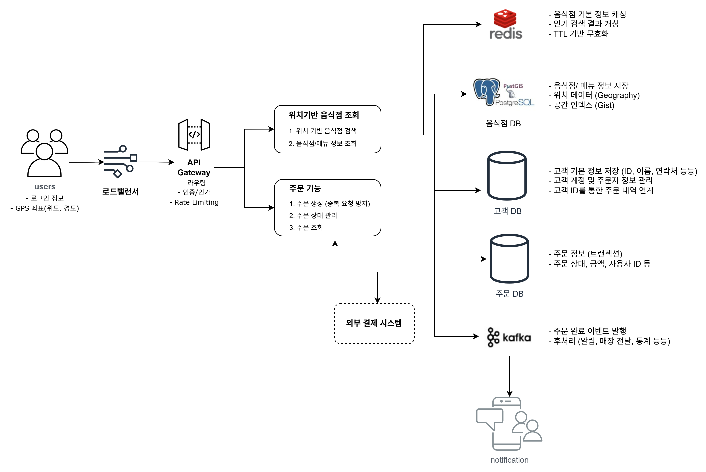

# 10강: 근접 서비스 설계

복습: No

<aside>
💡

근접 서비스: 위치 데이터 기반으로 한 서비스

</aside>

## 10.1 실제 활용 사례

- 승차 공유 서비스: 우버, 리프트, 카카오택시
    - 드라이버 매칭: 승객과 가장 가까운 드라이버 빠르게 찾아  연결
    사용자가 차량 호출 시 시스템 내에서 픽업 위치 주변에 있는 드라이버 찾아 알림 보내 응답 시간, 대기 시간을 줄임
    - 탄력적 요금제: 특정 지역의 수요와 드라이버 수를 반영해 요금 조정
    드라이버 수요 많은 곳에서 운행하도록 유도
- 지역 검색 및 추천 서비스: 옐프, 포스퀘어, 캐치 테이블?
    - 위치 기반 추천: 사용자의 현재 위치를 기반으로 주변 식당, 상점, 관광 명소, 서비스 추천
    사용자 취향, 평점, 리뷰 반영해 맞춤형 장소 골라줌
    - 체크인 및 리워드 프로그램: 위치 기반 체크인 기능으로 친구들에게 현재 방문한 장소 알리거나 근황 공유 가능, 특정 매장이나 장소 방문 이력, 리뷰 남기기
- 음식 배달 서비스: 도어대시, 그럽허브, 배달의 민족, 요기요, 쿠팡이츠
    - 배달 경로 최적화: 배달 기사가 여러 목적지를 가장 효율적으로 돌 수 있는 경로 찾아 배달 시간 줄이고 업무 효율 높이기
    - 실시간 위치 추적: 음식 준비, 픽업 여부, 배달 진행 상황 등을 실시간으로 확인 가능
    → 단계별로 정확하게 업데이트 받을 수 있어 서비스 신뢰도가 높아짐
- 소셜 네트워킹 및 데이팅 앱: 틴더
    - 위치 기반 매칭: 근처에 있는 사람들과 연결될 수 있도록 도움
    주변에 있는 프로필 확인하고 대화 나누거나 만남 주선 가능
    - 이벤트 및 장소 탐색: 주변에서 열리는 행사, 모임, 인기 있는 장소를 쉽게 찾아 볼 수 있음
    관심사와 위치 바탕으로 새로운 사람과의 자연스러운 소통, 관계 만들 수 있음
- 네비게이션 및 지도 서비스: 구글 맵, 카카오 맵, 네이버 지도
    - 실시간 경로 안내: 위치 정보 기반으로 실시간 경로 안내 제공
    - 교통 상황 및 사고 알림: 주변 교통 상황 실시간으로 파악해 정체 구간, 사고, 도로 폐쇄 등 정보 알려주고 우회 경로 안내해 교통 지연 최소화함
- 피트니스 및 건강 추적 앱
    - 위치 기반 활동 추적: 달리기, 자전거 타기, 걷기 등 활동을 기록, 분석
    - |주변의 인기 코스 안내, 개인 맞춤 운동 추천

### ***내 주변 음식점 찾기, 주문하기 서비스 구현***

10.1.1 기능적 요구사항

- 자신의 위치 기준으로 주변 음식점 검색
- 음식점 선택해 주문 할 수 있어야 함

10.1.2 비기능적 요구 사항

- 가용성: 서비스가 되도록 높은 가용성을 유지해야 함
- 확장성: 대규모 트래픽(사용자 1억명)을 처리할 수 있도록 확장 가능해야 하며 요청 폭주하는 상황도 감당할 수 있어야 함
- 지연 시간: 음식점 메뉴는 자주 바뀌지 않고 영업 시간도 한번 정하면 잘 안바뀌므로 쓰기 요청은 많지 않음. 하지만 읽기 요청의 지연 시간은 200ms 이내

## 10.2 API 설계

1. 위치 정보로 음식점 조회
    
    ```cpp
    GET	/restaurants/search?lat=37.7749&long=122.4194&distance=5
    Response:	[	
    				{	
    								"restaurantId":	"78566",	
    								"name":	"ABC_Italian",	
    								"location":	"123	Castro	St,	San	Francisco,	CA	94056",	
    								"cuisine":	"Italian",	
    								"rating":	4.9,	
    								"distance":	2	miles	
    				},	{	
    								"restaurantId":	"45678",	
    								"name":	"DEF_Mexican",	
    								"location":	"123	Main	St,	San	Francisco,	CA	94056",	
    								"cuisine":	"Mexican",	
    								"rating":	4.5,	
    								"distance":	3	miles	
    				}	...	
    ]
    ```
    
2. 주문하기
    
    ```cpp
    POST	/orders/place
    Request:	{	
    				"userId":	"12345",	
    				"restaurantId":	"78566",	
    				"items":	[	
    								{	
    												"itemId":	"item1",	
    												"quantity":	4	
    								},	
    								{	
    												"itemId":	"item2",	
    												"quantity":	3	
    								}	
    				],	
    				"paymentMethod":	"credit_card"	
    }	
    	
    Response:	{	
    				"orderId":	"6689092",	
    				"message":	"Thanks	for	ordering	with	us!",	
    				"Bill	Amount":	$75.92	
    }
    ```
    

## 10.3 계산으로 문제 규모 파악

- 예상 사용자 수: 약 1억 명
- 예상 DAU(하루 동안 이용한 활성 사용자 수): 전체 사용자의 10%로, 하루에 1000만 명입니다.
- DAU로 미루어 짐작할 수 있는 QPS(초당 쿼리 수): 대부분이 점심과 저녁 시간에 음식을 주문한다고 가정하면 주문은 점심 3시간, 저녁 3시간 동안 들어옵니다. 
즉, 사용자 1000만 명이 6시간 동안 주문한다면 QPS = 1000만 / (6×60×60) ≈ 1200QPS 정도로 추산할 수 있겠습니다.
- 트래픽이 폭주할 때 들어오게 될 요청 수: 다섯 배 정도로 가정하면 적당할 듯합니다. 
즉, 5×1200 ≈ 6000QPS입니다.
- 음식점 탐색이나 검색을 하는 사용자 수: 사용자 1000만 명이 1인당 다섯 번 검색한다고 가정하면 검색 QPS는 주문 QPS의 다섯 배로 6000QPS입니다.
- 앱에 등록된 음식점 수: 전 세계에 음식점이 1000만 개 있고, 이 중 100만 개가 현재 주문을 받을 수 있는 상태라고 가정해 보겠습니다. 음식점 데이터는 자주 바뀌지 않습니다

# 시스템 설계

<aside>
💡

[설계 주요 고려사항]

1. 위치 기반 음식점 조회
사용자 위치와 가까운 음식점을 어떻게 효율적으로 검색할 것인가
2. 주문 기능
데이터 정합성, 중복 주문 방지, 결제 결과에 따른 정확한 상태 관리
→ 사용자에게 직결되는 문제
</aside>



## 1. 아키텍처 구성

**사용자 → Load Balancer → API Gateway → 검색 서비스 / 주문 서비스**

**Load Balancer**

- 점심·저녁 시간대에 트래픽이 집중될 가능성을 고려
- 여러 서버 인스턴스로 요청을 분산하여 특정 서버에 부하가 집중되는 상황 방지

**API Gateway**

- 서비스별 요청 라우팅
- 인증 및 인가
- Rate Limiting을 통한 과도한 요청 제한
- 검색 API와 주문 API의 특성에 따라 요청 제한 정책 차등 적용 가능

검색과 주문은 성능 및 데이터 정합성에 대한 요구사항이 다르므로 별도 서비스로 분리한다.

---

## 2. 음식점 검색 서비스

### 2.1 위치 기반 음식점 검색 — PostgreSQL + PostGIS

**요구사항**

사용자의 위도, 경도, 검색 반경을 전달받아 해당 반경 내에 위치한 음식점 목록을 반환한다.
약 1,000만 개의 음식점 데이터와 피크 6,000 QPS를 가정하므로, 대규모 위치 데이터를 효율적으로 검색하는 것이 중요하다.

**일반적인 RDBMS 검색의 한계**

위도와 경도를 일반 숫자 컬럼에 저장한 뒤 모든 음식점과의 거리를 계산하는 방식은 데이터 규모가 커질수록 연산 비용이 증가한다.

B-tree 인덱스를 이용하면 위도와 경도의 범위를 좁힐 수 있지만, 기본적으로 정렬된 값이나 범위 검색에 적합하므로 2차원 공간 검색에 직접 최적화된 방식은 아니다.

예를 들어 반경 5km 검색 시 위도·경도의 사각형 범위로 후보를 좁히더라도 실제 원형 검색 반경에 포함되는지 추가 계산이 필요하다.

### 2.2 PostGIS란?

**PostGIS는 PostgreSQL에서 위치 및 공간 데이터를 처리할 수 있도록 지원하는 오픈소스 확장 기능이다.**

- 위도·경도 등의 공간 데이터를 전용 자료형으로 저장
- 공간 인덱스를 이용한 효율적인 위치 검색
- 거리 계산, 반경 검색, 공간적 포함 관계 등 다양한 함수 제공
- 기존 PostgreSQL의 일반 데이터와 공간 데이터를 함께 관리 가능

PostGIS는 오랫동안 GIS 분야에서 활용되어 온 기술로, 별도의 공간 데이터베이스를 구축하지 않고 PostgreSQL 환경에서 공간 검색 기능을 확장할 수 있다는 장점이 있다.

**대표 자료형**

- `geometry`: 평면 좌표계 기반 공간 연산
- `geography`: 지구의 곡률을 고려하는 지리 좌표 기반 연산으로, 미터 단위 거리 검색에 활용 가능

### 2.3 GiST 공간 인덱스

PostGIS에서는 GiST(Generalized Search Tree) 인덱스를 이용해 공간 검색을 효율적으로 수행할 수 있다.

**작동 원리**

1. 공간 객체를 둘러싸는 경계 영역(Bounding Box)을 활용해 인덱싱
2. 검색 범위와 겹칠 가능성이 있는 영역을 우선 탐색
3. 검색 범위와 관련 없는 영역은 탐색 대상에서 제외
4. 후보 데이터에 대해 실제 공간 조건을 확인

예를 들어 강남역 반경 5km를 검색할 때, 전체 음식점을 대상으로 거리 계산을 수행하는 대신 공간 인덱스를 통해 강남역 주변의 후보를 우선적으로 탐색할 수 있다.

**B-tree와 GiST 비교**

| 항목 | B-tree | GiST 공간 인덱스 |
| --- | --- | --- |
| 주요 목적 | 값 및 범위 검색 | 공간적 관계 검색 |
| 검색 기준 | 정렬된 값 | 공간 영역 및 겹침 관계 |
| 위치 검색 | 좌표 범위 필터링 가능 | 공간 영역 기반 후보 탐색 |
| 반경 검색 | 별도 거리 계산 필요 | 공간 인덱스와 거리 함수 연계 |

### 2.4 ST_DWithin()을 이용한 반경 검색

`ST_DWithin()`은 두 공간 객체 사이의 거리가 지정한 거리 이내인지 확인하는 함수이다.

예를 들어 사용자가 반경 5km 이내의 음식점을 요청하면 다음과 같이 검색할 수 있다.

```sql
SELECT id, name
FROM restaurants
WHERE ST_DWithin(
    location,
    ST_SetSRID(ST_MakePoint(:longitude, :latitude), 4326)::geography,
    5000
);
```

위 예시는 `location` 컬럼이 `geography(Point, 4326)` 자료형이고, 해당 컬럼에 GiST 인덱스가 생성되어 있다고 가정한다.

- `ST_MakePoint()`: 경도와 위도를 이용해 위치 좌표 생성
- `ST_SetSRID()`: 좌표계 지정
- `ST_DWithin()`: 5,000m 이내에 포함되는지 판별

GiST 인덱스를 통해 검색 후보를 줄이고, 최종 거리 조건을 확인해 결과를 반환한다.

**PostGIS 선택 이유**

대규모 음식점 데이터에서 불필요한 탐색과 거리 계산을 줄일 수 있고, PostgreSQL을 통해 일반 음식점 정보와 공간 데이터를 통합 관리할 수 있기 때문이다.

단, 피크 6,000 QPS 처리 가능 여부는 인덱스뿐 아니라 데이터 분포, 검색 반경, DB 인스턴스 및 캐시 구성에 따라 달라지므로 별도의 부하 테스트가 필요하다.

### 2.5 음식점 및 메뉴 정보 조회 — Redis

음식점 이름, 주소, 음식 종류, 메뉴 등은 반복적으로 조회되는 반면 변경 빈도는 상대적으로 낮다.

따라서 반복적인 DB 접근을 줄이기 위해 Redis 캐싱을 적용한다.

**Cache-aside 패턴**

1. 요청 시 Redis에서 해당 음식점 정보 조회
2. Cache Hit → Redis 데이터 반환
3. Cache Miss → PostgreSQL에서 조회
4. 조회 결과를 Redis에 저장한 후 반환

**기대 효과**

- 반복적인 음식점 및 메뉴 정보 조회에 대한 DB 부하 감소
- 캐시 적중 시 응답 시간 단축
- 피크 트래픽 대응에 유리

**데이터 최신성 관리**

- TTL을 통한 캐시 만료
- 음식점 정보 및 메뉴 변경 시 캐시 무효화

PostGIS는 위치 기반 검색을 담당하고, Redis는 검색된 음식점의 상세 정보를 빠르게 제공하는 역할로 구분한다.

---

## 3. 주문 서비스

### 3.1 주문 생성 및 검증

**주문 처리 흐름**

사용자 주문 요청 → 사용자 정보 검증 → 메뉴 및 가격 검증 → 주문 DB 저장 → 외부 결제 연동

주문 서비스에서는 클라이언트가 전달한 주문 정보를 그대로 신뢰하지 않고 서버에서 검증한다.

- 주문자 정보 확인
- 메뉴 존재 여부 확인
- 메뉴 가격 및 주문 가능 상태 확인
- 최종 결제 금액 계산

검증이 완료되면 주문 및 주문 메뉴 정보를 DB에 저장한다.

### 3.2 멱등성 키를 통한 중복 주문 방지

사용자가 주문 버튼을 여러 번 누르거나 네트워크 문제로 동일한 요청이 재전송될 수 있다.

이를 방지하기 위해 하나의 주문 시도에 고유한 멱등성 키를 적용한다.

- 동일한 키의 요청이 반복되면 기존 주문 결과를 확인
- 동일 주문이 여러 번 생성되는 상황 방지
- Rate Limiting과 별도로 주문 데이터의 중복 생성 방지

### 3.3 주문 상태 및 결제 관리

주문 이후 각 단계에서 발생할 수 있는 실패나 응답 지연을 고려해 주문 상태를 구분하여 관리한다.

- `PENDING`: 주문 생성 후 결제 대기
- `PAID`: 결제 성공
- `FAILED`: 결제 실패

외부 결제 시스템으로부터 결과를 전달받아 주문 상태를 변경하며, 결제 결과가 불확실한 경우에는 상태를 재확인하는 과정이 필요하다.

### 3.4 주문 DB — RDBMS

주문 데이터는 주문 정보, 주문 메뉴, 결제 금액, 주문 상태 등이 서로 연관되어 있으므로 **데이터 정합성 보장**이 중요하다.

**RDBMS 선택 이유**

- 트랜잭션을 통한 주문 데이터의 일관성 유지
- 주문 및 주문 메뉴 정보의 관계 관리
- 주문 ID를 기준으로 주문 조회 및 상태 변경
- 주문 당시 가격과 최종 결제 금액 보존

검색 서비스가 조회 성능을 우선한다면, 주문 서비스는 데이터의 정확성과 안정성을 우선한다.

---

## 4. Kafka 기반 비동기 이벤트 처리

### 4.1 주문 완료 이벤트 처리

**처리 흐름**

결제 성공 → 주문 상태 `PAID` 변경 → Kafka에 `OrderCompleted` 이벤트 발행 → 알림 서비스에서 이벤트 소비 → 사용자 및 음식점에 알림 전송

주문 서비스에서 알림을 직접 처리하지 않고 Kafka를 통해 비동기로 전달하도록 구성한다.

### 4.2 Kafka 선택 이유

**서비스 간 결합도 감소**

- 주문 서비스와 알림 서비스를 분리
- 알림 전송이 완료될 때까지 주문 서비스가 기다릴 필요 없음

**장애 대응**

- 알림 서비스에 장애가 발생해도 주문 처리와 분리 가능
- Kafka에 보관된 이벤트를 이후 재처리 가능

**확장성**

- 주문 완료 이벤트를 통계 및 매출 분석 등 다른 서비스에서도 활용 가능
- 새로운 이벤트 소비자를 추가하기 용이

### 4.3 데이터 정합성 고려

주문 DB에는 결제 완료로 저장됐지만, Kafka 이벤트 발행에 실패하면 알림이 누락될 수 있다.

이를 방지하기 위해 Transactional Outbox 패턴을 고려할 수 있다.

- 주문 상태 변경과 이벤트 정보를 같은 DB 트랜잭션으로 저장
- 저장된 이벤트 정보를 별도로 Kafka에 전송
- Kafka 전송에 실패하더라도 DB에 기록이 남아 있어 재전송 가능