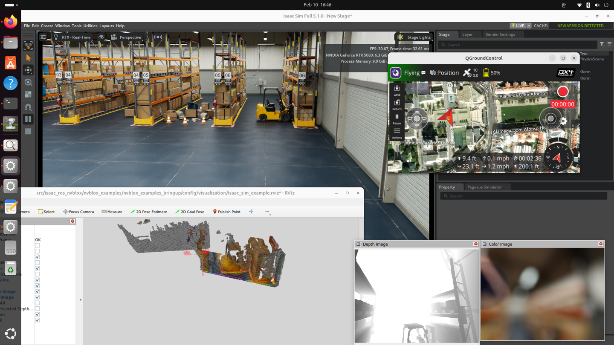
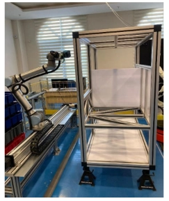

# 7강: 발표자료

강의 번호: 요즘 개발자를 위한 시스템 설계 수업
유형: 섹션
복습: No

# ROS vs Kafka? ROS x Kafka?

## 1. ROS란?

### 1.1 ROS의 개념

ROS(Robot Operating System)는 로봇 소프트웨어를 개발하기 위한 오픈소스 프레임워크

- 이름에는 Operating System이 포함되어 있지만 Windows나 Linux처럼 하드웨어와 프로세스를 직접 관리하는 일반적인 운영체제는 아님
- 로봇을 구성하는 여러 소프트웨어가 서로 통신하고 협력할 수 있도록 공통 인터페이스와 개발 도구를 제공

로봇은 일반적으로 하나의 프로그램만으로 동작하지 않음
카메라에서 영상을 가져오는 프로그램, 영상에서 객체를 인식하는 프로그램, 로봇의 위치를 계산하는 프로그램, 모터를 제어하는 프로그램 등이 함께 실행됨
→ 이 모든 기능을 하나의 프로그램에 구현하면 기능을 수정하거나 교체하기 어렵고, 특정 기능의 문제가 전체 시스템에 영향을 미치기 쉬움

⇒ ROS는 각 기능을 **Node라는 독립적인 실행 단위로 나누고, 노드들이 메시지를 주고받으며 협력하도록 설계함**

[IsaacSim 위에서 Nvblox 실행 결과]




- **Stereo Camera / Depth Camera (센서 데이터 발행)**: Isaac Sim 환경에서 좌우 카메라 영상과 Depth Image, Camera Info 등의 데이터를 ROS Topic으로 발행
스테레오 영상은 Visual SLAM의 위치 추정에, 깊이 영상은 Nvblox의 3D 지도 생성에 활용된다.
- **Visual SLAM Node (`visual_slam_node`)**: 스테레오 카메라 영상을 이용해 주변 환경의 특징점을 추출하고, 이를 기반으로 로봇의 위치와 자세(Pose)를 추정
- **Nvblox Node (`nvblox_node`)**: Visual SLAM에서 추정한 로봇의 위치·자세 정보와 Depth Camera에서 관측한 깊이 정보를 결합하여 주변 환경을 밀집된 3D 지도로 재구성함.

각 노드는 서로의 내부 구현을 모두 알 필요 없이 정해진 메시지 형식으로 통신한다. 이를 통해 로봇 소프트웨어를 모듈화하고 기능별로 개발·테스트할 수 있다.

### 1.2 ROS의 핵심 통신 방식: Topic

ROS에서 노드들이 데이터를 주고받는 대표적인 방법은 **Publisher–Subscriber(Pub/Sub)** 방식이다.

- **Publisher**: 메시지를 발행하는 노드
- **Topic**: 메시지가 전달되는 논리적인 통신 채널
- **Subscriber**: 특정 Topic을 구독해 메시지를 받는 노드

### 예시: 카메라 영상 전달

```
Camera Node
    │
    │ Publish
    ▼
/camera/image
    │
    │ Subscribe
    ▼
Visual SLAM Node
```

카메라 노드는 `/camera/image` Topic에 영상을 발행한다.

Visual SLAM 노드는 해당 Topic을 구독해 영상을 전달받고, 이를 이용해 로봇의 위치를 추정한다.
여기서 중요한 점은 **카메라 노드가 Visual SLAM 노드를 직접 호출하지 않는다는 것**이다.

카메라 노드는 정해진 메시지 타입으로 데이터를 발행하기만 하면 된다. 
이를 구독하는 노드가 Visual SLAM인지, 다른 영상 처리 노드인지는 알 필요가 없다.

웹 개발에서 서비스 간 의존성을 낮추기 위해 메시지 기반 통신을 사용하는 것과 비슷하다.

---

## 2. ROS와 Kafka는 무엇이 다른가?

### 2.1 둘 다 Pub/Sub인데, 왜 다른 기술일까?

ROS 2와 Apache Kafka는 모두 메시지를 발행하고 구독하는 구조를 사용한다.

하지만 **메시지를 전달하는 목적**이 다르다.

- **ROS 2**: 로봇의 노드들이 현재 필요한 데이터를 교환하고 동작을 조정하기 위한 통신
- **Kafka**: 발생한 이벤트를 기록하고, 여러 시스템에서 활용할 수 있도록 하는 데이터 스트리밍

예시) 로봇이 장애물을 감지

**ROS 2:** 장애물 감지 노드가 장애물의 위치와 거리 정보를 발행 → 제어 노드는 해당 정보를 받아 로봇을 정지시키거나 경로를 변경할 수 있음.
⇒ **지금 로봇이 어떻게 움직여야 하는가?**

**Kafka:** 장애물 감지 이벤트를 기록하고, 모니터링 시스템이나 분석 시스템이 해당 데이터를 읽도록 할 수 있음.
⇒ **어디에서 장애물이 자주 발생했는가? 지난 일주일간 몇 번 발생했는가?**

같은 데이터를 사용하더라도 ROS는 로봇의 현재 동작에, Kafka는 이벤트의 기록과 활용에 초점을 맞춘다.

## 2.2 ROS Topic과 Kafka Topic의 구조적 차이

두 기술 모두 Topic이라는 이름을 사용하지만, 내부 구조적 차이가 있다

### ROS 2: 메시지를 전달하는 통신 채널

ROS 2 Topic은 노드 간 데이터를 전달하는 논리적인 채널이다.

일반적인 DDS 기반 ROS 2 환경에서는 Publisher와 Subscriber가 미들웨어를 통해 데이터를 주고받는다.

```
Publisher Node
      │
      │ ROS Topic
      ▼
Subscriber Node
```

이 과정에서 Kafka처럼 중앙 Broker에 모든 메시지를 저장할 필요는 없다.

ROS 2는 QoS 설정을 통해 전달 신뢰성과 제한적인 메시지 이력을 관리할 수 있지만, 일반적인 Topic 통신은 **노드 간 데이터 교환**을 목적으로 한다.

### Kafka: 메시지를 기록하는 이벤트 로그

Kafka에서는 Producer가 발행한 이벤트가 Broker의 Topic에 저장된다.
Topic은 여러 Partition으로 나뉠 수 있고, 각 Partition에 기록된 메시지에는 순서대로 Offset이 부여된다.

```
Producer
    │
    ▼
Kafka Broker
    │
    └── Topic: robot-events
          └── Partition 0
                Offset 0 → 이벤트 A
                Offset 1 → 이벤트 B
                Offset 2 → 이벤트 C
    │
    ▼
Consumer
```

Consumer는 Offset을 기준으로 이벤트를 읽는다.

중요한 점은 **Consumer가 이벤트를 읽어도 Kafka에서 즉시 삭제되지 않는다는 것**
설정된 보관 기간 내에서는 과거 이벤트를 다시 읽을 수 있다.

### 이 차이가 왜 중요할까?

ROS 2에서는 감지된 장애물 정보를 제어 노드에 전달하는 것이 중요하다.

반면 Kafka에 장애물 감지 이벤트를 저장하면 다음과 같은 작업이 가능하다.

- **모니터링 서비스**: 현재 장애물 발생 현황 확인
- **분석 서비스**: 특정 구역의 장애물 발생 빈도 계산
- **이력 관리 서비스**: 로봇의 과거 운행 기록 저장

각 서비스는 서로 다른 Consumer Group으로 동일한 이벤트를 독립적으로 읽을 수 있다.
또한 분석 서비스가 일시적으로 중단되더라도, Kafka에 보관된 이벤트를 나중에 다시 처리할 수 있다.
즉, Kafka는 단순히 메시지를 전달하는 것에서 나아가 **저장, 재처리, 여러 서비스의 독립적인 데이터 소비**를 지원한다.

## 2.3 그렇다면 Kafka가 ROS를 대체할 수 있을까?

기술적으로 Kafka를 통해 로봇 상태나 제어 명령을 전달하는 시스템을 만들 수는 있지만 모든 로봇 통신을 Kafka로 대체하는 것은 적절하지 않음

로봇의 모터 제어, 충돌 회피, 안전 관련 기능은 일정한 시간 안에 데이터가 전달되고 처리되는 것이 중요하기 때문에 지연 시간과 지터(Jitter, 데이터가 전달되는 데 걸리는 시간이 매번 바뀌는 현상)에 민감함 

Kafka는 이벤트 저장과 분산 처리에 강점이 있지만, 엄격한 실시간 제어에 필요한 결정적인 지연 시간을 보장하는 기술은 아니다.

따라서 두 기술은 다음과 같이 역할을 나눌 수 있다.

- **ROS 2**: 센서 데이터 교환, 위치 추정, 로봇 제어를 위한 통신
- **Kafka**: 로봇 이벤트 수집, 이력 저장, 데이터 분석, 외부 시스템 연계

### 결론

**ROS 2와 Kafka는 서로를 대체하는 기술이 아니라, 서로 다른 역할을 수행하는 기술이다.**

ROS 2가 로봇 내부의 노드들을 연결한다면, Kafka는 로봇에서 발생한 데이터를 외부 시스템에서 활용할 수 있도록 연결한다.


---

# 3. ROS 2 × Kafka: 실제 연구 기반 데이터 파이프라인 설계

실제 산업용 로봇 디지털 트윈 연구를 통해 두 기술을 어떻게 연결했는지, 그리고 연구진이 어떤 요구사항을 고려해 시스템을 설계했는지 알아보기

## 3.1 연구 배경: 왜 ROS 2와 Kafka를 연결했을까?

**참고 논문**

[*Real-Time Big Data Pipelines for Industrial Robot Digital Twins: An OMPL Benchmarking Framework*](https://www.mdpi.com/2075-1702/14/6/702)

### 연구에서 해결하려는 문제

산업용 로봇의 디지털 트윈(Digital Twin): 실제 로봇의 움직임과 상태를 가상 환경에 반영하여 모니터링하고 분석하는 기술

이 연구에서는 **UR10e 산업용 로봇과 Gazebo 시뮬레이션 환경**을 활용하여 실제 로봇과 가상 로봇의 동작을 비교하고, 데이터를 수집·분석하는 파이프라인을 구성했다.




이때 로봇에서는 관절의 위치와 속도, 힘·토크 등 다양한 데이터가 지속적으로 발생한다.

이 데이터를 활용하려면 단순히 로봇 내부에서 전달하는 것만으로는 부족하다.

- 로봇의 현재 상태를 모니터링해야 한다.
- 실제 로봇과 시뮬레이션 결과를 비교해야 한다.
- 수집한 데이터를 저장하고 이후 실험에서 다시 분석할 수 있어야 한다.

이를 위해 연구에서는 **ROS 2를 로봇 통신 계층으로, Kafka를 외부 데이터 스트리밍 계층으로 활용하는 구조**를 구성했다.

## 3.2 시스템 아키텍처: 데이터는 어떻게 이동할까?


```
UR10e / Gazebo
      │
      │ 관절 상태, 힘·토크 데이터
      ▼
ROS 2 Topics
      │
      │ Subscribe
      ▼
ROS 2–Kafka Bridge
      │
      │ ROS 메시지 → JSON 변환
      │ Kafka Producer
      ▼
Apache Kafka
      │
      │ Consumer
      ▼
데이터 처리 및 저장
      │
      ├── Elasticsearch / Grafana
      │      실시간 데이터 조회 및 시각화
      │
      └── MariaDB / CSV
             실험 데이터 저장 및 분석
```

### ① ROS 2: 로봇 데이터 발행

ROS 2에서는 로봇의 상태 정보를 Topic으로 발행한다.

- `/dynamic_joint_states`: 로봇 관절의 상태 정보
- `/force_torque_sensor_broadcaster/wrench`: 힘과 토크 센서 데이터

이 데이터는 로봇의 동작을 관찰하고 실제 로봇과 디지털 트윈을 비교하는 데 사용된다.

### ② ROS 2–Kafka Bridge: 두 시스템 연결

ROS 2와 Kafka는 같은 Pub/Sub 개념을 사용하지만, 메시지 형식과 통신 방식이 다르다.

따라서 ROS Topic의 메시지가 Kafka에 자동으로 전달되는 것은 아니다.

연구에서는 이를 연결하기 위해 **Python 기반 ROS 2–Kafka Bridge**를 사용했다.

Bridge는 다음 작업을 수행한다.

1. ROS 2 Topic을 구독하여 메시지를 수신한다.
2. 수신한 ROS 메시지를 JSON 형태로 변환한다.
3. Kafka Producer를 통해 Kafka Topic으로 전송한다.

즉, Bridge는 **ROS 2 Subscriber이면서 Kafka Producer 역할**을 수행한다.

### ③ Kafka: 데이터를 외부 시스템으로 전달

Kafka는 Bridge에서 전달받은 이벤트를 Topic에 기록한다.
이후 외부 시스템은 Kafka Consumer를 통해 데이터를 읽는다.

여기서 중요한 점은 로봇이 Elasticsearch나 MariaDB에 직접 데이터를 전송할 필요가 없다는 것이다.

Kafka를 중간에 두면 **데이터 생산자와 소비자를 분리**할 수 있고, 여러 시스템이 동일한 데이터 스트림을 각자의 목적에 맞게 처리하도록 구성할 수 있다.

### ④ 데이터 저장 및 시각화

수집된 데이터는 목적에 따라 다른 시스템에서 활용된다.

- **Elasticsearch / Grafana:** 시간에 따라 변화하는 로봇 상태를 조회하고 시각화
- **MariaDB:** 구조화된 실험 데이터 저장
- **CSV:** 후속 분석 및 외부 도구에서 데이터 재사용

Kafka는 데이터를 전달하고 일정 기간 보관하는 스트리밍 계층이며, Elasticsearch와 MariaDB는 데이터를 조회하고 분석하는 계층이다.

**핵심:** ROS 2 → Bridge → Kafka → 저장·분석 시스템으로 이어지는 구조를 통해 로봇 내부 통신과 외부 데이터 처리를 분리했다.

---

## 3.3 ROS2 → Kafka 핵심 설계 고려 사항

로봇 데이터는 짧은 주기로 지속적으로 발생하기 때문에 **지연 시간, 메시지 전달 방식, 데이터 동기화** 등을 고려해야 한다.

### 설계 ① 높은 데이터 발생 빈도와 Kafka 전송 지연

**문제: 로봇에서 빠르게 발생하는 데이터를 어떻게 지연 없이 전달할까?**

연구에서는 로봇 데이터를 **50Hz**, 즉 약 **20ms 간격**으로 수집했다.

Kafka Producer는 여러 메시지를 잠시 모아서 한 번에 전송하는 배치 방식을 사용할 수 있다.
배치 전송은 처리량 측면에서 유리하지만, 메시지가 모이기를 기다리는 시간이 추가될 수 있다.

연구에서는 이러한 대기 시간을 줄이기 위해 Kafka Producer의 다음 설정을 사용했다.

`linger.ms = 0`

`linger.ms`는 Producer가 메시지 배치를 전송하기 전에 추가 메시지를 기다릴 수 있는 최대 대기 시간을 의미한다.

- `linger.ms = 0`: 배치를 위한 추가 대기 시간을 최소화
- `linger.ms = 10`: 최대 10ms의 배치 대기를 허용

**⇒ 배치 효율보다 전송 지연을 줄이는 방향으로 설정을 선택**

다만 `linger.ms=0`이 Kafka의 전체 전송 시간을 0ms로 만든다는 의미는 아니다. 네트워크, Broker 기록, Consumer 처리 등의 지연은 별도로 존재한다.

**설계 포인트:** 데이터의 발생 주기와 처리 목적에 따라 Kafka Producer 설정을 선택해야 한다.

### 설계 ② ROS 2의 메시지 전달 신뢰성

**문제: 센서 데이터가 빠르게 들어올 때, 모든 메시지를 재전송하는 것이 항상 좋을까?**

ROS 2는 QoS(Quality of Service)를 통해 메시지 전달 방식을 설정할 수 있다.
연구에서는 고주파 센서 데이터에 Sensor_Data QoS의 `Best_Effort` 신뢰성 설정을 활용했다.

대표적인 신뢰성 정책은 다음과 같다.

- **Reliable:** 전달 실패 시 재전송 등을 통해 신뢰성 있는 전달을 시도
- **Best_Effort:** 메시지 전달을 시도하지만 손실된 메시지의 재전송을 보장하지 않음

센서 데이터가 지속적으로 새로 생성되는 상황에서는 이전 데이터를 재전송하는 것보다 **최신 데이터를 빠르게 전달**하는 것이 중요하기 때문에 `Best_Effort`를 선택함

ROS 2 단계에서 재전송을 보장하지 않았기 때문에 Kafka가 데이터를 안정적으로 저장하더라도, ROS 2 구간에서 유실된 메시지는 복구할 수 없음. 따라서 두 시스템을 연결할 때는 각 구간의 전달 보장 수준을 함께 고려해야 함

### 설계 ③ 실시간 조회와 실험 데이터 저장의 분리

**문제: 같은 로봇 데이터를 모니터링과 장기 분석에 모두 사용하려면?**

실시간 대시보드와 실험 데이터 분석은 데이터 사용 방식이 다르다.
대시보드는 최신 상태를 빠르게 조회해야 하고, 실험 분석은 과거 데이터를 구조적으로 저장하고 비교할 수 있어야 한다.

연구에서는 Elasticsearch/Grafana와 MariaDB 등을 활용하여 데이터 활용 목적을 구분했다.
이 구조에서 Kafka를 사용하는 장점은 **하나의 데이터 스트림을 여러 처리 시스템으로 연결할 수 있다는 것**이다.

새로운 분석 시스템을 추가할 때도 로봇의 ROS 2 Node를 직접 수정하는 대신 Kafka Consumer를 추가하는 구조를 고려할 수 있다.

---

## 3.4 실제 운영 환경으로 확장한다면?

그렇다면 이 아키텍처를 여러 대의 로봇이 운영되는 스마트 팩토리로 확장한다면 어떤 문제를 추가로 고려해야 할까?

### ① Consumer Lag: 데이터를 처리하는 속도가 느려진다면?

- Kafka 입력: 1,000 events/s
- 분석 Consumer 처리량: 600 events/s
- 초당 400개씩 처리 대기 이벤트 증가

이렇게 Consumer가 아직 처리하지 못한 데이터가 쌓이는 현상을 **Consumer Lag 증가**라고 함
단순히 Consumer를 추가하면 될 것 같지만, **로봇별 이벤트의 순서를 유지해야 함**

예를 들어 7번 로봇의 상태가 다음 순서로 발생했다고 해보자.

```
robot-07
10:00:00  MOVING
10:00:01  OBSTACLE_DETECTED
10:00:02  STOPPED
```

이벤트가 순서대로 처리되지 않으면 관제 시스템에서 로봇이 이미 정지했는데도 이동 중이라고 표시할 수 있다.

**설계: `robot_id`를 Partition Key로 사용**

Kafka Producer에서 메시지를 발행할 때 로봇 ID를 Key로 지정한다.

```python
producer.produce(
    topic="robot-status",
    key="robot-07",
    value=json.dumps(event)
)
```

Kafka의 기본 키 기반 Partition 할당 방식에서는 동일한 Key를 가진 이벤트가 동일한 Partition으로 전달된다.
따라서 안정적인 Partition 구성 아래에서 **같은 로봇의 이벤트 순서를 Partition 내 기록 순서로 유지**할 수 있다.

```
Kafka Topic: robot-status

Partition 0
  robot-07: MOVING
  robot-07: OBSTACLE_DETECTED
  robot-07: STOPPED

Partition 1
  robot-12: MOVING
  robot-12: CHARGING

Partition 2
  robot-21: MOVING
  robot-21: STOPPED
```

### ② Retry와 Idempotency: 메시지가 중복되면?

OS 2–Kafka Bridge가 로봇의 장애 이벤트를 Kafka에 전송했다고 가정

```
1. ROS 2 → Bridge: 장애 이벤트 발생
2. Bridge → Kafka: 이벤트 전송
3. Kafka: 이벤트 기록 성공
4. Kafka → Bridge: **ACK 응답 유실**
5. Bridge: 전송 실패로 판단하고 **재시도**
```

이때 Kafka에는 동일한 장애 이벤트가 두 번 기록될 가능성이 있음

**설계 A: Kafka Producer의 멱등성 활성화**

```python
producer = Producer({
    "bootstrap.servers": "localhost:9092",
    "enable.idempotence": True,
    "acks": "all"
})
```

`enable.idempotence=true`는 Kafka Producer의 재시도로 인해 동일한 레코드가 중복 기록되는 문제를 방지하기 위한 기능이다.

Bridge가 애플리케이션 수준에서 동일한 이벤트를 새 메시지로 다시 발행하는 경우까지 자동으로 제거하지는 않음(의도된 메시지)

**설계 B: 이벤트에 고유 ID 부여**

```json
{
  "event_id": "robot-07-error-1024",
  "robot_id": "robot-07",
  "event_type": "OBSTACLE_DETECTED",
  "timestamp": "2026-10-13T10:00:01Z"
}
```

Consumer에서는 `event_id`를 기준으로 중복 여부를 확인할 수 있다.
예를 들어 DB의 `event_id` 컬럼에 UNIQUE 제약조건을 두고 중복 삽입을 방지할 수 있다.
이 경우 이벤트 저장과 중복 여부 판단을 하나의 DB 트랜잭션으로 처리하도록 설계하는 것이 중요하다.

### ③ Offset과 Replay: Consumer가 중단되면?

로봇 이벤트를 저장하는 Consumer가 Offset 102까지 처리한 상태에서 장애가 발생했다고 가정

```
Kafka Partition

Offset 100  [처리 완료]
Offset 101  [처리 완료]
Offset 102  [처리 완료]
Offset 103  [처리 중 장애]
Offset 104  [미처리]
Offset 105  [미처리]
```

Consumer가 재시작할 때 어디서부터 읽어야 할까?
Kafka는 Consumer Group의 **Committed Offset**을 통해 다음에 읽을 위치를 관리한다.

**설계: 처리 완료 후 Offset 커밋**

```python
consumer = Consumer({
    "bootstrap.servers": "localhost:9092",
    "group.id": "robot-history-service",
    "enable.auto.commit": False,
    "auto.offset.reset": "earliest"
})

consumer.subscribe(["robot-status"])

while True:
    msg = consumer.poll(1.0)

    if msg is None:
        continue
    if msg.error():
        continue

    event = json.loads(msg.value())

    save_to_database(event)
    consumer.commit(message=msg, asynchronous=False)
```

**왜 자동 커밋을 끄는 걸까?**
자동 커밋을 사용하면 애플리케이션의 실제 DB 저장 완료 시점과 Offset 커밋 시점이 일치하지 않을 수 있음
반면 수동 커밋을 사용하면 데이터 처리가 성공한 뒤 다음 읽기 위치를 기록하도록 제어할 수 있음

하지만 이 방식도 완벽하지는 않다.

```
DB 저장 성공
    ↓
Offset 커밋 직전 장애 발생
    ↓
Consumer 재시작
    ↓
동일 이벤트 재처리 가능
```

따라서 앞에서 설명한 `event_id` 기반 중복 방지와 함께 설계하는 것이 좋음

`auto.offset.reset=earliest` : 유효한 Committed Offset이 없는 경우 등의 초기 읽기 위치를 결정하는 설정