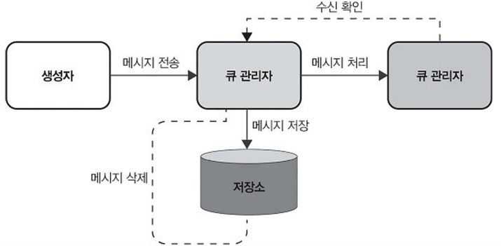

# 7강: 발행/구독과 분산 큐

강의 번호: 요즘 개발자를 위한 시스템 설계 수업
유형: 스터디 그룹
복습: No

<aside>
💡

데이터를 효과적으로 처리하고 배포하기 위한 메시징 패턴

</aside>

## 7.1 분산 시스템의 발전 과정

모놀리식(모든 구성요소가 하나의 서비스안에 연결) → 메시지를 주고받으며 소통하는 마이크로 서비스

분산 큐: 여러 서버에 분산된 큐이며 메시지를 저장하고 전달
메시지를 보낸 순으로 처리하거나 각 메시지가 하나의 소비자만 대상으로 할 때 주로 사용됨

7.1.1 분산 큐 설계

큐 사용 시 이점

- 부하 관리: 메시지 생성자 ↔ 소비자 사이의 완충 역할
메시지 폭증하는 상황에서도 과부하 안걸리게 해줌
- 구성 요소 간 결합도 낮추기: 각 부분이 독립적으로 동작할 수 있음
메시지 생성자와 소비자가 서로의 상태 신경쓰지 않아도 되므로 시스템을 모듈화, 유지 보수성 높일 수 있음
- 신뢰성, 일관성: 메시지가 안전하게 처리 됨, 소비자가 메시지 처리에 실패하더라도 큐가 다시 전달해서 일관성 유지 가능

⇒ 부하를 효과적으로 관리하며, 시스템의 각 구성 요소가 독립적으로 확장되고 안정적으로 동작 할 수 있도록 함

분산 큐 설계 및 구현

- 확장성: 큐가 처리해야 할 작업이나 메시지 크기가 많아도 안정적으로 감당할 수 있어야 함
- 장애 허용성: 일부 시스템에 장애 발생해도 큐는 지속적으로 작동할 수 있어야 함
- 메시지 일관성: 메시지가 한번만 정확히 전달되고, 필요하면 올바른 순서대로 처리되도록 해야 함

분산 큐 주요 특징

- 큐 관리자: 큐에서 메시지 분배를 책임짐
메시지 순서 유지, 적절한 소비자에 전달, 처리에 실패 시 재전송 관리
- 메시지 저장소: 소비자가 메시지 처리하기 전까지 보관되는 공간
높은 신뢰성을 바탕으로 대량의 데이터를 처리할 수 있어야 함
빠른 읽기 및 쓰기 작업으로 메시지 처리 효율적으로 지원할 수 있어야 함
- 로드 밸런싱: 특정 **소비자에 메시지가 몰리는 일 방지**하기 위해 부하 분산해야 함
각 소비자의 현재 작업량 + 처리 능력 고려
- 장애 허용과 복구: 시스템에 문제가 생겨도 정상적으로 작동해야 함
실패한 메시지나 처리 오류 감지하고 메시지를 다시 전달 또는 다른 경로로 보낼 수 있는 기능을 이용해 안정성과 신뢰성을 확보해야 함
- 확장성: 메시지와 소비자가 늘어나더라도 성능 저하 없이 효과적으로 처리하고 확장 가능해야 함



## 7.2 발행/구독 시스템 설계

- 생성자가 토픽에 메시지 발행해 구독자가 토픽을 구독해 메시지를 받아봄
- 여러 소비자가 정보를 동시에 전달하는 데 효과적, 실시간 데이터 처리 시스템에서 사용

7.2.1 주요 특징

- 생성자와 소비자 간의 낮은 결합도: 생성자는 소비자를 알 필요가 없음 → 시스템의 유연성, 확장성이 크게 향상됨
- 확장성과 효율성: 대량의 메시지 처리하고 여러 소비자에 효율적으로 분배할 수 있어 대규모 분산 시스템에 적합함
- 메시지 처리의 유연성: 메시지를 다양한 방식으로 처리할 수 있으므로 실시간 데이터 분석부터 이벤트 기반 아키텍처까지 다양한 활용이 가능함

[아키텍처 관련 특징]

- 토픽 관리: 토픽 생성, 관리, 삭제 방식 명확히 정의해야 함
시스템과 사용자 요구 사항 바뀌며 토픽을 동적으로 생성하거나 삭제하는 방안도 생각해야 함
- 메시지 라우팅: 생성자가 발행한 메시지를 적절한 소비자에 전달할 수 있도록 라우팅 메커니즘을 개발하는 것이 중요
- 소비자 관리: 각 소비자가 어떤 토픽 구독할지 관리하는 것까지 해야 함
관심에 따라 구독 추가, 취소할 수 있도록 유연하게 대응하는 것이 중요
- 서비스 품질 기술: 메시지를 어느 수준까지 보장할지 결정
메시지 최대 한번 보낼지, 최소 한 번 이상 보낼지, 정확히 한번만 보낼지, 메시지 순서 어떻게 관리 할지 등
- 확장성과 로드 밸런싱: 생성자, 소비자 늘어나더라도 원활히 처리 할 수 있도록 확장성 갖추기 → 부하 균등하게 분산 시킬 수 있는 전략 마련하기


다수의 메시지 생성자와 다수의 메시지 소비자가 존재함

7.2.2 발행/구독 시스템을 설계할 때 고려사항

각 서비스가 비동기 방식으로 통신해 이벤트에 즉각적을 대응하게 할 수 있다는 장점
→ 이걸 살리기 위해 **확장성, 신뢰성** 신경 써야 함

[확장성]

- 수평 확장, 수직 확장
    - 수평 확장 선택: 메시지 처리량이 늘어나면 서버를 추가해 시스템 용량을 쉽게 늘려 수요 변동할 대도 대응하기 좋음
    - 수직 확장 선택: 기존 장비에 CPU나 메모리 같은 자원 추가해 단기적으로는 간편하지만 장기적으로는 유연하거나 안정적이지는 않음
- 동적 로드 밸런싱: 주로 메시지 브로커가 로드 밸런싱을 수행해 여러 구독자 사이의 메시지 부하를 골고루 나눔
발행자와 구독자가 분배, 부하 조정 신경 안써도 되며 시스템은 확장하기 쉽고 안정성도 높아짐
메시지 양, 구독자 수요에 따라 브로커가 실시간으로 부하 분산 시켜 특정 노드에 병목 안생기도록 해 성능 유지할 수 있음
- 토픽 파티셔닝: 하나의 토픽을 작고 관리하기 쉬운 여러 파티션으로 나누는 방법
메시지 부하를 시스템 전체에 골고루 분산할 수 있어 처리 성능, 처리량 좋아짐 ⇒ 성능 최적화의 핵심적인 역할

[신뢰성]

- 메시지 전달 보장: 메시지 무결성 확보 위해 다양한 수준의 전달 보장을 구현하는 것이 중요
메시지 최대 한번, 최소 한번, 정확히 한번 전달 되도록 설정 가능
데이터 손실, 중복 처리에 영향 미치며 궁극적으로 사용자가 시스템을 더욱 신뢰할 수 있게함
- 장애 허용성: 데이터를 여러 노드에 복제해 저장, 메시지를 다시 전송할 수 있는 재시도 메커니즘 설계해야 함
- 메시지 순서: 메시지의 순서가 중요한 경우 순서를 정확히 보장해야 함
시스템 설계할 때 메시지의 시간적 순서를 유지할 수 있도록 해야 함
→ 여러 경로를 거치는 분산 환경에서는 더욱 복잡해짐

#### 소비자 관리, 메시지 라우팅

- 소비자 등록 및 관리: 소비자가 특정 토픽을 구독하거나 구독 취소하고 구독 상태를 쉽게 관리할 수 있도록 지원
- 효율적인 메시지 라우팅: 메시지를 적절한 소비자에 전달하며 지연 시간 최소화하고 자원을 효율적으로 사용할 수 있는 알고리즘 설계하기

#### 서비스 품질 수준

서비스 특성, 요구사항에 따라 설정 → 한번 이상 전달, 정확히 한번 전달, 지연 시간 줄이기 등

#### 기본적인 발행/구독 시스템 구축

1. 적절한 도구, 기술 선택하기
    - 시스템의 확장성, 신뢰성, 기능적 요구 사항 충족 할 수 있는 플랫폼 선택해야 함
    - 어떤 프로그래밍 언어, 프레임워크 사용해 생성자, 소비자 구현할지 선택해야 함
2. 발행/구독 인프라 설정하기
    - 생성자가 메시지 보낼 토픽 고르기
    - 메시지 저장, 전달, 처리에 필요한 인프라 포함해 발행/구독 시스템 설정
3. 생성자, 소비자 구현하기
    - 생성자가 특정 토픽으로 메시지 보낼 수 있도록 코드 작성
    - 토픽을 구독해 메시지를 처리하는 소비자 구현
    - 메시지 안정적으로 처리되도록 오류 처리, 재시도 로직 추가하기
4. 테스트 및 최적화
    - 여러 상황에서 시스템이 예상대로 작동하는 지 꼼꼼하게 테스트
    - 로드 밸런싱 메시지 라우팅 설정 조정해 성능 최적화

## 7.3 카프카

아파치 카프카: 분산 스트리밍 플랫폼으로 발행/구독, 큐 기반 메시징 패턴 모두를 구현하는 데 탁월한 성능을 자랑함

- 토픽: 레코드를 토픽이라는 카테고리로 분류
생성자는 토픽에 데이터 보낼 수 있고 소비자는 원하는 토픽 선택해 데이터 받을 수 있음
- 생성자, 소비자
생성자: ‘날씨 정보’ 토픽으로 기온 데이터 발행 → 소비자: 해당 데이터 받아 작업
- 브로커: 생성자가 보낸 데이터 저장, 소비자 관리 및 추적(데이터 어디까지 읽었는지), 소비자 요청에 따라 데이터 전송
- 파티션, 복제: 각 토픽을 여러 파티션으로 나눌 수 있음
데이터 복제해 여러 브로커에 분산시켜 장애 대비하고 처리량 높일 수 있음

생성자는 메시지를 토픽에 연결된 파티션에 할당
소비자마다 메시지 오프셋(각 파티션에서 메시지가 저장된 위치를 나타내는 숫자)을 관리해 모든 메시지를 한 번씩 순서대로 읽을 수 있도록 보장
여러 브로커에 데이터 복제해 데이터 손실 방지하고 신뢰성 높임


7.3.1 카프카의 중요성

이벤트 스트리밍 플랫폼으로 대규모 데이터를 낮은 지연 시간으로 처리해야 하는 분산 시스템에서 핵심적인 역할을 함

1. 카프카 클러스터 설정하기
    - 클러스터 설정: **브로커를 여러 개 구성**해 장애 허용성, 높은 가용성 확보해야 함
    - 주키퍼 통합 설정: 클러스터 정보 관리, 브로커 간 역할 분담하는 데 사용
    주키퍼를 설치하고 설정함
2. 토픽 생성 및 설정하기
    - 토픽 생성: 토픽은 메시지가 저장되고 관리되는 공간
    토픽을 생성할 때 파티션 수, 복제 계수를 적절히 설정해 성능, 안정성 높임
3. 카프카 생성자와 소비자 구현하기
    - 생성자 구현: 카프카 토픽으로 메시지 보내는 생성자 구현하는 단계
    메시지를 직렬화하고 카프카 클러스터와 연결을 관리하는 작업이 필요함
    - 소비자 구현: 토픽을 구독해 메시지를 처리하는 소비자를 구현해야 함
    동시성 처리(여러 소비자가 동시에 작업)와 오프셋 관리에 중점을 두고, 메시지를 안정적으로 처리할 수 있도록 해야 함
4. 모니터링, 유지보수
    - 클러스터 모니터링: 클러스터 상태와 성능 지표를 확인할 수 있는 도구를 활용해 문제를 조기에 파악해야 함
    - 성능 튜닝: 생성자, 소비자 설정, 네트워크, 디스크 입출력 속도 최적화 등으로 성능 개선

## 7.4 카프카 스트림

아파치 카프카 위에서 데이터를 처리하기 위해 설계된 도구
데이터를 실시간으로 처리, 분석하는 애플리케이션을 만들 수 있음
고수준 DSL(Domain-Specific Language), 저수준 Processor API 두 방식을 이용해 데이터 다룰 수 있으며 
별도의 스트림 처리 프레임워크 없어도 카프카 내에서 바로 작업을 수행할 수 있음

[주요 특징]

- 카프카와 완전한 통합: 카프카와 완전히 통합되어 카프카 토픽에서 데이터를 자연스럽게 읽고 쓸 수 있음
카프카의 파티션 및 복제 기능으로 시스템의 장애 허용성, 확장성을 높일 수 있음
- 고수준 DSL: 스트림 처리 애플리케이션을 쉽게 개발할 수 있도록 map, filter, join, aggregate 등 다양한 연산을 지원
- 저수준 Processor API: 복잡한 데이터 처리, 처리 구조(토폴로지)를 **세밀하게 제어**해야 할 때 사용
고수준 DSL만으로 구현이 어려울 때 직접 구현
- 상태 기반 처리: 시간이 지난 후에도 애플리케이션 상태를 유지하고 업데이트 할 수 있도록 상태 기반 처리를 지원함 (이전 메시지의 처리 결과를 기억해 두었다가 새로운 메시지가 들어오면 그 상태를 조회하고 갱신함)
상태를 저장하고 조회할 수 있는 저장소를 제공
- 정확히 한 번 처리(exactly-once processing): 데이터 처리 신뢰성을 높이기 위해 레코드가 단 한 번만 처리되도록 보장함
실패하더라도 중복 처리, 누락 없이 데이터 정확히 처리하기 위해 트랜잭션 기능을 사용함
- 확장성, 장애 허용성: 여러 인스턴스를 추가해 수평 확장 가능
카프카가 알아서 파티션 나눠 인스턴스 간 작업 분배를 해줌
복제, 장애 대응 메커니즘으로 일부 노드에 문제 생겨도 전체 시스템 안정적으로 동작 가능

#### 스트림 처리 토폴로지

토폴리지: 스트림 프로세서(노드)와 스트림(엣지)로 구성된 그래프
각 프로세서가 입력 데이터를 처리해 출력 스트림을 생성
이때 데이터 흐르는 방식, 프로세서 간 연결 관계를 정의

고수준 DSL을 이용해 입력 토픽, 데이터 처리 프로세서, 출력 토픽을 정의해 토폴로지 구성 가능

예시: VIP 주문 필터링

```
orders (Source)
    ↓
filter(주문 금액 ≥ 100,000원)
    ↓
vip-orders (Sink)
```

#### 카프카 스트림 활용 사례

- 실시간 데이터 분석: 스트리밍 데이터를 분석해 중요한 정보 찾거나 이상 징후 감지하고 필요한 지표 만들기
- 이벤트 기반 아키텍처: 실시간으로 이벤트 처리하고 반응하는 시스템을 구축해 마이크로서비스 간 통신과 조율
- 데이터 보강 및 변환: 스트리밍 데이터에 외부 소스 정보 추가해 데이터 풍부하게 하거나 후속 단계에서 사용할 수 있도록 형식 변환
- 부정행위 감지: 거래나 사용자 행동을 분석해 부정행위를 식별하고 방지하는 경우
- 스트리밍 ETL: 스트리밍 데이터를 실시간으로 추출(Extract), 변환(Transform), 적재(Load)해 지속적으로 통합하고 처리

## 7.5 아마존 키네시스

- AWS 제공 클라우드 기반 서비스, 대규모 데이터 스트림을 실시간으로 처리할 수 있도록 설계됨
- 짧은 지연시간으로 대량의 데이터 처리 가능

[핵심 구성 요소]

- 키네시스 데이터 스트림: 대규모 데이터를 실시간으로 **수집하고 처리**할 수 있음
로그 생성기나 실시간 이벤트 소스 등 다양한 데이터 생성자가 스트림에 데이터를 계속 보내며, 여러 소스에서 동시에 대량의 데이터를 처리할 수 있는 유연성을 지님
즉각적으로 데이터 처리, 분석이 필요한 상황에 적합
- 키네시스 데이터 파이어호스: 키네시스 데이터 스트림과 연계해 스트리밍 데이터를 AWS 서비스나 외부 데이터 **저장소**로 바로 적재할 수 있게 함
데이터를 받아서 필요하면 변환한 후에 아마존 S3, Redshift 등의 저장소에 자동으로 적재
⇒ 데이터 저장소와 자연스럽게 연동되므로 실시간 분석 애플리케이션 아키텍처를 단순화하고 데이터를 효율적으로 저장,조회,시각화 할 수 있음
- 키네시스 데이터 애널리틱스: 표준 **SQL 쿼리**를 사용해 스트리밍 데이터를 실시간으로 분석할 수 있는 도구
SQL 쿼리로 스트림 데이터를 직접 처리해 실시간 분석과 의사 결정을 지원함
키네시스 데이터 스트림과 함께 사용하면 데이터를 배치 처리하거나 별도로 내보내지 않아도 들어오는 즉시 분석할 수 있음