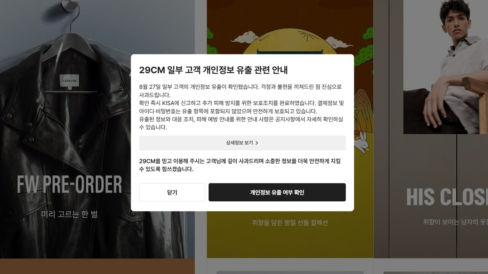

# 8강: 발표자료(API 보안)

강의 번호: 요즘 개발자를 위한 시스템 설계 수업
유형: 스터디 그룹
복습: No

## API Security Deep Dive

### 29CM·강남언니 개인정보 유출 사고로 보는 API 보안 실패

---

## 01. API 보안 — 무엇을 보호해야 하는가?

### API 보안이 필요한 이유

- API를 통한 개인정보 및 민감 데이터 접근
- 인증 우회 및 권한 검증 누락 위험
- 단일 보안 장치가 아닌 다계층 보안 설계 필요

### API 보안의 4가지 핵심 요소

| 보안 요소 | 핵심 역할 | 대표 기술 |
| --- | --- | --- |
| 인증(Authentication) | 요청자의 신원 확인 | API Key, OAuth 2.0, JWT |
| 인가(Authorization) | 리소스 접근 권한 검증 | RBAC, ABAC, 객체 단위 권한 검증 |
| 전송 보안 | 통신 데이터 보호 | HTTPS 기본 사용, TLS(전송 계층 보안) 최신 유지 |
| 요청 제한(Rate Limiting) | 과도한 API 호출 제어 | 토큰 버킷:(버킷에 토큰 있으면 요청 수락), 누수 버킷(버킷 가득 차면 요청 거부), 슬라이딩 윈도우(요청 수 추적해 한도 이상이면 거부) |

---

# 02. Case Study ① 29CM

## 사고 개요

- **발생:** 2026년 8월 27일
- **대상:** 주문정보 조회 API 및 파트너 계정 관리 기능
- **초기 발표 유출 규모:** 약 15만 9천 건
- **유출 정보:** 주문·배송 관련 개인정보

### 사고의 주요 보안 문제

1. 인프라 변경 과정에서 ACL 설정 누락
2. 내부 주문 조회 API의 인증·인가 미흡
3. 파트너 계정 관리 API 및 OTP 인증 보호 미흡
4. 주문정보 대량 조회 제한 미흡

---

## 원인 ① ACL 설정 누락 — 내부 API의 외부 노출

### 관련 개념: ACL (Access Control List)

- 특정 자원에 접근할 수 있는 대상과 조건을 정의하는 규칙
- 네트워크 ACL은 IP 주소·포트·프로토콜 등을 기준으로 접근 제어
- 내부 API에 대한 외부 네트워크 접근 차단에 활용

### 29CM에서는?

**인프라 구성 변경 → ACL 설정 누락 → 내부 주문 조회 API 외부 노출**

- 29CM 측의 인프라 변경 과정에서 접근통제 설정 누락
- 원래 내부 접근을 전제로 운영하던 주문 조회 API가 외부에서 접근 가능한 상태가 됨
- 공격자가 네트워크 설정을 직접 변경한 것으로 확인된 것은 아님

### 왜 문제가 되었을까?

- 내부용 API가 외부 요청을 받을 수 있는 상태로 변경
- 외부 접근을 차단하던 **1차 보안 계층**이 제대로 작동하지 않음
- API 자체의 인증·인가도 미흡해 추가적인 방어 부족

### 해결 방안

**1. Private Subnet + Security Group**

- **Private Subnet:** 내부 주문 조회 API를 외부 인터넷에서 직접 접근할 수 없는 네트워크에 배치
- **Security Group:** 허용된 애플리케이션 서버에서 오는 요청만 수신하도록 접근 규칙 설정
- 내부 API에 공인 IP를 직접 부여하지 않고, 필요한 서비스 간 통신만 허용

**2. Terraform + Policy as Code**

- **Terraform:** 네트워크 및 접근통제 설정을 코드로 관리하는 IaC 도구
- **OPA / Checkov:** 인프라 설정이 보안 정책을 위반하는지 자동 검사 도구
- 배포 전 `terraform plan`으로 변경사항 확인
- 내부 API에 `0.0.0.0/0` 등 과도한 외부 접근 허용 규칙이 존재하면 배포 차단

**3. 배포 이후 접근 검증**

- 인프라 변경 후 외부 네트워크에서 내부 API에 접근할 수 있는지 테스트
- 정기적인 외부 노출 자산 스캔
- 내부 API의 접근통제 정책이 변경되면 관리자에게 알림

**Insight 01**

> 내부 API도 설정 변경으로 외부에 노출될 수 있다. 중요한 것은 내부망이라는 위치가 아니라, 실제로 적용되는 접근통제 정책이다.
> 

---

## 원인 ② API 인증·인가 미흡 — 두 번째 방어 계층의 부재

### 관련 개념: Authentication & Authorization

| 인증(Authentication) | 인가(Authorization) |
| --- | --- |
| 요청자가 누구인지 확인 | 요청자가 무엇에 접근할 수 있는지 확인 |
| API Key, OAuth 2.0, JWT 등 활용 | RBAC, ABAC, 객체 단위 권한 검증 등 활용 |
| 신원 확인 | 접근 범위 결정 |
- **RBAC:** 사용자 역할에 따라 권한 부여
- **ABAC:** 사용자·리소스·환경 등의 속성에 따라 접근 판단
- **객체 단위 인가:** 특정 주문이나 상담 기록에 대한 개별 접근 권한 확인

### 29CM에서는?

- 외부에 노출된 내부 주문 조회 API의 독립적인 인증·인가 절차 미흡
- 네트워크 접근통제가 실패했을 때 요청자를 **추가로 검증**하는 장치 부족

### 왜 문제가 되었을까?

**ACL 실패 + API 자체 인증·인가 미흡 = 외부 요청에 대한 방어 약화**

- 네트워크 접근 허용 여부와 사용자 신원 검증은 서로 다른 문제
- 인증된 사용자라도 모든 주문정보를 조회할 수 있어서는 안 됨
- API 자체에서 접근 권한을 검증하지 않으면 내부망 보호 실패 시 피해가 커질 수 있음

### 해결 방안

**1. API Gateway를 통한 인증**

- **Kong / AWS API Gateway:** API 요청을 중앙에서 관리하는 게이트웨이
- 외부 요청의 인증정보를 확인하고 미인증 요청 차단
- 서비스(API) 간 통신에는 OAuth 2.0 Client Credentials(서버의 access token) 또는 mTLS(인증서) 기반 인증 적용
- 게이트웨이를 우회해 내부 API에 직접 접근할 수 없도록 네트워크 정책 설정

**2. JWT 기반 사용자 인증**

- JWT의 서명, 만료시간, 발급자, 대상 등을 검증
- 유효하지 않거나 만료된 토큰을 사용한 요청은 `401 Unauthorized` 반환
- JWT는 사용자 신원과 권한 정보를 전달하는 수단이며, 토큰 자체가 모든 데이터 접근 권한을 보장하지는 않음

**3. RBAC + 객체 단위 인가**

- **RBAC (Role-Based Access Control):** 고객·파트너·관리자 등 역할별 API 접근 범위 제한
- **객체 단위 인가:** 특정 주문의 소유자 또는 담당 파트너인지 서버에서 확인
- 예: 사용자 A가 유효한 JWT를 가지고 있어도 사용자 B의 주문정보 조회는 차단
- 권한 없는 데이터 접근 시 `403 Forbidden` 또는 보안 정책에 따라 `404 Not Found` 반환

**Insight 02**

> 네트워크 접근통제가 무너져도 API 자체에서 요청자의 신원과 권한을 검증해야 한다.
> 

---

## 원인 ③ 파트너 계정 관리·OTP 보호 미흡

### 관련 개념: OTP & 인증 시도 제한

**OTP (One-Time Password)**

- 일회용 인증번호를 이용한 추가 인증 수단
- 계정 탈취 위험을 줄이기 위한 다중 인증(MFA)에 활용

**인증 시도 제한**

- 일정 횟수 이상 인증 실패 시 추가 시도 제한
- 반복적인 코드 추측 및 무차별 대입 공격 완화
- 계정·IP·인증 세션 등을 기준으로 제한 가능

### 29CM에서는?

- 일부 파트너 계정 관리 API에 인증 미적용
- OTP 인증 실패 횟수 제한 미설정
- 이러한 취약점이 파트너 계정 탈취와 연관된 것으로 보도

### 왜 문제가 되었을까?

- 계정 관리 기능에 대한 접근 검증 부족
- OTP를 도입했더라도 반복 시도 제한이 없으면 보호 효과 약화
- 파트너 계정 탈취 시 해당 계정의 권한을 이용한 정보 접근 위험

### 해결 방안

**1. Redis 기반 OTP 시도 횟수 제한**

- **Redis:** 인증 세션별 OTP 실패 횟수와 만료시간을 저장
- 예: 5회 연속 실패 시 해당 인증 세션 차단
- OTP 재발급으로 실패 횟수 제한을 무한히 초기화하지 못하도록 설계
- 여러 서버에서 동시에 인증 요청을 처리하더라도 동일한 제한 적용 (합산)

**2. OTP 유효성 관리**

- 짧은 유효시간 설정
- 인증 성공 시 OTP 즉시 폐기
- 이미 사용한 OTP의 재사용 차단
- OTP 발급 요청 자체에도 횟수 제한 적용

**3. 민감 계정 관리 API 보호**

- 비밀번호 변경·계정 복구·파트너 정보 변경 API에 인증 필수 적용
- 중요한 계정 변경 작업에는 추가 인증(Step-up Authentication) 적용
- 비정상적인 로그인 및 계정 변경 이력 모니터링

**Insight 03**

> 보안 기능의 존재만으로 안전성이 보장되지는 않는다. OTP도 검증 횟수와 사용 조건을 함께 관리해야 한다.
> 

---

## 원인 ④ 대량 조회 제한 미흡

### 관련 개념: Rate Limiting

- 일정 시간 동안 허용할 API 요청량 제한
- 과도한 요청 및 반복적인 데이터 조회 제어
- 제한 초과 시 `429 Too Many Requests` 응답 가능

**대표 알고리즘**

| 알고리즘 | 특징 |
| --- | --- |
| Token Bucket | 일정 속도로 토큰 충전, 제한적인 순간 요청 허용 |
| Leaky Bucket | 요청을 일정한 속도로 처리 |
| Sliding Window | 최근 일정 시간의 요청량 기준 제한 |

### 29CM에서는?

- 주문 조회 API의 대량 조회 제한 장치 미흡
- 반복적인 주문정보 조회를 제어하는 보호 장치 부족

### 왜 문제가 되었을까?

- 비정상적인 대량 요청이 발생해도 이를 충분히 제한하기 어려움
- 하나의 접근 경로가 노출되었을 때 다수의 개인정보가 조회될 위험 증가
- 인증·인가 실패에 더해 피해 규모를 제한하는 방어도 부족

### 해결 방안

**1. Token Bucket 기반 Rate Limiting**

- **Token Bucket:** 일정 속도로 토큰을 충전하고 요청마다 토큰을 소비하는 알고리즘
- 토큰이 부족하면 요청 제한
- 정상적인 순간 트래픽 증가는 일부 허용하면서 지속적인 과도한 요청은 제한
- 제한 초과 시 `429 Too Many Requests` 반환

**2. Redis 기반 분산 요청 제한**

- 여러 API 서버가 Redis에 요청 횟수 또는 토큰 상태를 공유
- 서버별 제한이 아닌 전체 서비스 기준으로 요청량 관리
- 사용자·파트너 계정·API별로 서로 다른 제한 정책 적용

**3. 조회 데이터 수 기반 제한**

- API 호출 횟수뿐 아니라 실제 반환된 주문·고객정보 수까지 제한
- 한 번의 요청에서 반환할 수 있는 최대 데이터 수 설정
- 페이지네이션 및 대량 조회 전용 권한 적용
- 평소보다 급격히 증가한 조회량에 대해 경고 또는 차단

**Insight 04**

> Rate Limiting은 무단 접근 자체를 해결하지는 못하지만, 반복 조회와 피해 확산을 제한하는 중요한 보조 방어 수단이다.
> 

---

# 03. Case Study ② 강남언니

## 사고 개요

- **발생:** 2026년 9월 4일
- **대상:** 상담내역 조회 연동 API
- **유출 인원:** 219,665명
- **유출 정보:** 이름·연락처, 상담·시술 관련 정보, 상담 등록 사진 등

### 주요 보안 쟁점

1. 상담 조회 API를 통한 비인가 접근 (9월 4일)
2. 최초 차단 이후 다른 경로를 통한 재접근 (9월 5일)
3. 상담 사진 URL에 대한 접근통제 문제 (9월 8일)

※ 정확한 최초 침입 기법과 개별 인증·인가 로직의 결함은 공개자료만으로 확정할 수 없음.

---

## 쟁점 ① 상담 조회 API의 비인가 접근

### 관련 개념: Object-Level Authorization

- 개별 데이터 객체에 대한 접근 권한 검증
- 사용자 역할뿐 아니라 데이터 소유권·관계·접근 목적 확인
- 민감정보 조회 API에서 특히 중요

**BOLA (Broken Object Level Authorization)**

- 객체 단위 권한 검증이 누락된 API 취약점
- 인증된 사용자가 권한 없는 다른 객체에 접근할 수 있는 상황

### 강남언니에서는?

- 상담내역 조회 연동 API를 통한 비인가 접근 확인
- 다수 이용자의 상담·시술 관련 정보 유출
- 실제로 BOLA, IDOR 또는 특정 인증 우회가 사용됐는지는 미확인

### 왜 중요한가?

- 상담내역은 일반적인 프로필 정보보다 사생활 침해 위험이 큼
- API가 반환하는 개별 상담 데이터에 대한 권한 검증 필요
- 인증 성공 여부와 특정 상담내역 조회 권한은 별개

### 해결 방안

**1. OAuth 2.0 + Scope 기반 접근 제한**

- OAuth 2.0을 이용해 연동 서비스에 필요한 API 접근 권한을 토큰으로 부여
- Scope를 통해 상담 조회(`consultation:read`)와 수정(`consultation:write`) 권한 분리
- API 서버에서 토큰의 유효성과 허용된 기능을 확인
- Scope 검증 이후에도 병원·사용자별 상담 데이터 접근 권한을 추가 확인

**2. 최소 데이터 반환**

- 상담 목록에서는 필요한 요약 정보만 반환
- 상세 상담내용과 사진은 별도 권한 확인 후 제공
- API 응답에서 불필요한 개인정보 및 민감정보 제외

**Insight 05**

> 개인정보 조회 API는 요청자의 신원뿐 아니라 개별 데이터에 접근할 정당한 권한까지 검증해야 한다.
> 

---

## 쟁점 ② 최초 차단 이후 다른 경로로 재접근

### 관련 개념: Attack Surface (공격 표면)

- 공격자가 접근할 수 있는 시스템의 모든 진입점
- 공개 API, 내부 API, 연동 API, 파일 URL 등 포함
- 접근 경로가 많을수록 일관된 보안 정책 적용이 중요

### 강남언니에서는?

**상담 조회 API 비정상 접근 → 최초 경로 차단 → 다른 경로로 재접근 시도**

- 최초 접근 경로 차단 후에도 다른 접근 경로가 문제로 남음
- 정확히 어떤 경로로 재접근했는지는 공개자료상 제한적

### 왜 문제가 되었을까?

- 하나의 엔드포인트를 차단해도 동일 데이터로 연결되는 다른 경로가 존재할 수 있음
- 개별 API 단위의 대응만으로 전체 공격 표면을 보호하기 어려움
- 사고 대응 과정에서 관련 API와 연동 기능 전체를 확인해야 함

### 해결 방안

**1. OpenAPI 기반 API Inventory**

- **OpenAPI Specification:** API의 경로·요청·응답·인증 요구사항 등을 문서화하는 표준
- **API Inventory:** 운영 중인 API 엔드포인트와 연동 서비스를 목록화해 관리
- 사용하지 않는 구형 API, 테스트 API, 중복된 접근 경로 식별
- 신규 API 배포 시 인증·인가 정책 누락 여부 점검

**2. API Gateway를 통한 공통 보안 정책**

- 여러 API의 인증·요청 제한·접근 로그 정책을 중앙에서 관리
- 동일한 상담정보에 접근하는 API에 일관된 보안 정책 적용
- 게이트웨이를 우회하는 직접적인 백엔드 접근 차단

**3. 통합 로그 분석 및 사고 대응**

- API Gateway 로그, 애플리케이션 로그, 파일 접근 로그를 함께 분석
- 최초 공격 경로와 연관된 다른 API 요청 추적
- 사고 발생 시 관련 API·연동 기능의 접근 권한과 인증정보 점검
- 유출된 토큰이나 인증정보가 확인되면 무효화 및 교체

**Insight 06**

> 공격 경로 하나를 막는 것과 공격 가능한 모든 경로를 보호하는 것은 다르다.
> 

---

## 쟁점 ③ 상담 사진 URL 접근통제

### 관련 개념: File-Level Access Control

- 이미지·첨부파일에도 별도의 접근 권한 적용
- API 접근 권한과 파일 접근 권한을 함께 관리
- 공개 URL과 비공개 파일 접근 방식 구분

**Signed URL (서명 URL)**

- 서명과 만료시간 등으로 접근 조건을 제한하는 URL
- 비공개 파일을 일정 시간 동안 접근 가능하게 하는 데 활용
- URL이 유출될 경우 만료 전 재사용될 위험도 고려 필요

### 강남언니에서는?

- 2026년 10월 국정감사에서 상담 사진 URL 약 6,000건 유출 지적
- 공격 인지 이후에도 일부 사진 URL에 외부 접근이 가능했던 문제 제기
- API 접근 경로 차단과 별도로 파일 접근 경로 보호가 쟁점이 됨

### 왜 문제가 되었을까?

- API 호출을 차단해도 기존에 노출된 파일 URL은 별도로 접근 가능할 수 있음
- 상담 사진은 시술 및 신체 관련 사생활 정보가 포함될 수 있음
- API와 파일 저장소의 접근통제가 분리되어 있으면 보호 범위에 차이가 발생할 위험

### 해결 방안

**1. Private Object Storage**

- **Amazon S3 등 객체 저장소**에 상담 사진 보관
- S3 Block Public Access 등으로 외부 공개 접근 차단
- 파일 URL을 알고 있다는 이유만으로 사진을 조회할 수 없도록 설정
- 허용된 애플리케이션이나 사용자만 파일에 접근하도록 권한 제한

**2. Signed URL (서명 URL)**

- 파일 접근 권한을 확인한 사용자에게만 일정 시간 유효한 URL 발급
- URL에 서명과 만료시간을 포함해 접근 조건 제한
- 예: 사용자가 상담 사진 요청 → API 서버가 상담 접근 권한 확인 → 짧은 만료시간의 Signed URL 발급 → 비공개 저장소에서 사진 조회
- URL이 유출되더라도 만료시간이 지나면 사용할 수 없도록 구성

**3. URL 유출 시 접근 권한 회수**

- Signed URL도 만료 전에는 URL을 가진 사람이 재사용할 수 있음
- 사고 발생 시 저장소 접근 정책 변경, 서명에 사용된 권한 회수 등으로 기존 접근 경로 차단
- 필요한 경우 파일 경로 변경 또는 API 서버를 통한 파일 제공 방식 적용
- 민감도가 높은 사진은 다운로드 시점마다 서버에서 권한을 다시 확인하는 방식 고려

**4. 파일 접근 로그 및 이상 탐지**

- **AWS CloudTrail 데이터 이벤트:** S3 객체 접근 관련 API 활동 기록
- **S3 서버 액세스 로그:** 객체 요청 이력 분석에 활용
- 특정 사진에 대한 반복 접근 및 비정상적인 대량 다운로드 탐지
- 사고 발생 시 실제 파일 접근 여부를 조사할 수 있도록 로그 보관

**Insight 07** 검증 미흡 확인

| 비인가 접근 확인, 세부 기법 미공개 |  |  |
| --- | --- | --- |
| 요청 제한 | OTP·대량 조회 제한 미흡 | 구체적 설정 미공개 |
| 데이터 접근 경로 | 주문·배송정보 | 상담·시술정보 및 사진 URL |
| 운영상 교훈 | 인프라 변경 후 보안 검증 | 전체 접근 경로 및 파일 보호 |

### 공통 인사이트

- 내부 API도 외부 노출 가능성을 고려해야 함
- 네트워크 접근통제와 애플리케이션 인증·인가는 별도로 적용
- 민감정보의 모든 조회 경로 보호
- 비정상적인 요청과 대량 조회 탐지
- 배포·인프라 변경 및 사고 대응 이후 보안 정책 재검증