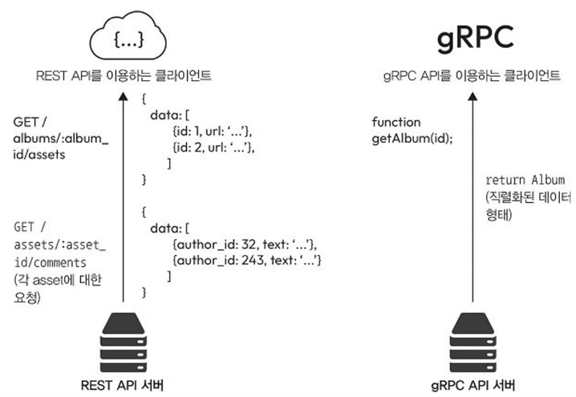

# 8강: 시스템 구성 요소 설계 및 구현 - API, 보안, 메트릭

강의 번호: 요즘 개발자를 위한 시스템 설계 수업
유형: 스터디 그룹
복습: No

<aside>
💡

대표적인 API 설계 방법: REST, gRPC

분산 시스템의 상태와 성능을 파악하고 문제를 신속하게 탐지·해결하기 위한 로깅, 메트릭, 알림, 트레이싱의 개념과 활용 방법을 학습

</aside>

## 8.1 REST API

REST: 표준 http 메서드 사용해 구현이 단순, 직관적이며 많이 사용됨

8.1.1 REST API 설계 원칙

- 리소스 기반 설계: 객체, 데이터, 서비스 등의 리소스를 URI로 식별
- HTTP 메서드 활용: GET, POST, PUT, DELETE를 사용해 CRUD 작업 수행
- 무상태성(Statelessness): 각 요청에 필요한 정보를 모두 포함하여 서버가 이전 요청의 상태를 기억하지 않도록 설계해 동작이 안정적이며 예측 가능
→ 서버에 요청 보낼 때 요청 처리에 필요한 모든 정보를 요청 안에 포함해야 됨

8.1.2 활용 사례

- 인터넷에 공개되는 공개 API에 적합
- http 프로토콜을 사용하므로 http 요청을 보낼 수 있는 다양한 클라이언트에서 쉽게 사용 가능
- CRUD 기반 작업 시스템에서 데이터를 생성, 읽기, 수정, 삭제 작업하는 경우 적합
ex) 제품 목록 관리

8.1.3  REST API 장단점

- 장점: 간단하고 이해하기 쉬운 구조 (http 기본 메서드, 상태 코드 사용)
- 단점: 여러 요청을 한 번에 처리해야 하는 복잡한 작업에는 비효율
         json 형식으로 데이터 교환하기 때문에 데이터 양이 많아지면 페이로드가 커짐
    
    → 이 단점을 gRPC로 해결
    

## 8.2 gRPC API

gRPC: 원격 프로시저 호출을 실행하는 고성능 프레임워크
함수 중심으로 설계되어 고효율 API 구현하는 데 효과적임

8.2.1 gRPC API 설계 원칙

- 프로토콜 버퍼(Protobuf): 언어와 플랫폼에 독립적인 데이터 직렬화 포맷으로, JSON보다 효율적이고 빠른 데이터 처리 지원
- 자동 코드 생성: `.proto` 파일에 서비스를 정의하면 클라이언트와 서버의 Stub 코드 자동 생성
→ API 더 쉽게 생성하고 관리 가능, 이후 서비스 정의 변경되더라도 클라이언트와 서버 코드에 자동 반영
- 다중 언어 지원: 다양한 프로그래밍 언어 간 통신이 가능해 여러 언어를 사용하는 분산 시스템에 적합
- 주요 기능: 인증, 로드 밸런싱, 양방향 스트리밍 지원

8.2.2 gRPC API 활용 사례

- 서비스 간에 빈번한 통신이 필요할 때 적합: 프로토콜 버퍼로 메시지 크기가 작고 양방향 스트리밍도 지원하기 때문에 실시간 애플리케이션에 잘 어울림
- 고성능 통신이 필요한 시스템: 서비스 간 통신 부하 줄여 효율적으로 작동됨

8.2.3 gRPC API 장단점

- 장점: Protobuf 기반의 작은 페이로드와 빠른 처리 속도, 명확한 데이터 구조 정의
- 단점: 바이너리 형식과 HTTP/2 사용으로 설정 및 디버깅이 복잡하고, API 변경 시 데이터 구조 수정과 코드 재배포가 필요
- 핵심 차이: gRPC는 성능과 효율성에, REST는 개발 편의성과 유연성에 강점이 있음

## 8.3 REST와 gRPC 차이

.proto에 데이터 구조를 정의해놨기 때문에 필드이름을 보내지 않아도 됨

성능

- REST: 주로 JSON을 사용하며, 상대적으로 데이터 크기와 처리 비용이 큼
- gRPC: HTTP/2와 Protobuf를 사용하여 작은 페이로드와 빠른 데이터 전송 지원

사용 편의성

- REST: HTTP 메서드와 상태 코드를 사용하며, cURL이나 Postman으로 테스트 및 디버깅이 쉬움
- gRPC: 바이너리 형식과 `.proto` 파일을 사용하므로 별도 도구와 설정이 필요함

호환성 

- REST: 웹 브라우저를 포함한 다양한 플랫폼과 네트워크 환경에서 사용 가능
- gRPC: HTTP/2 기반으로 동작하며, 웹 브라우저에서 직접 사용하기 어려워 추가 기술이 필요할 수 있음

스트리밍 지원

- REST: 기본적으로 요청·응답 방식으로 동작
- gRPC: 단방향 및 양방향 스트리밍을 지원하여 실시간 데이터 교환에 유리

활용 사례

- REST: 공개 API, 웹 애플리케이션, CRUD 기반 서비스에 적합
- gRPC: 마이크로서비스 간 통신, 고성능 시스템, 실시간 애플리케이션에 적합

## 8.4 API 보안

8.4.1 인증

> 사용자가 누구인가?
> 
- API 키: 클라이언트가 http 요청 헤더에 키를 포함해 전송하는 간단한 인증방법
쉽게 탈취가 가능하며, 권한 제어를 세밀하게 할 수 없음
- OAuth: 사용자가 계정 정보를 직접 제공하지 않고도 한 웹사이트에서 다른 웹사이트로  리소스 제한적인 접근 권한을 부여할 수 있음
ex) 카카오로 로그인
- JWT: 두 시스템 간 정보를 안전하게 주고받을 수 있는 간결한 방법
JSON 형태로 작성된 클레임으로 구성되며 JWS 구조로 감싸짐
→ MAC(메시지 인증 코드)로 디지털 서명하거나 무결성 확인 가능, 암호화도 가능
크기가 작고 URL로 전송하기에 적합

8.3.2 인가

> 이 작업을 해도 되는가?
> 
- 역할 기반 접근 제어: 권한을 사용자 개개인이 아닌 역할에 할당
사용자는 특정 역할에 연결되며 역할이 가진 권한에 따라 리소스 접근이 허용됨
역할만 관리하면 되니까 관리가 훨씬 간편
- 속성 기반 접근 제어: 속성을 기반으로 인가를 정의
사용자, 리소스, 환경 등 다양한 속성을 바탕으로 권한을 정의하며 속성들을 조합하기도 함
ex) 사용자 부서, 리소스 type, 요청된 시간 등
세밀한 제어가 가능하지만 구현이 상대적으로 복잡함

8.4.3 API의 보안 통신

- 기본적으로 **HTTPS**를 사용하는 것이 필수
클라이언트와 서버 간 통신을 암호화해 가로채거나 해독하기 어렵게 함
- TLS(전송 계층 보안) 설정을 최신 상태로 유지하는 것이 중요
보안 취약점, 발표 표준이 새로 발전함에 따라 최신화해야 새로운 보안 문제 예방하고 시스템 보호할 수 있음

8.4.4 요청 속도 제한

요청 속도 제한: 특정 시간 내 클라이언트가 보낼 수 있는 요청 수를 제한해 API가 과도하게 사용되는 것을 방지할 수 있음

- DoS 공격 방어에 효과적
- 서버 자원을 효율적으로 관리하고 사용자 간 자원 사용을 균형 있게 분배할 수 있음
독점 사용을 방지하며 모든 사용자가 안정적인 서비스를 이용할 수 있도록 할 수 있음

[알고리즘]

- 토큰 버킷: 요청 하나를 처리하면 토큰 하나가 사용되며 토큰을 일정한 간격으로 버킷에 채워짐
버킷에 토큰 없으면 추가 요청은 거부됨
- 누수 버킷: 토큰은 일정한 속도로 추가되지만 동시에 일정한 속도로 새어나감
버킷이 가득 차면 새로운 요청은 거부됨
- 슬라이딩 윈도우: 특정 시간 내에서 처리된 요청 수를 추적
설정된 한도 초과하면 이후 요청은 거부됨

## 8.5 분산 시스템 로깅

로깅: 시스템에서 발생하는 이벤트 기록하는 작업
중앙 집중형 로깅: 각 서비스에서 생성된 로그를 중앙 저장소로 모아 관리

8.5.1 중앙 집중형 로깅

[장점]

- 접근성 향상: 모든 로그가 한곳에 있어 검색, 분석이 쉬움
- 상관관계 분석: 다른 서비스에서 생성된 로그를 타임스탬프나 고유 식별자를 기준으로 연결해 트랜잭션이나 작업의 전체 흐름을 파악할 수 있음
- 데이터 장기 보관: 오랜 기간 로그 보관해 요구사항 충족 가능

**로그 설계 시 로그가 어떤 정보를 담을 지 고민해야 함**

- 발생 시각: 이벤트 발생 날짜, 시각
- 서비스 이름: 로그 생성한 서비스 이름
- 심각도: 이벤트 중요도 수준 ex) WARNING, ERROR
- 메시지: 이벤트 설명 담은 메시지
- 추가 정보: 사용자 ID, 트랜잭션 ID 등 이벤트와 관련된 세부 정보

중앙 집중형 로깅 오픈소스 라이브러리

- 로그스태시: 앨라스틱스택의 구성 요소 중 하나, 다양한 소스에서 데이터를 효율적으로 **수집, 변환**해 엘라스틱서치 같은 저장소로 데이터 전달
- Fluentd: 여러 소스에서 데이터를 수집하고 통합할 수 있는 오픈소스 **데이터 수집기**

→ 로그스태시는 복잡한 데이터 처리 파이프라인에, Fluentd는 유연한 로그 수집·라우팅에 많이 활용

- Graylog: 대표적인 솔루션, 개방형 표준을 기반으로 설계됨
시스템이나 애플리케이션에서 자동으로 생성되는 데이터를 대량으로 **수집, 저장, 실시간 분석** 지원

8.5.2 분산 로깅 구현 사례

- 일관된 로그 형식 사용: 모든 서비스에서 생성되는 로그가 같은 형식을 따르면 검색, 분석이 훨씬 수월함
- 로그에 컨텍스트 정보 포함: 용자 ID, 트랜잭션 ID 등을 기록해 이벤트 추적과 문제 분석을 도움
- 예외 처리 및 기록: 오류 발생 시 스택 트레이스를 남겨 원인 파악을 쉽게 함
- 적절한 로그 레벨 설정: ERROR, INFO 등 중요도에 따라 로그를 분류해 불필요한 로그를 줄임
- 로그 순환 및 아카이빙: 오래된 로그는 삭제하고 중요한 로그는 별도 보관하여 저장 공간을 관리함

## 8.5 분산 시스템 메트릭

메트릭: 특정 시간 간격 동안 측정된 데이터를 수치로 표현한 것

메트릭을 통해 시스템이 원할하게 작동하고 있는지, 서비스 수준 목표 충족되는지, 성능 병목 현상 있는 지, 예상대로 시스템이 작동하고 있는 지에 대한 답을 찾는데 도움이 됨

8.6.1 메트릭 종류

- 시스템 메트릭: CPU, 메모리, 디스크 입출력 등 시스템 자원이 어떻게 사용되고 있는지
- 애플리케이션 메트릭: 요청 속도, 오류 비율, 응답 시간 등 애플리케이션의 성능과 안정성
- 비즈니스 메트릭: 시스템이 비즈니스에 미치는 영향
ex) 사용자 가입 수, 주문 건수 등

8.6.2 메트릭을 위한 오픈소스 라이브러리

메트릭을 수집, 저장, 시각화하는 도구

- 프로메테우스: 오픈 소스 모니터링·알림 도구로, 다차원 메트릭 데이터와 PromQL을 활용한 분석에 강점이 있으며 클라우드·마이크로서비스 환경에 적합
    
    
    
- 그라파이트(Graphite): 숫자형 시계열 데이터를 저장하고, Graphite-web을 통해 시간에 따른 데이터 변화를 그래프로 시각화하는 도구
    
    
    
- 데이터독(Datadog): SaaS 기반 통합 모니터링 서비스로, 서버·DB·애플리케이션의 상태를 실시간으로 분석하고 이상 발생 시 알림을 제공
    
    
    

8.6.3 메트릭 구현 사례

- 핵심 메트릭 선정: 서비스 수준 목표(SLO)에 직접적인 영향을 주는 중요한 메트릭에 집중함
- 일관된 이름 규칙 사용: 메트릭 이름을 통일하여 검색과 분석을 쉽게 함
- 오류율·지연 시간 모니터링: 이상 징후를 빠르게 감지하고, 임계값 초과 시 알림을 설정
- 메트릭 시각화: 대시보드를 활용해 데이터 변화와 이상 현상을 쉽게 파악

## 8.7 분산 시스템에서 알림

잠재적인 문제를 사전에 감지할 수 있기 때문에 알림이 중요

8.7.1 알림을 효율적으로 설계

- 중요도에 따른 우선순위 설정: 모든 알림을 동일하게 처리하지 않고 긴급도에 따라 분류
긴급 알림은 즉시 대응하고, 경고 수준의 알림은 근무 시간 내 처리하는 등 대응 시점을 구분
- 실행 가능성 고려: 실제로 조치가 필요한 상황에만 알림을 생성 
별도의 대응이 필요하지 않은 불필요한 알림은 줄여 알림의 효율성을 높임
- 문제 진단에 필요한 정보 포함: 알림에는 문제가 발생한 서비스, 발생 시간, 오류 메시지, 관련 로그 등 원인을 파악하고 해결하는 데 필요한 정보를 충분히 제공해야 함

8.7.2 알림을 위한 오픈소스 라이브러리

- 프로메테우스(Prometheus) + 알림 매니저(Alertmanager): 오픈 소스 모니터링 및 알림 도구로, 프로메테우스가 생성한 알림을 Alertmanager가 처리 
알림 중복 제거, 그룹화, 수신자별 전달 기능을 통해 알림을 효율적으로 관리함
- 그라파나(Grafana): 다양한 데이터 소스를 연결해 차트와 그래프로 시각화하는 오픈 소스 플랫폼 
데이터 기반 알림 조건을 설정할 수 있으며, 이메일·슬랙·웹훅 등 다양한 채널로 알림을 전달
- 페이저듀티(PagerDuty): IT 운영팀을 위한 상용 사고 관리 플랫폼으로, Prometheus·Grafana 등과 연동하여 알림을 중앙에서 관리함 
전화·SMS·이메일·푸시 알림을 통해 담당자가 신속하게 장애에 대응하도록 지원함

8.7.3 알림 시스템 구현 사례

- 불필요한 알림 최소화: 알림이 지나치게 많으면 알림 피로(Alert Fatigue)가 발생해 중요한 문제를 놓칠 수 있기에 꼭 필요한 알림만 생성하고, 임계값을 적절히 조정하여 거짓 경보를 줄여야 함
- 알림의 정기적인 테스트: 알림이 의도한 대로 작동하는지 주기적으로 점검해야 함. 
카오스 엔지니어링 실험이나 정기 테스트를 통해 실제 장애 상황에서도 알림이 정상적으로 발생하는지 확인해야 함
- 알림 대응 프로세스 문서화: 알림 유형별 대응 절차를 문서화하여 신속하고 일관된 문제 해결을 지원
문제 해결 방법, 담당자 및 보고 체계, 실행 지침(Runbook) 등을 포함해야 함

## 8.8 분산 시스템에서 트레이싱

트레이싱: 요청이 여러 서비스를 거쳐 처리되는 과정을 추적하는 기법
성능 문제 분석, 병목 지점 파악, 시스템에서 요청 처리되는 전체 흐름 이해하는 데 유용

8.8.1 분산 트레이싱

스팬(span): 요청이 처리되는 각 단계
트레이스(trace): 스팬이 모여 요청 전체 흐름을 보여줌

- 성능 최적화: 요청 흐름을 시각화해 성능 병목 현상을 파악하고 이를 최적화 할 수 있음
- 오류 진단: 요청이 실패했을 경우 트레이스를 이용해 오류가 발생한 위치와 원인을 파악할 수 있음
- 시스템 동작 파악: 시스템에서 요청이 처리되는 흐름을 명확히 할 수 있음
팀원과 소통, 시스템 설정이나 아키텍처 변경할 때도 유용

8.8.2 분산 트레이싱을 위한 오픈소스라이브러리

- 예거(Jaeger): 우버에서 개발한 오픈 소스 분산 트레이싱 시스템으로, 요청 흐름 추적, 트랜잭션 모니터링, 근본 원인 분석 및 성능 최적화를 지원
Elasticsearch, Cassandra, Kafka 등 다양한 백엔드와 연동하여 확장성을 확보할 수 있음
- 집킨(Zipkin): 마이크로서비스 간 요청 처리 시간과 흐름을 수집·시각화하는 오픈 소스 분산 트레이싱 도구
직관적인 인터페이스를 통해 지연 발생 지점과 성능 병목을 쉽게 파악할 수 있으며, 다양한 저장소와 프로그래밍 언어를 지원함
- 오픈텔레메트리(OpenTelemetry): 분산 트레이스와 메트릭 등 관측 데이터를 표준화하여 수집하고 전달하는 오픈 소스 프레임워크
 API, 라이브러리, 에이전트, 수집기 등을 제공하며 Prometheus, Jaeger 같은 도구와 연동할 수 있음

전체 트레이스 시간, 백엔드 처리 시간, 루트 스팬 시간 등을 확인할 수 있으며, 각 처리 단계의 시작·종료 시점을 분석하여 성능 문제와 병목 구간을 파악하는 데 활용함

8.8.3 분산 트레이싱 구현 사례

- 코드에 트레이싱 추가: 트레이싱 라이브러리를 적용하고, 추적할 작업에 스팬(Span)을 설정하여 실행 과정과 처리 시간을 수집
- 컨텍스트 전파: 여러 서비스에 걸친 요청 흐름을 추적할 수 있도록 트레이스 컨텍스트를 HTTP 헤더 등을 통해 서비스 간 전달
- 명확한 스팬 이름 사용: 각 스팬이 어떤 작업을 나타내는지 쉽게 파악할 수 있도록 구체적이고 일관된 이름을 사용
- 스팬에 메타데이터 추가: 스팬에 작업과 관련된 추가 정보(주석·속성)를 기록하여 문제의 원인과 실행 맥락을 쉽게 분석할 수 있도록 함

8.8.4 분산 트레이싱 모범 사례

- 적절한 API 설계 선택: REST와 gRPC의 성능, 사용 편의성, 호환성 등을 비교하여 시스템 요구 사항에 적합한 API 방식을 선택하기
- API 보안 강화: 인증 및 권한 부여 체계를 구축하고, HTTPS를 통한 데이터 암호화와 요청 속도 제한(Rate Limiting)을 적용하여 악의적인 접근과 과도한 요청을 방지
- 중앙 집중형 로깅 구현: 여러 서비스에서 발생하는 로그를 중앙에서 수집·저장하여 로그 검색과 분석을 효율화하고 시스템 문제를 신속하게 파악해야 함
- 핵심 메트릭 모니터링: 시스템·애플리케이션·비즈니스의 주요 메트릭을 선정하고 지속적으로 모니터링하여 성능을 평가하고 데이터 기반 의사 결정을 지원함
- 효과적인 알림 설계: 적절한 민감도와 정확성을 유지하여 거짓 경보와 알림 피로를 최소화
문제 진단에 필요한 정보를 포함하고 정기적인 테스트를 통해 알림의 신뢰성을 확보
- 분산 트레이싱 활용: 서비스 간 요청 흐름과 처리 시간을 추적하여 성능 병목과 장애 원인을 분석하고 시스템 성능을 최적화