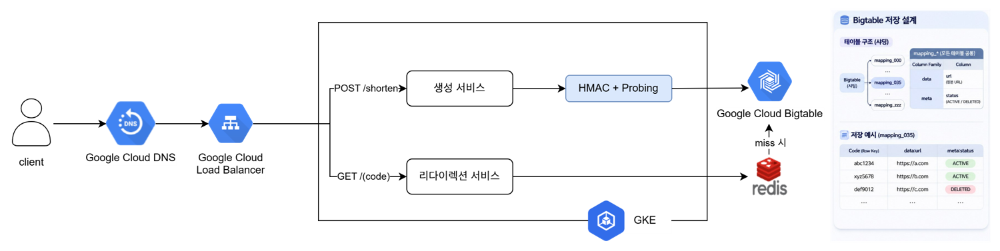

# 9강: URL 단축 서비스 설계

복습: No

## 1. URL 단축 서비스란?

긴 URL을 짧은 URL로 변환하고, 단축 URL에 접근하면 원본 URL로 연결해 주는 서비스

**주요 활용 사례**

- **소셜 미디어:** 긴 링크를 간결하게 공유
- **마케팅:** 링크 클릭 수와 클릭률(CTR)을 추적해 캠페인 성과 분석
- **QR 코드:** 짧은 URL을 사용해 QR 코드 생성 및 공유
- **모바일 앱:** 특정 콘텐츠나 앱 스토어로 연결
- **브랜딩:** 기업 전용 도메인을 활용한 맞춤형 단축 URL 제공

## 2. 요구 사항

### 2.1 기능적 요구 사항

**핵심 기능**

- 긴 URL을 입력받아 단축 URL 생성
- 단축 URL을 입력받아 원본 URL 반환
- 단축 URL의 고유성과 일정한 길이 보장

**추가 고려 기능**

- URL 유효성 검사 및 사용자 지정 URL 지원
- 마지막 사용 시점 기준 6개월 후 만료
- URL 수정 및 삭제
- 클릭 수 분석 및 모니터링
- 사용자 계정 관리 및 오류 처리

### 2.2 비기능적 요구 사항

| 가용성 | 장애 상황에서도 안정적으로 서비스 제공 |
| --- | --- |
| 확장성 | 1억 명 이상의 사용자 및 트래픽 증가 대응 |
| 응답 속도 | URL 생성과 조회를 빠르게 처리 |
| 일관성 | 동일한 URL 요청에 대해 일관된 매핑 제공 |
| 내구성 | 생성된 URL 데이터의 손실 방지 |
| 신뢰성 | 요청 폭주나 장애 발생 시에도 정상 동작 |

특히 **동일한 긴 URL을 여러 번 입력하더라도 동일한 단축 URL을 반환**하도록 설계

## 3. API 설계

| API | 기능 | 요청 | 응답 |
| --- | --- | --- | --- |
| `POST /shorturl` | 단축 URL 생성 | 원본 URL | 단축 URL |
| `GET /shorturls/{shorturl}` | 원본 URL 조회 | 단축 URL | 원본 URL |
- `getShortUrl(user_id, longurl)`: 긴 URL을 단축 URL로 변환
- `getLongUrl(shortUrl)`: 단축 URL에 해당하는 원본 URL 조회

## 4. 시스템 규모 추정

### 4.1 사용자 및 트래픽

- 전체 사용자: **10억 명**
- URL 생성 사용자: **1억 명(10%)**
- 하루 생성 URL: **1억 개**
- 데이터 보관 기간: **10년**

**총 URL 수**

1억 × 365일 × 10년 = **3,650억 개**

### 4.2 단축 URL 길이

단축 URL에는 영문 대소문자와 숫자를 사용한다.

- a-z: 26개
- A-Z: 26개
- 0-9: 10개
- 총 **62개 문자(Base62)**

| URL 길이 | 생성 가능한 조합 |
| --- | --- |
| 6자리 | 62⁶ ≈ 568억 개 |
| 7자리 | 62⁷ ≈ 3.52조 개 |

10년간 약 3,650억 개의 URL을 저장해야 하므로 **최소 7자리의 단축 URL이 필요하다.**

### 4.3 저장 공간

URL 하나에 저장할 데이터는 다음과 같다.

| 데이터 | 크기 |
| --- | --- |
| 단축 URL | 20B |
| 원본 URL | 1,000B |
| 생성 시각 | 10B |
| 수정 시각 | 10B |
| 생성자 | 20B |
| 합계 | 1,060B |

여유 공간을 고려해 URL당 약 1,500B로 가정한다.

- 전체 저장 용량: **약 500TB**
- 복제본 3개 기준: **약 1.5PB**

### 4.4 초당 요청 수(RPS)

**쓰기 요청 (URL 생성)**

- 하루 1억 건 ÷ 86,400초 ≈ 1,157 RPS
- 대략 **1,000 RPS**로 가정

**읽기 요청 (원본 URL 조회)**

- 읽기 요청이 쓰기보다 100배 많다고 가정
- 1,000 × 100 = **100,000 RPS**

| 구분 | 예상 RPS |
| --- | --- |
| 쓰기 | 약 1,000 |
| 읽기 | 약 100,000 |

읽기 요청이 쓰기보다 훨씬 많으므로 **조회 성능과 대규모 트래픽 처리가 중요한 설계 요소**가 된다.

## 5. 서비스 설계

1. 불특정 다수에 의해 사용되는 서비스 
⇒ **동일한 URL에는 항상 동일한 단축 코드를 반환하면서 저장 공간을 최소화할 수 있는가?**
2. 쓰기:읽기 = 100:1 
→ 생성 서비스, 리다이렉션 서비스 분리해 독립적으로 확장 가능하도록

- HMAC + probing
    
    
    
- 삭제
    
    
    

### ① Bigtable 선택 — 대규모 데이터 저장

Bitly의 MySQL → Bigtable 마이그레이션 사례를 참고하여 Google Cloud Bigtable을 선택했다.

- 단축 코드를 Row Key로 사용해 원본 URL을 조회
- 하나의 논리적 테이블을 여러 Tablet으로 자동 분할
- Tablet을 여러 노드에 분산하여 수평 확장
- HMAC 기반 코드 분포를 활용해 특정 Row Key 범위에 쓰기가 집중되는 현상 완화

### ② HMAC + Probing — 중복 생성 및 충돌 처리

목표: `URL → Code` 역방향 인덱스를 추가하지 않고, `Code → URL` 매핑만으로 동일 URL에 동일 코드를 반환

- HMAC으로 원본 URL에 대한 결정적인 코드 후보 생성
- 7자리 Base62 사용 (약 3.52조 개)
- 코드 충돌 시 `k`를 증가시키며 새로운 후보 생성
- Bigtable `CheckAndMutateRow`로 동시 저장 충돌 방지

Tombstone 적용

- 삭제 시 데이터를 완전히 제거하지 않고 `DELETED` 상태로 변경
- 원본 URL을 유지하여 기존 코드의 소유 관계 보존
- 동일 URL 재요청 시 기존 코드를 찾아 `ACTIVE`로 복구
- 다른 URL에는 삭제된 코드를 재할당하지 않음

트레이드오프: 역방향 인덱스를 생략하는 대신 삭제된 URL의 정보도 계속 보관해야 한다.

### ③ Redis — 대규모 읽기 요청 처리

읽기 : 쓰기 비율이 100 : 1인 Read-Heavy 시스템이므로 Redis Cache-aside 패턴을 적용했다.

- Cache Hit → Redis에서 원본 URL 반환
- Cache Miss → Bigtable 조회 후 Redis에 캐싱
- 캐시 적중률 95% 가정 시 Bigtable 읽기 요청 약 95% 감소
- HTTP 302를 사용해 리다이렉션

### ④ GKE — 서비스별 독립적인 확장

Create와 Redirect 서비스를 별도 Deployment로 구성했다.

- Create: HMAC 코드 생성 및 Bigtable 저장
- Redirect: Redis 조회 및 리다이렉션
- HPA로 각 서비스의 Pod 수를 독립적으로 조절
- 읽기 트래픽이 급증하더라도 Redirect 서비스만 확장 가능